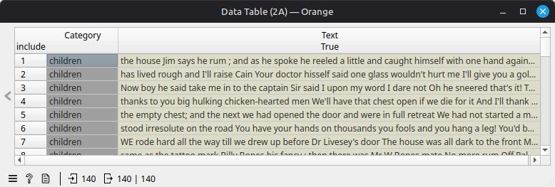

# Chapter 2: Getting Started with Orange

## Learning Objectives

By the end of this chapter, you will be able to:

- Install Orange and the add-ons this book uses.
- Name the parts of the Orange window and explain what a widget, a connection, and a workflow are.
- Load a text dataset with the *Corpus* widget and say what a corpus is.
- Build a small workflow that cleans text and shows the most frequent words, and explain how each cleaning step changes what you see.

---

## 2.1 Installing Orange and the Add-ons

### Step 1: Orange

Download Orange for Windows, macOS, or Linux from [orangedatamining.com](https://orangedatamining.com/download/) and follow the instructions there. This book was tested with Orange 3.41.

> 💡 If you prefer the command line, Orange can be installed with `pip install orange3` or `conda install orange3`. The book's exercises only need the graphical program.

### Step 2: Add-ons

Orange itself has no text widgets. They come from **add-ons**. Open **Options → Add-ons**, tick the ones below, and press **OK**. Orange installs them and asks you to restart.

| Add-on | What it adds | Used from |
|--------|--------------|-----------|
| **Text** (Orange3-Text) | *Corpus*, *Preprocess Text*, *Word Cloud*, *Bag of Words*, *Sentiment Analysis*, *Topic Modelling*, and more | Chapter 2 on |
| **orange3-nlp** | Embedding, *Question Answering*, *Text Generator*, *Text Chunker*, *Reference Library*, *Ollama RAG*, and more | Chapters 11 to 15 |

Install **Text** now. You can install **orange3-nlp** later, when you reach Chapter 11.

After the restart, a **Text Mining** section appears in the widget toolbox on the left.

> ⚠️ If a widget such as *Word Cloud* shows an error about a *WebView* or *WebEngine*, the Python package `PyQtWebEngine` is missing. Install it into the same Python that runs Orange. The standard installer already includes it.

Language models (Chapters 13 to 15) run in a separate program called **Ollama**, which is installed in Chapter 14. You do not need it yet.

---

## 2.2 The Orange Window

Orange is built around **workflows**. A workflow is a set of **widgets**, each doing one job, joined by **connections** that carry data from one widget to the next.

- **Canvas.** The large empty area where you build the workflow. Drag a widget onto it, or click a widget in the toolbox.
- **Widget toolbox.** The panel on the left. Widgets are grouped as *Data*, *Transform*, *Visualize*, *Model*, *Evaluate*, *Unsupervised*, and (after you install the add-on) *Text Mining*. The **Filter** box at the top searches by name, which is the fastest way to find a widget.
- **Help panel.** The area below the toolbox. Click any widget and it shows a short description.- **Connections.** A line between two widgets. It is labeled with what it carries, such as *Data* or *Corpus*.
- **Top bar.** The menus for saving, loading, and arranging workflows.

To change a widget's settings, **double-click** it. Its window opens, and it updates the result as you change settings. Closing the window does not close the widget, which stays on the canvas.

---

## 2.3 Widgets and Connections

A widget has **inputs** on its left and **outputs** on its right. You draw a connection by dragging from the edge of one widget to another. Orange only offers connections that make sense: a widget that outputs a corpus can be joined to one that accepts a corpus.

The widgets for this book fall into three groups:

- **Loading and viewing:** *Corpus*, *Data Table*, *Corpus Viewer*
- **Transforming and visualizing:** *Preprocess Text*, *Select Rows*, *Word Cloud*, *Distributions*
- **Modeling and evaluating:** *Logistic Regression*, *Naive Bayes*, *Test and Score* (Chapters 4 to 6)

When you change a widget, every widget downstream recalculates. That is how you will experiment: change one setting and watch what follows.

---

## 2.4 What Is a Corpus?

A **corpus** is a collection of documents. In Orange, a corpus is a table in which:

- each **row** is one *document* (an excerpt, a review, a tweet, a chapter),
- one or more columns hold the **text**, and
- other columns hold information about the document, such as its title, author, or category (its **label**).

The *Corpus* widget loads such a table and lets you choose which column is the **text feature**: the column Orange treats as the document's text. Choosing the wrong column is a common source of confusing results, so check it first.

The pieces a document is split into, called **tokens**, are produced by preprocessing (Section 2.5).

---

## 2.5 What Is Preprocessing?

A computer sees "The", "the", and "THE" as three different strings, and "dog," and "dog" as different as well. **Preprocessing** is the set of cleanup steps that makes the words uniform so that they can be counted. The *Preprocess Text* widget groups them in stages:

| Stage | What it does | Example |
|-------|--------------|---------|
| **Transformation** | Changes the text before it is split | `The` becomes `the` (lowercase) |
| **Tokenization** | Splits the text into pieces, called **tokens** (usually words) | `dog, cat!` becomes `dog`, `cat` (punctuation dropped) |
| **Normalization** | Reduces words to a base form | `running`, `ran` become `run` |
| **Filtering** | Removes tokens you do not want | very common words (**stopwords**) such as `the`, `of`, `and` |

You will use these in detail in Chapter 3. For now, you only need to know that the order matters (lowercasing *before* filtering stopwords) and that each step changes what the computer counts.

---

## Lab Exercise 2A: Load a Corpus and Look at It

**Goal**: Load a dataset, look at its rows, and make a first word cloud.

**Dataset**: `book-excerpts.tab` comes with the Text add-on. It has 140 excerpts from books, 70 labeled **adult** and 70 labeled **children**. Each excerpt is a few hundred words, taken from famous novels.

**Steps**:

1. From the *Text Mining* section, drag a *Corpus* widget onto the canvas. Double-click it and choose `book-excerpts.tab` from the list of sample datasets. Check that **Text** is the text feature.
2. Add a *Data Table* and connect *Corpus* to it. Look at the rows. Which column holds the label?
3. Add a *Word Cloud* and connect *Corpus* to it.
4. Look at the cloud. Which words are largest?
5. Save your workflow (**File → Save As**) as `2-first-corpus.ows`.

**Questions**:

- How many documents does the corpus contain? How many are in each category?
- Which words are the largest in the cloud? Do they tell you what the books are about?
- Look for small fragments such as `s`, `ll`, and `ve`. Where do they come from?

---

## Lab Exercise 2B: Clean the Text

**Goal**: See how each preprocessing step changes the most frequent words.

**Steps**:

1. Insert a *Preprocess Text* widget between *Corpus* and *Word Cloud*. (Connect *Corpus* to *Preprocess Text*, and *Preprocess Text* to *Word Cloud*.)
2. Double-click *Preprocess Text*. By default it **lowercases** the text and **removes English stopwords**. Build the pipeline one stage at a time, and look at the cloud after each change:
   1. **Tokenization only**: untick Lowercase and Stopwords.
   2. add **Transformation: Lowercase**.
   3. add **Filtering: Stopwords** (English).
3. Add a *Corpus Viewer*, connect the preprocessed corpus to it, and choose **Show Tokens & Tags**. Select a document and compare its tokens with its text.
4. Now try stopword filtering **without** lowercasing. Compare the two.

**Questions**:

- What are the largest words with no stopword filtering? Why are they not informative?
- After lowercasing and removing stopwords, which words are largest? Are they more useful, or are they new "boring" words (such as `said`, `one`)? What does that tell you about the limits of a standard stopword list?
- Stopword filtering without lowercasing leaves behind capitalized words (`The`, `I`, `And`). Why? What is the right order of the stages?
- In the tokenization-only cloud, find both `the` and `The`. What does that tell you about what the computer counts?
- Find a document with punctuation or a contraction in the Corpus Viewer. How was it tokenized?

> 📝 **Reflection:** Which stage changed the cloud the most? Which stage do you trust the least, and why?

---

## Lab Exercise 2C: Adult or Children?

**Goal**: Compare the vocabulary of the two categories.

**Steps**:

1. Add a *Select Rows* widget after *Preprocess Text* (Transform section). Set the condition **Category is adult**.
2. Connect it to a new *Word Cloud*.
3. Repeat with a second *Select Rows* set to **Category is children**, and a second *Word Cloud*.
4. Compare the two clouds.

**Questions**:

- Which words are in one cloud and not the other?
- Some of the biggest words are names of characters. Does that tell you about the *genre*, or just about which books are in the sample?
- If you built a classifier from these 140 excerpts (Chapter 4), what might it learn that is not really about "adult" versus "children's" writing?

---

## Comprehension Questions

1. What is a widget? What is a connection? What is a workflow?
2. How do you install an add-on, and which add-on gives you the *Corpus* widget?
3. What is a corpus, and what is a text feature?
4. What does tokenization do to raw text? What is a stopword?
5. Why does the order of lowercasing and stopword filtering matter?
6. Why is it risky to draw conclusions about a genre from word frequencies in a small sample?

---

## Key Terms

- Add-on
- Widget, connection, canvas
- Workflow
- Corpus, document, text feature, label
- Preprocessing
- Token, tokenization
- Stopword
- Word cloud

---

## Notes

- Save your workflow as `2-first-corpus.ows`. Chapter 3 extends it.
- The workflow `workflows/4 First Dataset.ows` in the book's repository contains the first part (*Corpus* and *Word Cloud*).
