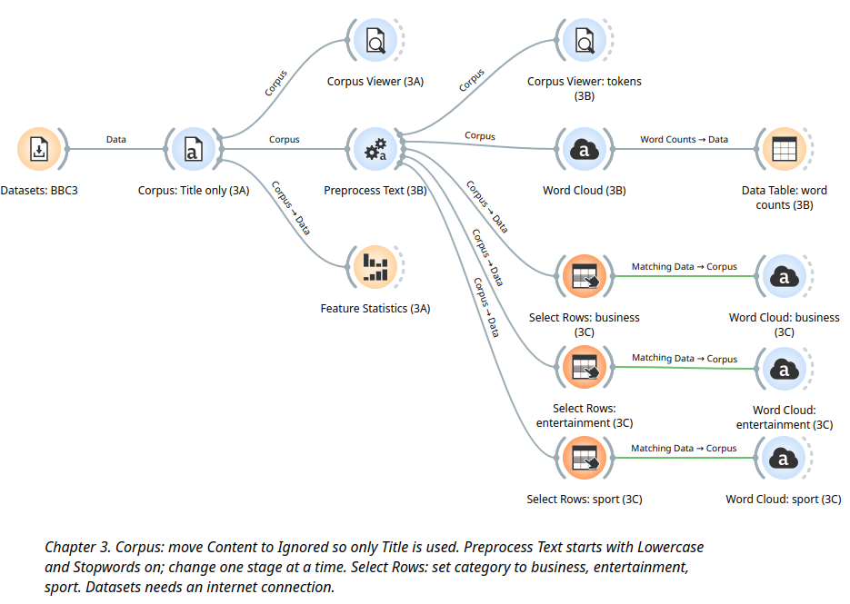
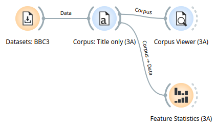
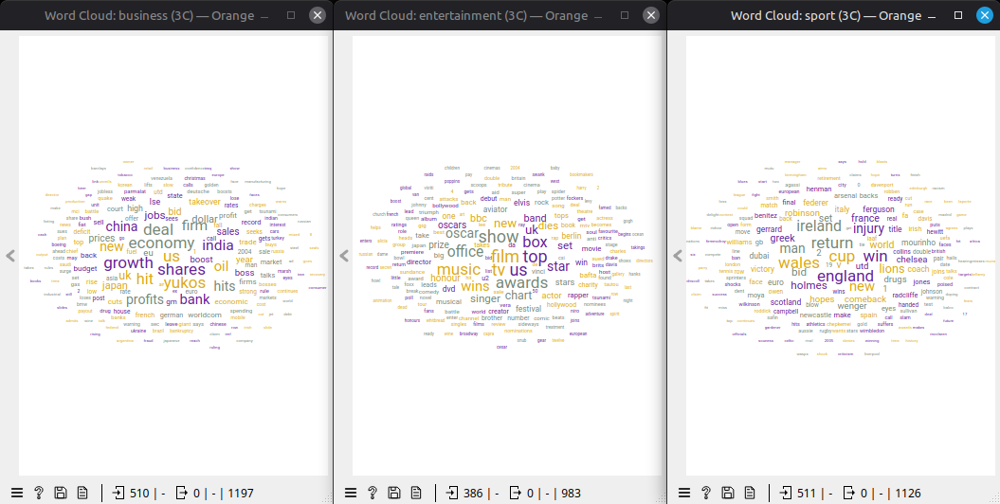

# Chapter 3: Working with Text Data

## Learning Objectives

By the end of this chapter, you will be able to:

- Load a text dataset into Orange and choose which column Orange treats as the text.
- Inspect a corpus: its size, its labels, and the documents themselves.
- Apply the standard preprocessing stages (lowercasing, tokenization, normalization, filtering) with the *Preprocess Text* widget, and describe what each one does to a real headline.
- Explain the difference between stemming and lemmatization, and recognize when either one damages the text.
- Judge whether a cleaning step helps, by looking at the tokens and the size of the vocabulary.

---

## 3.1 Loading Text into Orange

Orange can load text in several ways:

| Widget | Use it for |
|--------|-----------|
| **Corpus** | A table in which one or more columns hold text (the usual case; from the Text add-on) |
| **Datasets** | Downloading a ready-made dataset from Orange's server, then passing it to *Corpus* |
| **Import Documents** | A folder of text, PDF, or Word files, one document per file |
| **File** / **CSV File Import** | Spreadsheets and CSV files; connect the result to *Corpus* |

A corpus has two kinds of columns:

- **Text features**: the columns Orange reads as the document. These are what preprocessing and later models will use.
- **Everything else**: labels (such as a category), titles, dates, authors. These stay with the document but are not read as text.

If more than one column is marked as text, Orange joins them into one document. So the first thing to do with a new corpus is to check *which* columns are used.

### The dataset: BBC News

The **BBC3** dataset has 1,407 news articles from the BBC (2004 and 2005), each with a **Title** (the headline), the article **Content**, and a **category**: *business* (510), *entertainment* (386), or *sport* (511). It is downloaded by the *Datasets* widget, so you need an internet connection the first time.

> 📝 The articles are copyrighted by the BBC and the dataset is for non-commercial and research use. That is fine for this course. If you want to use the data in a product, check the licence first.

This chapter uses only the **headlines**. They are short, so you can read the tokens and see every effect of every step. Chapters 4 to 6 use the same headlines.

---

## 3.2 From Text to Tokens

Before a computer can count words, the text must be cleaned and split into pieces. These are the standard stages, in the order the *Preprocess Text* widget applies them:

| Stage | What it does | Options in *Preprocess Text* |
|-------|--------------|------------------------------|
| **Transformation** | Changes the text before it is split | Lowercase; Remove accents; Parse HTML; Remove URLs |
| **Tokenization** | Splits the text into **tokens** (usually words) | Regexp (the default), Word & Punctuation, Whitespace, Sentence, Tweet |
| **Normalization** | Reduces each token to a base form | Porter stemmer, Snowball stemmer, WordNet lemmatizer, UDPipe, Lemmagen |
| **Filtering** | Removes tokens you do not want | Stopwords, Lexicon, Numbers, Regexp, Document frequency, Most frequent tokens, POS tags |

Two more options exist (**N-grams** for pairs and triples of words, and **POS Tagger** for parts of speech). You will meet them later.

> ⚠️ **The POS tags filter can empty your corpus.** The filter keeps only tokens whose part-of-speech tag is in its list, and the list starts as `NOUN,VERB`. Those are *universal* tags, but the taggers in *Preprocess Text* (Averaged Perceptron and MaxEnt) produce *Penn Treebank* tags such as `NN`, `NNS`, `VB`, and `VBZ`. With the default list, no token matches, so *Preprocess Text* outputs documents with **no tokens at all**. If you use the filter, type Penn tags, for example `NN,NNS,NNP,VB,VBD,VBG,VBN,VBP,VBZ`. Leave it unticked for this chapter.

### What each stage does to a real headline

Take the BBC headline **`High fuel prices hit BA's profits`**.

| After stage | Tokens |
|-------------|--------|
| Tokenize with the default pattern `\w+` | `High` `fuel` `prices` `hit` `BA` `s` `profits` |
| + Lowercase | `high` `fuel` `prices` `hit` `ba` `s` `profits` |
| + Stopwords (English) | `high` `fuel` `prices` `hit` `ba` `profits` |
| + Normalization (Porter or WordNet) | `high` `fuel` `price` `hit` `ba` `profit` |

Notice three things:

- The default tokenizer splits on anything that is not a letter or digit, so `BA's` becomes `BA` and `s`. The stray `s` is a **stopword**, so it disappears at the filtering stage.
- The case must be fixed *before* filtering. The stopword list is lowercase, so `The` would not be removed (you saw this in Chapter 2).
- `prices` became `price` and `profits` became `profit`. The two forms are now one feature, which is the goal of normalization.

### Stemming and lemmatization

Both reduce words to a base form, but in different ways.

- A **stemmer** (Porter, Snowball) chops off endings by rules. It is fast and needs no dictionary, but the result is not always a word: `companies` and `company` both become `compani`, `business` becomes `busi`.
- A **lemmatizer** (WordNet, Lemmagen, UDPipe) looks the word up and returns its dictionary form, the **lemma**: `faces` becomes `face`, `prices` becomes `price`. It is slower and needs a language resource, but keeps real words.

Neither is perfect. On the BBC headlines the Porter stemmer turns the oil company `yukos` into `yuko`, and it maps `unit`, `united`, and `unites` all to `unit`. A model then cannot tell a business unit from Manchester United.

### Less is sometimes more

More cleaning is not always better. Every step discards information:

- Removing stopwords can remove words that matter (`not`, `no`, `against`).
- Removing short words also removes `us`, `uk`, `tv`, `oil`, and `top`, which are some of the most useful words in headlines.
- Stemming merges words that do not belong together (`united` and `unit`).

The way to decide is the same as for any other model choice: try it, look at the tokens, and measure on the task (Chapters 4 and 6).

---

## 3.3 The Widgets

| Widget | What it does |
|--------|--------------|
| **Datasets** | Lists Orange's example datasets and loads the one you select. |
| **Corpus** | Loads the table and lets you choose the text features ("Used text features"). |
| **Feature Statistics** | Shows each column's type and distribution, which is a quick way to count the categories. |
| **Corpus Viewer** | Shows the documents, and with **Show Tokens & Tags** ticked, their tokens. |
| **Preprocess Text** | Applies the stages above. Add or remove stages on the left, and set each one's options. |
| **Word Cloud** | Draws the most frequent tokens, and outputs a table of all words and their counts. |
| **Data Table** | Shows a table. The number of rows at the bottom left is the number of words when the input is the Word Cloud's *Word Counts*. |

*Preprocess Text* starts with **Lowercase** and **Stopwords** turned on and the **Regexp** tokenizer. Normalization and the other filters are off until you add them. The **Output** box at the bottom left of the widget shows the number of **Tokens** (all words) and **Types** (different words, which is the vocabulary size).

---

## Lab Exercise 3A: Load and Inspect

**Goal**: Load BBC3, use only the headlines, and look at the data.

**Steps**:

1. Add a *Datasets* widget, select **BBC3**, and connect it to a *Corpus* widget.
2. Open *Corpus*. Under **Used text features** there are two: `Title` and `Content`. Drag `Content` into **Ignored text features**, so that only `Title` is used.
3. Add a *Corpus Viewer* and connect *Corpus* to it. Click a few documents.
4. Add a *Feature Statistics* widget, connect *Corpus* to it, and look at the `category` row. Use **Color** at the bottom to show the legend for the three categories.

**Questions**:

- How many documents are there? How many are in each category? Are the categories balanced?
- Look at ten headlines. Can you tell the category from the headline alone? Which ones are hard?
- If you left `Content` as a text feature too, what would change in the Corpus Viewer? Try it.

---

## Lab Exercise 3B: Preprocess the Headlines

**Goal**: Build a preprocessing pipeline one stage at a time, and see how each stage changes the tokens and the size of the vocabulary.

**Steps**:

1. Connect *Corpus* to a *Preprocess Text* widget.
2. Connect *Preprocess Text* to a *Corpus Viewer*, and tick **Show Tokens & Tags**.
3. Connect *Preprocess Text* to a *Word Cloud*, and connect the Word Cloud's **Word Counts** output to a *Data Table*. The number of rows in the table is the number of different words (the **vocabulary size**). The **Types** count in the *Preprocess Text* Output box should show the same number.
4. In *Preprocess Text*, build the pipeline stage by stage, and write down the vocabulary size each time:

   | Stage added | Vocabulary size (yours) |
   |-------------|-------------------------|
   | Tokenization only (untick Lowercase and Stopwords) | |
   | + Lowercase | |
   | + Stopwords (English) | |
   | + Normalization: Porter stemmer | |
   | Normalization: WordNet lemmatizer instead of Porter | |

5. Find the headline `High fuel prices hit BA's profits` in the Corpus Viewer. Compare its tokens at each stage with the table in section 3.2.
6. With Porter selected, find the headline about **Yukos** and a headline with **united** in it. What does the stemmer do to them?

**Questions**:

- Which stage reduced the vocabulary the most? Which reduced it the least?
- How do the Porter stemmer and the WordNet lemmatizer differ in vocabulary size? Find two words on which they disagree.
- Find a word that the stemmer damaged. Would this hurt a classifier? Why or why not?
- Why did lowercasing reduce the vocabulary even though it removed no words?

---

## Lab Exercise 3C: What Do the Categories Say?

**Goal**: See whether the cleaned headlines carry a signal about the category, and test a filter that sounds sensible.

**Steps**:

1. Keep the pipeline Lowercase + Regexp tokenization + Stopwords (no normalization).
2. Add a *Select Rows* widget after *Preprocess Text*, set it to **category is business**, and connect it to a new *Word Cloud*. Repeat for **entertainment** and **sport**.
3. Compare the three clouds.
4. **Bonus.** Add a **Regexp** filter in *Preprocess Text* with the pattern `^\w{1,4}$` to remove tokens of 4 or fewer characters. Compare the vocabulary size and the word clouds.

**Questions**:

- Which words are the most frequent in each category? Are they useful for telling the categories apart? Which ones appear in more than one category?
- In the bonus, how much smaller is the vocabulary? Which useful words are removed by the length filter? (Hint: look for `us`, `uk`, `tv`, and `new`.)
- Is there a filter you would remove from the pipeline? Which one, and why?

> 📝 **Reflection:** You can now clean text in many ways. How would you decide which pipeline is best? Chapter 4 will give you a way to test it: train a classifier on each version and compare the accuracy.

---

## Comprehension Questions

1. What is a token? What is the difference between a token and a word?
2. Why must lowercasing come before stopword filtering?
3. What is the difference between stemming and lemmatization? Give one advantage of each.
4. Give an example of a cleaning step that removes useful information.
5. What is a text feature in a corpus, and what happens if you mark the wrong column?
6. Why does the vocabulary size matter? What happens to later steps when it is very large?

---

## Key Terms

- Corpus, text feature
- Preprocessing
- Token, tokenization
- Normalization
- Stemming, lemmatization
- Stopwords
- Vocabulary
- N-gram

---

## Notes

- Save your workflow as `cleaning-headlines.ows`. Chapter 4 builds on the same headlines, and its first steps are the ones in 3A and 3B.
- The preprocessed tokens live in the corpus object that flows between widgets. A *Save Data* widget saves the table, not the tokens, so save the workflow instead.
