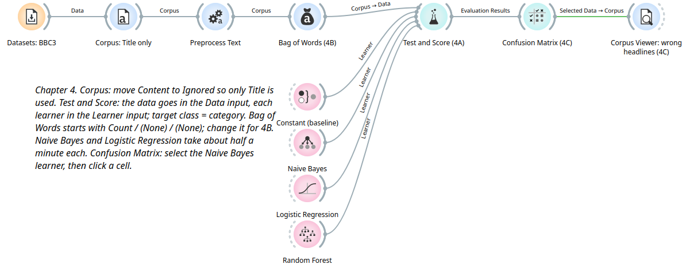
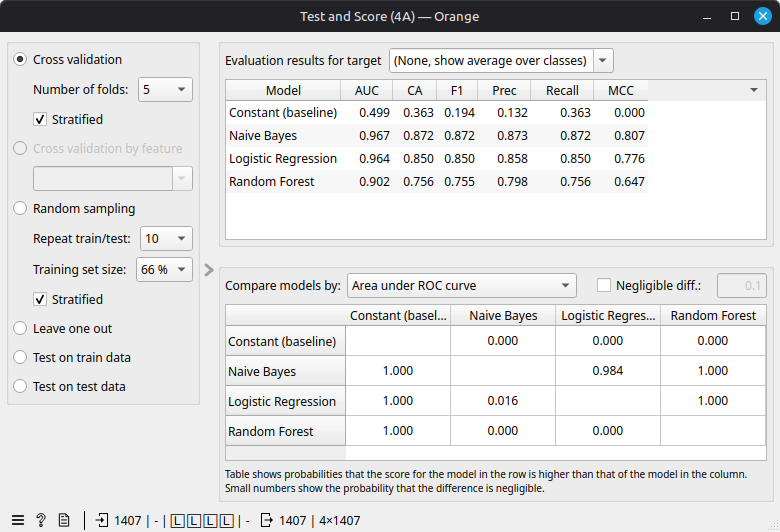
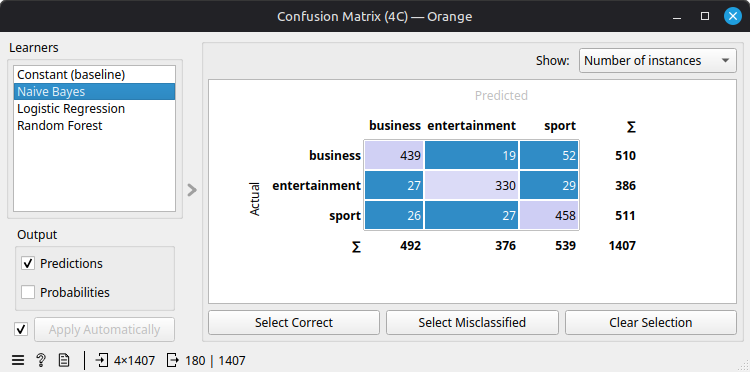

# Chapter 4: Text Classification

## Learning Objectives

By the end of this chapter, you will be able to:

- Explain text classification and what it means to learn from labeled examples.
- Turn a set of documents into a table of numbers with Bag of Words, and explain what the TF-IDF options change.
- Train several classifiers in Orange and compare them with a baseline.
- Read accuracy, precision, recall, F1, and a confusion matrix, and explain why accuracy alone can mislead.
- Look at the headlines a classifier gets wrong, and say why.

---

## 4.1 What Is Text Classification?

**Text classification** assigns each document to one of a set of predefined categories (its **class** or **label**). Examples:

- Spam or not spam
- Positive, neutral, or negative reviews
- Topic labeling: business, entertainment, or sport

It is a **supervised learning** task. You give the computer many documents whose labels are already known (the **training data**), and it learns which patterns go with which label. Then you give it new documents and it predicts their labels.

The important question is not "how well does it do on the documents it learned from?" but "how well does it do on documents it has never seen?" The second number is the honest one, and Orange's *Test and Score* widget measures it for you (section 4.5).

In this chapter the task is the one from Chapter 3: given a BBC **headline**, predict whether it is a *business*, *entertainment*, or *sport* story.

---

## 4.2 From Headlines to Numbers

A classifier needs a table of numbers: one row per document, one column per feature. After Chapter 3, each headline is a list of tokens. The simplest way to turn it into a row is to count words.

### Bag of Words

A **bag of words** has one column for every different word in the corpus, and the value in a cell is how many times that word appears in the document. The order of the words is thrown away, which is why it is called a *bag*.

Take three tiny documents, after lowercasing and removing stopwords:

- **D1:** profits rise shares rise
- **D2:** team wins cup
- **D3:** shares fall team loses

| | profits | rise | shares | team | wins | cup | fall | loses |
|---|--:|--:|--:|--:|--:|--:|--:|--:|
| **D1** | 1 | 2 | 1 | 0 | 0 | 0 | 0 | 0 |
| **D2** | 0 | 0 | 0 | 1 | 1 | 1 | 0 | 0 |
| **D3** | 0 | 0 | 1 | 1 | 0 | 0 | 1 | 1 |

On the BBC headlines the table has 1,407 rows and 2,759 columns (the vocabulary size from Chapter 3), and nearly every cell is 0.

### TF-IDF

Raw counts treat every word as equally informative, but they are not. `shares` appears in many business headlines, so it tells you less than `profits`, which is rarer. **TF-IDF** (term frequency × inverse document frequency) multiplies:

- **TF**, how often the word appears in *this* document, by
- **IDF**, a weight that is high for words found in few documents and low for words found in many: IDF = ln(N / df), where N is the number of documents and df the number of documents containing the word.

In the three-document example, N = 3. `shares` appears in 2 documents, so its IDF is ln(3/2) = 0.41. `rise` appears in 1, so its IDF is ln(3/1) = 1.10. D1's weights are then:

| Word | Count | IDF | TF-IDF |
|------|------:|----:|-------:|
| profits | 1 | 1.10 | 1.10 |
| rise | 2 | 1.10 | 2.20 |
| shares | 1 | 0.41 | 0.41 |

The word that is shared with another document is downweighted.

### In Orange

The *Bag of Words* widget has **no separate TF-IDF widget**. TF-IDF is a combination of its three settings:

| Setting | Options | What it does |
|---------|---------|--------------|
| **Term Frequency** | Count, Binary, Sublinear | Count uses the raw count. Binary uses 1 if the word is present and 0 if not. Sublinear uses 1 + ln(count). |
| **Document Frequency** | (None), IDF, Smooth IDF | (None) applies no weighting. IDF and Smooth IDF down-weight words that appear in many documents. |
| **Regularization** | (None), L1, L2 | Scales each row to a fixed length so that long and short documents are comparable. |

**TF-IDF** is *Term Frequency = Count* with *Document Frequency = IDF* (and usually *Regularization = L2*). The default is plain counts.

---

## 4.3 The Learners

A **learner** is a method for finding patterns in labeled data. This chapter uses three, plus a baseline.

| Learner | Idea |
|---------|------|
| **Constant** (majority class) | Always predicts the most common class. It learns nothing, so any real method must beat it. This is the **baseline**. |
| **Naive Bayes** | Estimates, for each word, how likely it is in each class, and combines the evidence (treating the words as independent, which is naive but works well for text). |
| **Logistic Regression** | Learns a weight for each word that pushes the prediction toward or away from a class. |
| **Random Forest** | Builds many decision trees that each ask yes/no questions about the words, and lets them vote. |

In Orange, a learner widget does not train anything by itself. It produces a **learner** (a recipe), and *Test and Score* uses the recipe to train and test models. That is why you connect the data to *Test and Score*, and not to the learner.

---

## 4.4 Measuring Performance

Suppose a spam filter looks at 100 emails, of which 10 are spam. It flags 12: 8 really are spam, and 4 are good emails flagged by mistake.

| | Flagged spam | Flagged not spam |
|---|---:|---:|
| **Actually spam** | 8 (true positives) | 2 (false negatives) |
| **Actually not spam** | 4 (false positives) | 86 (true negatives) |

- **Accuracy**: the fraction of all emails classified correctly = (8 + 86) / 100 = **94%**.
- **Precision**: of the emails flagged as spam, the fraction that are spam = 8 / 12 = **67%**.
- **Recall**: of the actual spam, the fraction that was flagged = 8 / 10 = **80%**.
- **F1**: a single number that combines precision and recall (their harmonic mean) = **0.73**.

Notice that 94% sounds good, but a filter that never flags anything would score 90%, because only 10 emails are spam. **Accuracy can mislead when one class is much more common than the others.** This is why you always compare against the baseline, and why precision and recall matter.

For more than two classes, Orange computes precision, recall, and F1 for each class and then averages them. The BBC classes are fairly balanced (510, 386, 511), so the baseline that always predicts the biggest class is right 36% of the time.

### The confusion matrix

A **confusion matrix** counts, for every pair of classes, how many documents of one class were predicted as the other. The diagonal holds the correct predictions. Everything else is a mistake, and its position tells you *which* classes are being confused.

---

## 4.5 The Widgets

| Widget | What it does |
|--------|--------------|
| **Preprocess Text** | The cleaning pipeline from Chapter 3. |
| **Bag of Words** | Turns the preprocessed corpus into a table of word counts or weights. |
| **Constant**, **Naive Bayes**, **Logistic Regression**, **Random Forest** | Learners. Each outputs a learner for *Test and Score*. |
| **Test and Score** | Trains and tests each learner on the data, and reports accuracy and other scores. The data goes into its **Data** input, and each learner into its **Learner** input. |
| **Confusion Matrix** | Shows the confusion matrix for the results of *Test and Score*. Selecting a cell outputs those documents. |
| **Corpus Viewer** | Reads the selected documents. |

*Test and Score* defaults to **cross-validation** with 5 folds: it splits the data into 5 parts, trains on 4, tests on the 1 left out, repeats 5 times, and averages. Every document is tested exactly once, by a model that did not see it. Chapter 6 explains this and the other options.

> ⏱ Naive Bayes and Logistic Regression take about half a minute each on this table. The widget shows a progress bar, and *Test and Score* recalculates whenever you change the data or a setting, so wait for it to finish.

---

## Lab Exercise 4A: Classify the Headlines

**Goal**: Train three classifiers on the BBC headlines and compare them with the baseline.

**Steps**:

1. Start from your Chapter 3 workflow (`cleaning-headlines.ows`): *Datasets* (BBC3), *Corpus* (only `Title` as the text feature), and *Preprocess Text* (Lowercase, Regexp tokenization, English stopwords).
2. Connect *Preprocess Text* to a *Bag of Words* widget, with the default settings (Count, no document frequency, no regularization).
3. Add *Test and Score* and connect *Bag of Words* to its **Data** input.
4. Add the learners *Constant*, *Naive Bayes*, *Logistic Regression*, and *Random Forest*, and connect each to the **Learner** input of *Test and Score*. Make sure the target class in *Test and Score* is `category`.
5. Wait for the scores. Write down **CA** (classification accuracy), **F1**, **Precision**, and **Recall** for each learner. With the default settings you should see about 0.36 for *Constant*, 0.87 for Naive Bayes, 0.85 for Logistic Regression, and 0.76 for Random Forest.

**Questions**:

- What accuracy does the *Constant* baseline get, and why is that its value? (Hint: look at the class sizes.)
- Which learner is best? By how much does it beat the baseline? Is the gap between the best two large or small?
- Is the Random Forest as good as the others? Why might it do worse on a table with thousands of mostly-zero columns?
- Why must the data go into *Test and Score* and not into each learner?

---

## Lab Exercise 4B: Change the Representation

**Goal**: See whether TF-IDF helps.

**Steps**:

1. In *Bag of Words*, change the settings, and wait for *Test and Score* each time. Record **CA** for Naive Bayes and Logistic Regression:

   | Term Frequency | Document Frequency | Regularization | Naive Bayes CA | Logistic Regression CA |
   |---|---|---|---|---|
   | Count | (None) | (None) | | |
   | Binary | (None) | (None) | | |
   | Count | IDF | L2 (Euclidean) | | |

2. Go back to *Preprocess Text* and change the cleaning (for example, turn off stopwords, or add the Porter stemmer). Does the accuracy move?

**Questions**:

- Does TF-IDF improve the accuracy on these headlines? Does it help one learner more than the other?
- Is Binary as good as Count? Why might it be, for short headlines?
- Headlines are short, so most words appear once. How might that change what TF-IDF can add?
- Which change moved the accuracy most: the representation, the cleaning, or the learner?

> 📝 **Reflection:** TF-IDF is usually recommended for text, but here the plain counts do as well or better. What does that tell you about trusting a rule of thumb without testing it?

---

## Lab Exercise 4C: Where Does It Go Wrong?

**Goal**: Read the mistakes.

**Steps**:

1. Connect *Test and Score* to a *Confusion Matrix*. Select the **Naive Bayes** learner in the widget.
2. Look at the matrix. Which pair of classes is confused most often?
3. Connect the *Confusion Matrix* to a *Corpus Viewer*, click an off-diagonal cell (for example, actual *business*, predicted *sport*), and read the headlines in it. The **Select Misclassified** button outputs every wrong prediction at once.
4. Try a headline of your own by writing it into a small corpus (or find one in the viewer), and ask whether a person could tell its category from the headline alone.

**Questions**:

- Add up the correct predictions on the diagonal and divide by the total. Does it match the accuracy in *Test and Score*?
- Is one class easier than the others? Which?
- Read ten wrong headlines. Why would a person also find some of them hard? Are there headlines that have no clue to the category in the words?
- Some headlines contain a code such as `&#163;` for a pound sign. What might you add to *Preprocess Text* to handle this? (Hint: Chapter 3 lists the Transformation options.)

---

## Comprehension Questions

1. What is the difference between supervised and unsupervised learning, and which is classification?
2. In a bag of words, what is a row, and what is a column? What information is lost?
3. How is TF-IDF different from a plain count, and which words does it down-weight?
4. A model reports 95% accuracy. What else do you need to know before you call it good?
5. A spam filter has high recall and low precision. What does this mean for the person using it?
6. What does the confusion matrix tell you that accuracy does not?

---

## Key Terms

- Text classification
- Supervised learning
- Label / class
- Training data and test data
- Bag of Words
- TF-IDF
- Learner and model
- Baseline (majority class)
- Accuracy, precision, recall, F1
- Confusion matrix
- Cross-validation

---

## Notes

- Save your workflow as `headline-classifier.ows`. Chapter 6 uses it to compare models and tune their settings.
- The numbers in this chapter come from the BBC headlines with Lowercase, Regexp tokenization, and English stopwords, using the default 5-fold cross-validation. Your results may differ by a point or two because the folds are chosen at random.
