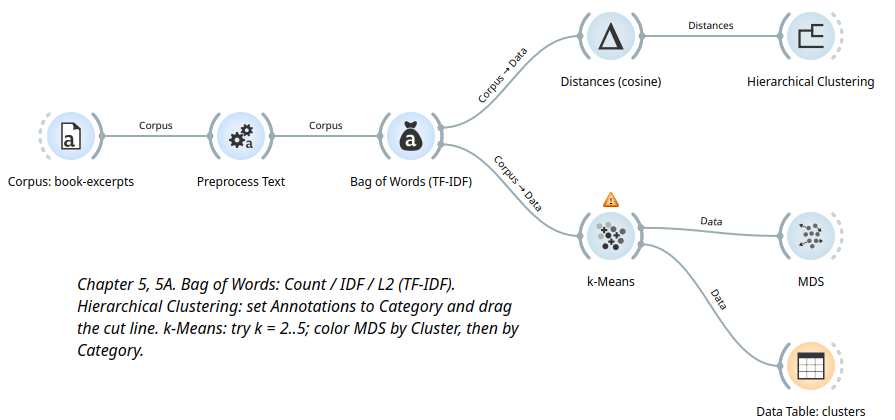
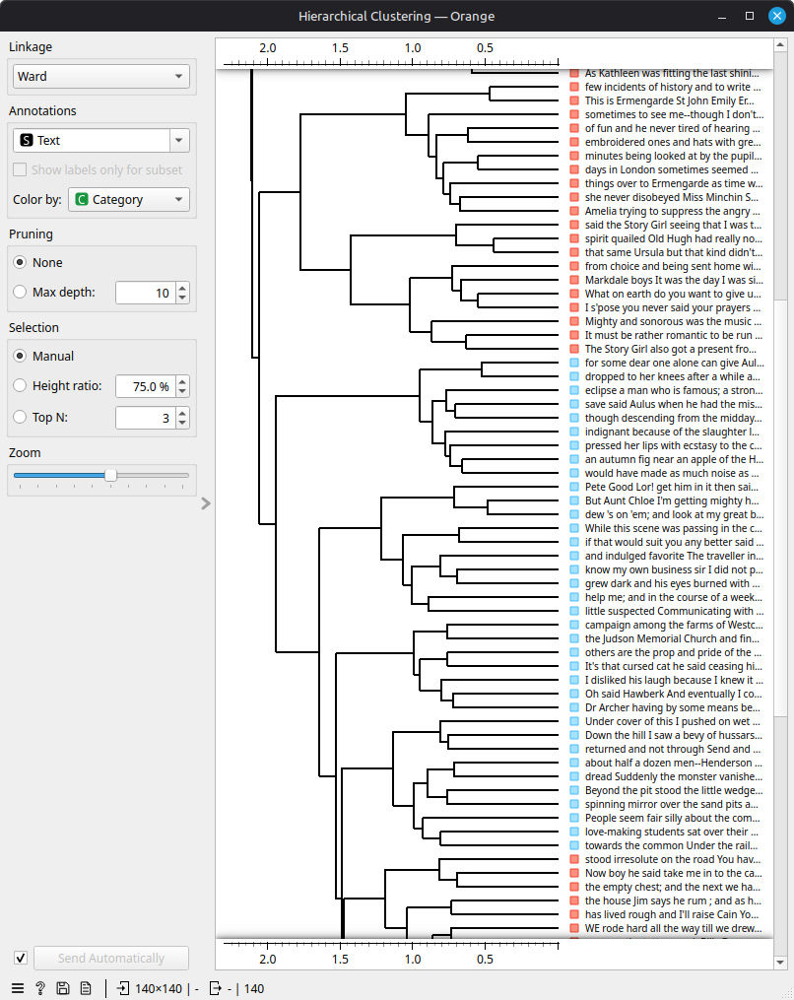
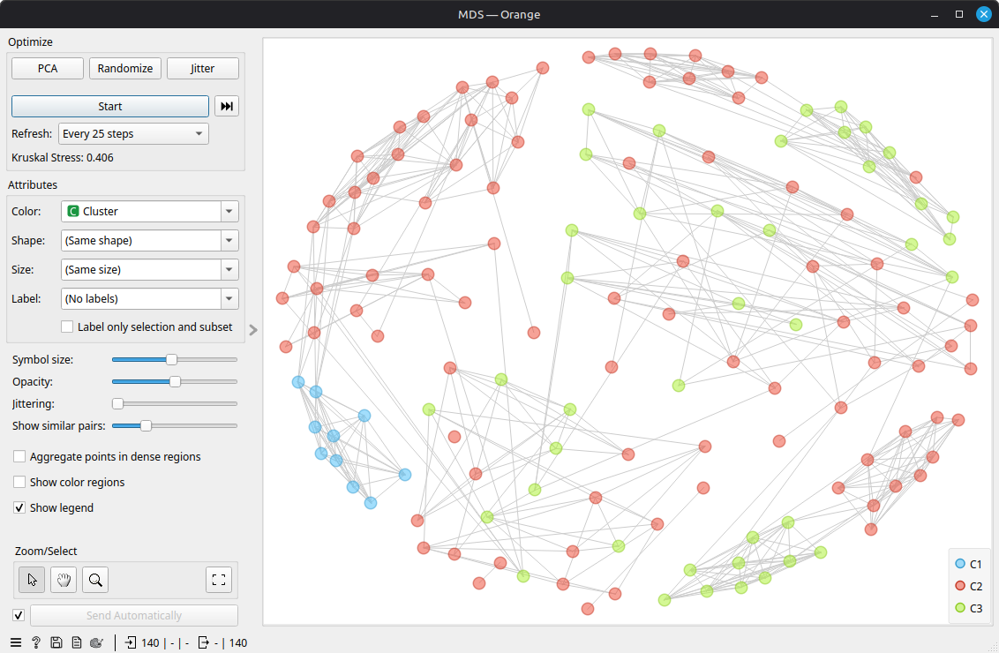
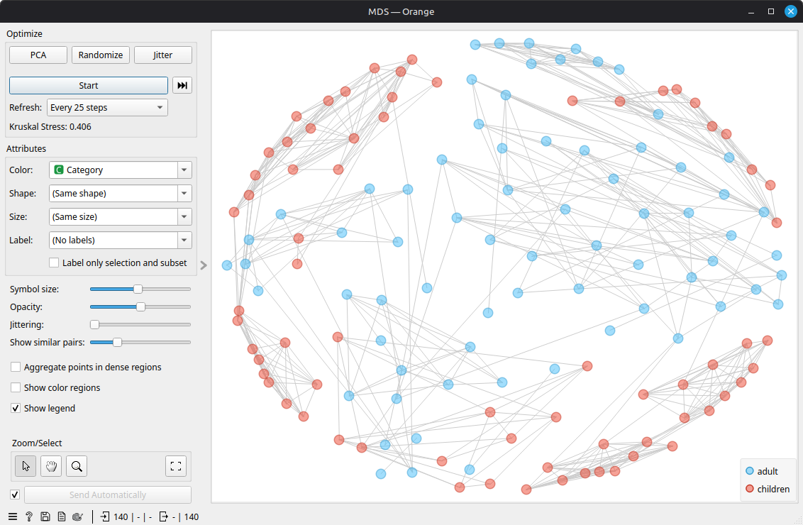
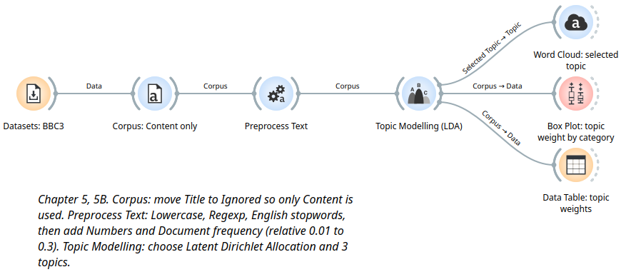
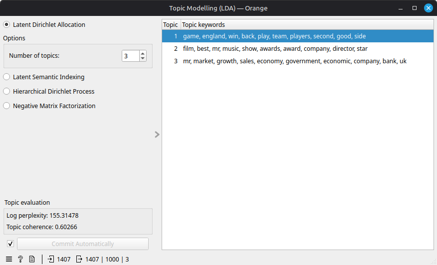
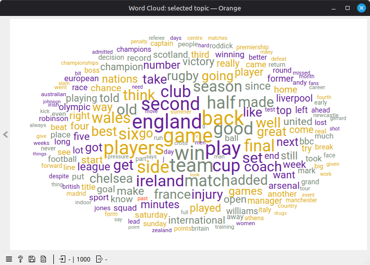
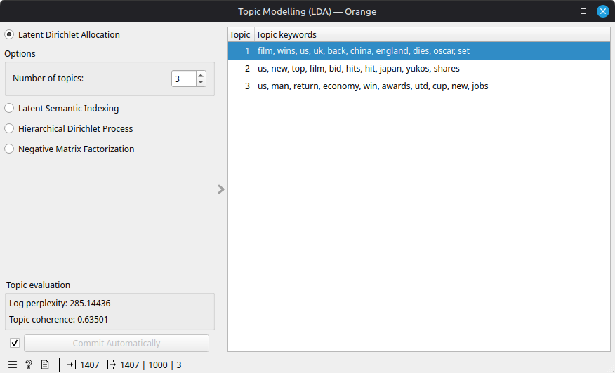

# Chapter 5: Clustering and Topic Modeling

## Learning Objectives

By the end of this chapter, you will be able to:

- Explain the difference between supervised and unsupervised learning, and between clustering and topic modeling.
- Explain what it means for two documents to be "similar", and measure it with a distance.
- Cluster documents with k-Means and with hierarchical clustering, and read a dendrogram.
- Extract topics with LDA, and explain how the number of topics and the preprocessing change them.
- Judge clusters and topics when there are no correct answers to check against.

---

## 5.1 Unsupervised Learning for Text

In Chapter 4 every document had a label, and a classifier learned to predict it. **Unsupervised learning** works on documents with *no* labels: it looks for structure on its own. Two methods are common for text:

- **Clustering** puts each document into exactly one group of similar documents.
- **Topic modeling** describes each document as a mixture of themes (topics), and each topic as a list of words.

They are used to **explore** a collection you have not read, to **summarize** it, and to **prepare** it (for example, to find groups worth labeling for a classifier).

The catch: since no answer key exists, you cannot compute accuracy. You must read the output and decide whether it makes sense. That makes unsupervised methods more of an art than the classifiers of Chapter 4. When you *do* have labels, as in this chapter, you can use them as a sanity check, but be careful: the method was not trying to find your labels.

---

## 5.2 What Does "Similar" Mean?

Clustering needs a number for how alike two documents are. The usual way is to turn each document into a row of numbers (a bag of words, Chapter 4) and measure the **distance** between the rows.

- **Euclidean distance** is the straight-line distance between two rows. Longer documents have bigger counts, so they end up far from short ones even when they are about the same thing.
- **Cosine distance** compares the *direction* of the two rows and ignores their length. Two documents that use the same words in the same proportions have a cosine distance near 0, however long they are. It is the usual choice for text.

TF-IDF weighting (Chapter 4) helps here too: common words that appear in every document stop dominating the distance.

---

## 5.3 Clustering

### k-Means

1. Choose the number of clusters, **k**.
2. Place k centers at random.
3. Assign every document to the nearest center.
4. Move each center to the middle of its documents.
5. Repeat 3 and 4 until nothing changes.

k-Means is fast, but you must choose k, and a different starting point can give a different answer.

### Hierarchical clustering

Hierarchical clustering starts with every document alone, then repeatedly merges the two closest groups until only one is left. The result is a tree called a **dendrogram**. Cutting the tree at a chosen height gives a set of clusters, so you can try several numbers of clusters without recomputing. How the distance between two *groups* is defined (the **linkage**: average, complete, single, or Ward) changes the shape of the tree.

### Clusters are not classes

Clusters are groups of documents that look alike *in the numbers you gave the algorithm*. They need not match the categories you have in mind. You will see this in 5A.

---

## 5.4 Topic Modeling with LDA

**Latent Dirichlet Allocation (LDA)** assumes that:

- every **topic** is a distribution over words (a "sports" topic gives high probability to *game*, *team*, *win*), and
- every **document** is a mixture of topics (an article might be 70% sports and 30% business).

LDA is given only the documents and the number of topics. It works backward to find word groups that best explain which words appear together. It does *not* name the topics: you read each topic's top words and name it yourself.

Three things decide whether the topics are any good:

- **The number of topics**, which you choose. Too few and different themes are merged; too many and one theme is split into near-copies.
- **The length of the documents.** LDA needs words that occur together in the same document, so it works poorly on a seven-word headline and well on a news article.
- **The preprocessing.** Words that appear in nearly every document (for example `said` in news articles) end up in *every* topic and hide the real differences. You remove them by filtering on how many documents a word appears in (the **Document frequency** filter in *Preprocess Text*), and by removing numbers.

The *Topic Modelling* widget offers other methods as well (LSI, HDP, NMF). This chapter uses LDA.

---

## 5.5 The Widgets

| Widget | What it does |
|--------|--------------|
| **Corpus**, **Preprocess Text**, **Bag of Words** | As in Chapters 3 and 4. |
| **Distances** | Computes a distance (Euclidean, cosine, and others) between every pair of rows. |
| **Hierarchical Clustering** | Draws the dendrogram from a distance matrix. Drag the line to cut it into clusters. |
| **k-Means** | Clusters the rows into k groups, and adds a `Cluster` column. |
| **MDS** | Draws the documents as points on a plane so that close points are similar documents. |
| **Topic Modelling** | Runs LDA (or LSI, HDP, NMF) on a preprocessed corpus and adds a weight for each topic to each document. |
| **Word Cloud** | With a topic selected in *Topic Modelling*, draws that topic's top words. |
| **Data Table** | Shows the documents with their cluster or topic columns. |

---

## Lab Exercise 5A: Cluster Book Excerpts

**Goal**: Cluster documents without labels, then compare the clusters with the labels.

**Dataset**: `book-excerpts.tab` (140 excerpts from novels, labeled **adult** or **children**, 70 of each). The labels are *not* given to the clustering.

**Steps**:

1. Load `book-excerpts.tab` with *Corpus* (the text feature is `Text`) and connect it to *Preprocess Text* (Lowercase, Regexp tokenization, English stopwords).
2. Add *Bag of Words* and set **Term Frequency: Count**, **Document Frequency: IDF**, and **Regularization: L2** (this is TF-IDF).
3. **Hierarchical clustering.** Connect *Bag of Words* to *Distances* with the **Cosine** metric, then connect *Distances* to *Hierarchical Clustering*. In the widget, set **Color by** to `Category` so that each leaf is colored by its label, and drag the cut line to get 3 to 5 clusters. Try the different **Linkage** options.
4. **k-Means.** Connect *Bag of Words* to *k-Means* and try k = 2, 3, 4, and 5. (The widget may show a warning, *Sparse data cannot be normalized*. It is harmless here: the bag of words is a sparse table, so k-Means skips its optional column normalization.) Connect its output to *MDS* and color the points once by `Cluster` and once by `Category`. Read the top words of each cluster in a *Data Table* or *Word Cloud*.

**Questions**:

- Do the clusters line up with *adult* and *children*? Try k = 2. What do you see?
- Look at the words that characterize each cluster. What are they? (Hint: look for names.)
- If the clusters are not adult versus children, what *are* they? What do the excerpts in a cluster have in common?
- You wanted two groups and got others. Does that mean the method failed? What did it find instead?
- Run k-Means again with k = 3. Is the result exactly the same? Why might it differ?

---

## Lab Exercise 5B: Discover Topics in News Articles

**Goal**: Find the themes in a collection of news articles without using the categories, then check them against the categories.

**Dataset**: `BBC3`. This exercise uses the article **Content**, not the headlines, because articles are long enough for LDA.

**Steps**:

1. Load BBC3 with *Datasets* and connect it to *Corpus*. Move `Title` to **Ignored text features** so that only `Content` is used.
2. Connect *Corpus* to *Preprocess Text* with Lowercase, Regexp tokenization, and English stopwords.
3. Connect it to *Topic Modelling*, choose **Latent Dirichlet Allocation**, and set **Number of topics** to 3. Look at the top words of each topic.
4. Now improve the preprocessing. In *Preprocess Text* tick **Numbers** (with *Includes Numbers* unticked, which removes numbers) and **Document frequency** (relative, from `0.01` to `0.3`, so that words in fewer than 1% or more than 30% of the articles are dropped). Run the topic model again.
5. Connect *Topic Modelling* to a *Box Plot*. Choose a topic weight (for example `Topic 1`) as the variable and `category` for **Group by**. Look at which categories have a high weight for that topic, and repeat for the other topics.
6. Connect *Topic Modelling* to a *Word Cloud* and select each topic in turn.
7. Increase the number of topics to 5 and then 10. Read the topics again.

> 💡 The *Topic Modelling* window shows **Topic coherence** (higher is better: do the top words of a topic appear together?) and **Log perplexity** (lower is better). They give you a number to compare runs, but always read the words too. The `1000` in the status bar and in the word cloud is the limit on how many top words per topic the widget keeps. It is not your vocabulary size.

**Questions**:

- In step 3, which word appears in every topic? Why is it unhelpful? What did step 4 change?
- Name each of the three topics from its top words. Do the names match the BBC categories?
- In the Box Plot, which category has a high weight for each topic? Does each topic belong to one category? Which category is hardest to recover?
- With 5 topics, which category is split? With 10, which categories are split, and what distinguishes the new topics?
- The same method run on the *headlines* gives mixed topics, as in the figure below. Why? (Hint: how many words does a headline have?)

- LDA never saw the categories, yet it found them. What does that tell you about the vocabulary of news? What would happen on a collection where the topics are not so different?

> 📝 **Reflection:** In 5A the clusters followed the *books* and not the labels. In 5B the topics followed the labels. What made the difference? How would you decide, for a new collection, which number of clusters or topics to use?

---

## Comprehension Questions

1. What is the difference between clustering and topic modeling? When would you use each?
2. How does k-Means decide which cluster a document belongs to? What do you have to choose in advance?
3. Why is cosine distance usually better than Euclidean distance for documents of different lengths?
4. What does LDA assume about documents and topics?
5. Why does the number of topics matter, and how would you choose it?
6. Why can an unsupervised result be useful even when it does not match your labels?

---

## Key Terms

- Unsupervised learning
- Clustering, k-Means, hierarchical clustering, dendrogram
- Distance (Euclidean, cosine)
- Topic modeling, LDA
- Topic, mixture of topics
- Document frequency filter
- MDS

---

## Notes

- Save your workflows as `clustering-books.ows` (5A) and `topics-news.ows` (5B).
- Cluster numbers and topic numbers are arbitrary, so your `Cluster 1` or `Topic 1` may be a different group than the one described here. k-Means starts from random centers, so its results can also differ from run to run.
- Chapter 6 returns to supervised models and shows how to compare and tune them.
