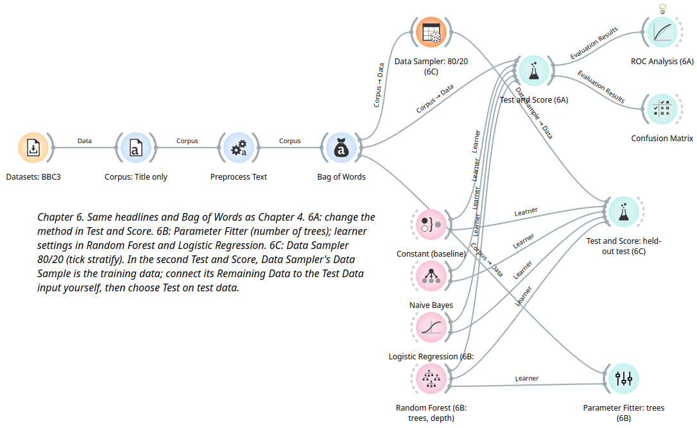
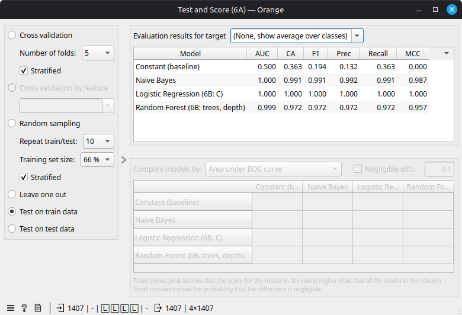
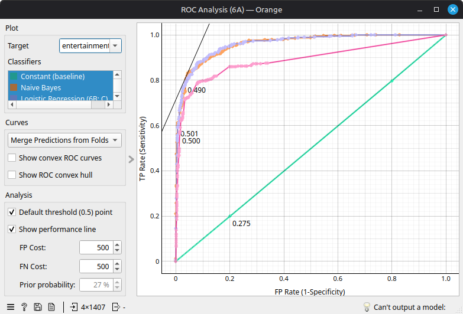
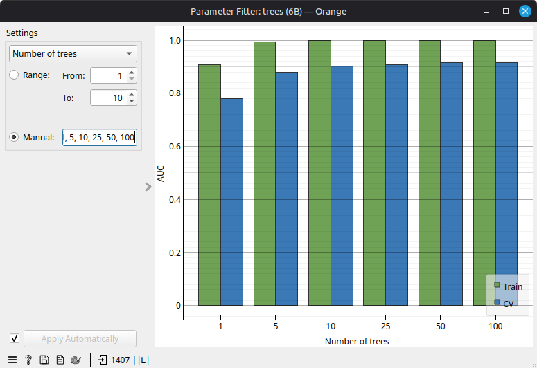
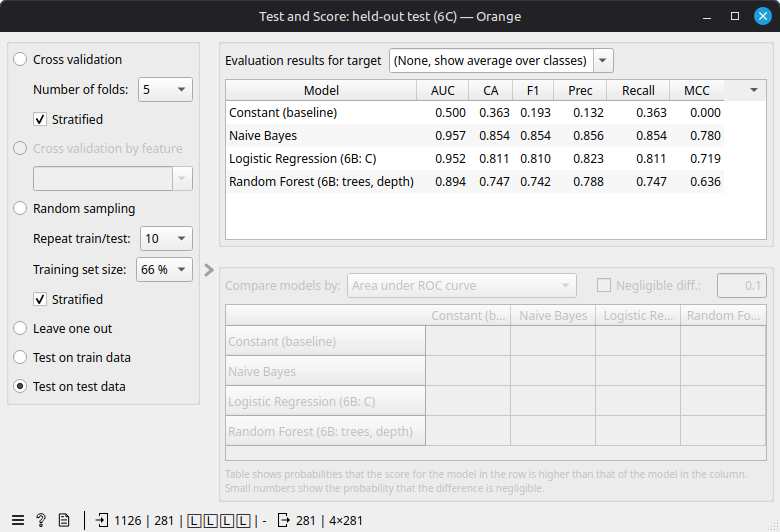

# Chapter 6: Model Evaluation and Tuning

## Learning Objectives

By the end of this chapter, you will be able to:

- Explain overfitting and why a model's score on its own training data is not its real performance.
- Compare train/test splits, cross-validation, and a held-out test set, and say when to use each.
- Compare several classifiers fairly, using per-class scores and ROC curves as well as accuracy.
- Tune hyperparameters in Orange, and recognize when a setting underfits or overfits.
- Report a final result that was not used to choose the model.

---

## 6.1 Why Evaluate? The Exam Analogy

A student who memorizes the answers to last year's exam will score 100% on last year's exam. The score says nothing about how they will do on a new one. A model is the same. If you test it on the documents it learned from, it can score well simply by remembering them. That is **overfitting**: learning the details of the training examples that are not true of the data in general.

Here is what happens on the BBC headlines from Chapter 4 when each model is tested on its own training data, and then with 5-fold cross-validation (where every document is tested by a model that did not see it):

| Learner | Tested on training data | Cross-validated |
|---------|------------------------:|----------------:|
| Naive Bayes | 0.990 | 0.875 |
| Logistic Regression | 1.000 | 0.849 |
| Random Forest | 0.990 | 0.760 |

The training score is nearly perfect for every model, and says almost nothing. The cross-validated score is the one that estimates how the model will do on new headlines. The gap between the two is the size of the overfitting. Notice that the Random Forest, the most flexible model, overfits the most.

The opposite problem is **underfitting**: the model is too simple (or too restricted) to capture the pattern, and it scores badly on both training and new data. You will see both in section 6.4.

---

## 6.2 Ways to Test a Model

*Test and Score* offers several ways to split the data.

| Method | How it works | Use it |
|--------|--------------|--------|
| **Test on train data** | Tests on the data the model learned from | Never as a result. It shows how much a model can memorize. |
| **Random sampling** | Repeatedly picks a random share (for example 66%) to train on and tests on the rest | When you want to see how much the result varies from split to split |
| **Cross-validation** | Splits the data into *k* folds, trains on *k*−1, tests on the remaining one, and rotates | The usual choice. Every document is tested exactly once. |
| **Leave one out** | Cross-validation with *k* equal to the number of documents | Small datasets, when you cannot spare any training data (slow) |
| **Test on test data** | Trains on one dataset and tests on a separate one you supply | The final check (section 6.5) |

### Splits vary

A single random split depends on luck. Running 10 random 66% / 34% splits of the headlines gives these accuracies:

- Naive Bayes: from **0.818** to **0.883** (mean 0.858)
- Logistic Regression: from **0.812** to **0.868** (mean 0.843)

If you reported only the best or worst split, you would be off by several points (the spread here is about 6 points). Cross-validation averages over the whole set, so it is more stable. It is also why a difference of one point between two models, measured once, should not impress you.

### How many folds?

More folds means more training data per fold, so the score usually rises slightly and then levels off. Logistic Regression on the headlines gives 0.820 with 2 folds, 0.849 with 5, 0.861 with 10, and 0.860 with 20. Orange's default is 5. More folds cost more time.

**Stratified** cross-validation (the default) keeps the class proportions the same in every fold. Always leave it on for classification.

---

## 6.3 Comparing Classifiers

Connect several learners to the same *Test and Score* widget and every learner is tested on the **same folds**. That makes the comparison fair, because a difference cannot come from one model getting an easy fold.

### Reading the scores

| Score | Meaning |
|-------|---------|
| **CA** | Classification accuracy: the fraction correct |
| **Precision**, **Recall**, **F1** | As in Chapter 4, averaged over the classes |
| **AUC** | The area under the ROC curve. For more than two classes Orange computes it one class against the rest, and averages. 0.5 is chance and 1.0 is perfect. |
| **MCC** | Matthews correlation coefficient, a single number from -1 to 1 that stays honest when the classes are unbalanced |

The **Evaluation results for target** menu at the top changes the table from the *average over classes* to the scores for one class. With the headlines you can see, for example, whether *entertainment*, the smallest class, is worse than *sport*.

### Is the difference real?

Below the table, *Test and Score* can compare models by one score. Each cell is the probability that the row's model really is better than the column's, given how much the scores varied across folds. A value near 1 (or near 0) means a real difference. A value near 0.5 means you cannot tell them apart. Use **Negligible diff.** to say how small a difference is too small to matter.

### Unbalanced classes

When one class is much more common, accuracy flatters a lazy model (the spam filter in Chapter 4). Always do these three things:

1. Compare with the **baseline** (the *Constant* learner).
2. Look at the scores for each class, not only the average.
3. Look at the **confusion matrix**.

### ROC curves

The *ROC Analysis* widget plots, for one class at a time, the true positive rate against the false positive rate as the decision threshold changes. A curve that hugs the top-left corner is a good classifier, and the diagonal is no better than chance. It lets you compare models at all thresholds, not only at the default one.

---

## 6.4 Tuning Hyperparameters

A model has two kinds of numbers:

- **Parameters** are learned from the data (the word weights of Logistic Regression).
- **Hyperparameters** are settings you choose *before* training: the number of trees in a Random Forest, how strongly Logistic Regression is regularized, and so on.

**Tuning** means trying different hyperparameter values and keeping the best one according to cross-validation.

### The three settings used here

| Learner | Setting in the widget | What it does |
|---------|----------------------|--------------|
| **Random Forest** | **Number of trees** | More trees means a more stable vote, with diminishing returns. |
| **Random Forest** | **Limit depth of individual trees** | A shallow tree is too simple (underfits). Unticked, trees grow until they separate the training data. |
| **Logistic Regression** | **Strength** (*C*) | Controls the **regularization**, a penalty that keeps the word weights small. A small *C* is a *strong* penalty (an underfit model), and a large *C* is a weak one (more freedom to overfit). |

### What the numbers look like

**Random Forest, number of trees** (AUC, 7-fold cross-validation, from the *Parameter Fitter* widget):

| Trees | Training AUC | Cross-validated AUC |
|------:|-------------:|--------------------:|
| 1 | 0.918 | 0.745 |
| 5 | 0.998 | 0.880 |
| 10 | 1.000 | 0.906 |
| 25 | 1.000 | 0.919 |
| 50 | 1.000 | 0.925 |
| 100 | 1.000 | 0.929 |

The training AUC reaches 1.0 with ten trees. The cross-validated AUC keeps rising, but slowly: going from 10 to 100 trees adds 0.02, and accuracy barely moves (about 0.76 throughout). The extra trees cost time and give almost nothing.

**Random Forest, depth limit** (50 trees, accuracy, 5-fold): depth 3 gives 0.559, depth 10 gives 0.657, depth 30 gives 0.726, and no limit gives 0.765. On sparse text features, deep trees are needed, and a depth limit **underfits**.

**Logistic Regression, strength *C*** (accuracy, training and 5-fold):

| *C* | Training | Cross-validated |
|----:|---------:|----------------:|
| 0.01 | 0.730 | 0.649 |
| 0.1 | 0.952 | 0.807 |
| 1 | 1.000 | 0.849 |
| 10 | 1.000 | 0.856 |
| 100 | 1.000 | 0.856 |

At *C* = 0.01 both scores are low (underfitting: the penalty is too strong). At *C* = 1 and above the training score is a perfect 1.000, but the cross-validated score has leveled off at about 0.856. More freedom no longer helps.

### Do not tune on your final test

If you try many settings and report the best cross-validated score, that score is a little optimistic: you picked it *because* it was high. The fix is to keep a separate **held-out test set**, use it only once, and report that score. Section 6.5 shows how.

---

## 6.5 The Held-Out Test Set

The honest workflow has three steps:

1. **Split** the data once into a larger part (say 80%) for building and a smaller part (20%) for the final test.
2. **Build** on the 80%: compare learners and tune settings using cross-validation *only on that part*.
3. **Test** the single chosen model once on the 20%, and report that number.

For the headlines (1,125 for building, 282 for testing; the exact documents depend on the random split, so your numbers will differ a little), tuning Logistic Regression's *C* looks like this:

| *C* | Cross-validated on the 80% | Tested on the 20% |
|----:|---------------------------:|-------------------:|
| 0.1 | 0.796 | 0.777 |
| 1 | 0.842 | 0.826 |
| 10 | 0.847 | 0.837 |
| 100 | 0.848 | 0.840 |

The test scores are a little lower than the cross-validated ones, as expected, but they follow the same pattern, so cross-validation was a good guide. For the other learners, Naive Bayes scores 0.864 in cross-validation and 0.865 on the test set, and Random Forest 0.753 and 0.730. On this task, the simple Naive Bayes classifier beats the tuned Logistic Regression and the Random Forest.

---

## 6.6 The Widgets

| Widget | What it does |
|--------|--------------|
| **Test and Score** | Trains and tests each learner using the chosen method, and compares them. Its **Test Data** input is used with *Test on test data*. |
| **Confusion Matrix** | Shows the confusion matrix for one learner (Chapter 4). |
| **ROC Analysis** | Draws ROC curves for a chosen class, for all learners. |
| **Data Sampler** | Splits the data into a sample (for example 80%) and the remaining data (20%). |
| **Parameter Fitter** | Tries a range of values for one hyperparameter and plots the training and cross-validated scores. It works for the Random Forest's **number of trees**. |
| **Random Forest**, **Logistic Regression**, **Naive Bayes**, **Constant** | Learners. Their settings are in each widget's window. |

> ⏱ Each change of a learner setting or a *Test and Score* option re-runs the cross-validation, which takes seconds to a minute on this dataset. Wait for it to finish before reading the table.

---

## Lab Exercise 6A: Compare Fairly

**Goal**: Compare Naive Bayes, Logistic Regression, Random Forest, and the baseline in several ways.

**Steps**:

1. Start from the Chapter 4 workflow (`headline-classifier.ows`: BBC3 headlines, *Preprocess Text*, *Bag of Words*, four learners, *Test and Score*).
2. In *Test and Score*, choose **Test on train data**. Write down **CA** for each learner. Then switch back to **Cross validation** (5 folds) and write the CA again.
3. Choose **Random sampling** (10 repeats, 66%). Run it a few times and watch the scores change.
4. Back in cross-validation, change the number of folds to 2, 10, and 20. How does the Logistic Regression CA change?
5. In **Evaluation results for target**, choose each category in turn. Which has the lowest F1 for Naive Bayes?
6. Below the table, set **Compare models by** to *Area under ROC curve*. Which differences are real?
7. Connect *Test and Score* to *ROC Analysis*. Choose the target `entertainment` and look at the curves.

**Questions**:

- How much higher is each learner's score when tested on its own training data? Which learner overfits most?
- How different are the Random sampling results from run to run? Why does that make a single split a poor basis for a decision?
- Is Naive Bayes really better than Logistic Regression? Use the *Compare models by* table to answer, and say what the number means.
- Which class is hardest for the classifier? Is that the smallest class?
- In the ROC plot, which learner's curve is highest? Does the baseline follow the diagonal?

---

## Lab Exercise 6B: Tune

**Goal**: Find how the number of trees, the tree depth, and the regularization strength change the scores.

**Steps**:

1. **Number of trees.** Connect *Bag of Words* to a *Parameter Fitter*, and the *Random Forest* widget to its **Learner** input. Choose **Number of trees**, and try the range 1 to 50 (or enter the values `1, 5, 10, 25, 50, 100`). Read the training and cross-validated curves.
2. **Depth.** In the *Random Forest* widget, tick **Limit depth of individual trees** and set 3, then 10, then 30. Write down the CA from *Test and Score* each time. Untick it and compare.
3. **Regularization.** In the *Logistic Regression* widget, move the **Strength** slider to a strong penalty (*C* = 0.01), then 0.1, 1, 10, and 100. Write down the CA each time.

**Questions**:

- In the Parameter Fitter, where do the training and cross-validated curves part ways? What does the gap mean?
- How many trees are enough? Would you use 100 if each tree takes time and memory?
- What happens to the accuracy when you limit the depth to 3? Is that overfitting or underfitting? Why does text need deep trees?
- For Logistic Regression, which *C* underfits? Does making *C* very large keep improving the cross-validated score?
- Which single setting changed the score the most?

---

## Lab Exercise 6C: The Honest Test

**Goal**: Report a final score that was not used to choose the model.

**Steps**:

1. Connect *Bag of Words* to a *Data Sampler*. Choose a **fixed proportion of data**, set it to 80%, and tick the option to **stratify** the sample (it is off by default; the default proportion is 70%).
2. Add a second *Test and Score*. Connect **Data Sample** to its **Data** input, and **Remaining Data** to its **Test Data** input. Connect the learners to it.
3. In the second *Test and Score*, use **Cross validation** (the 80% only). Set Logistic Regression's *C* to 0.1, 1, 10, and 100 in turn and write down the CA. Pick the best learner and setting.
4. Switch to **Test on test data**. Write down the CA of the chosen learner on the 20%.

**Questions**:

- Is the test score lower or higher than the cross-validated score? By how much? Is that what you expected?
- Do the learners rank the same way on the test set as in cross-validation?
- You looked at the test score and did not like it, so you change the setting and look again. Why does that defeat the purpose of the held-out set?
- How would your recommendation change if the test set had only 30 documents?

> 📝 **Reflection:** Chapter 16 asks you to compare a classical method and a modern one. What would you write down *before* you run anything so that your comparison is fair?

---

## Comprehension Questions

1. What is overfitting, and why does a model score near 100% on its own training data?
2. Why is cross-validation more reliable than a single train/test split?
3. Why should all learners be tested on the same folds?
4. What is the difference between a parameter and a hyperparameter? Give an example of each.
5. What are the signs of underfitting? Of overfitting?
6. Why must the final test set be used only once?
7. Accuracy is 90%, but one class makes up 90% of the data. What other things would you check?

---

## Key Terms

- Generalization
- Overfitting and underfitting
- Train/test split, cross-validation, held-out test set
- Stratification
- Hyperparameter, parameter
- Regularization
- AUC, ROC curve
- Baseline
- Tuning

---

## Notes

- Save your workflow as `classifier-evaluation.ows`.
- The numbers here come from the BBC headlines with Lowercase, Regexp tokenization, English stopwords, and plain word counts (Chapter 4). Your results may differ by a point or two because the folds and splits are random.
- Chapter 7 uses the same evaluation tools on sentiment analysis.
