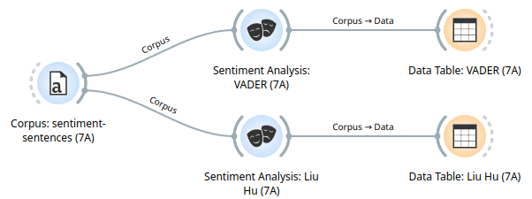
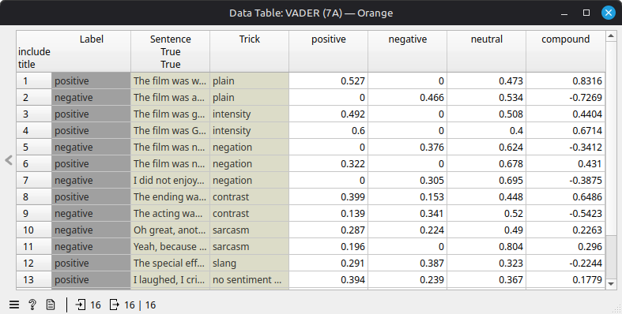
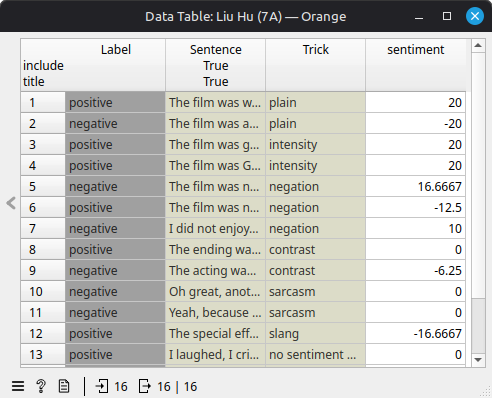
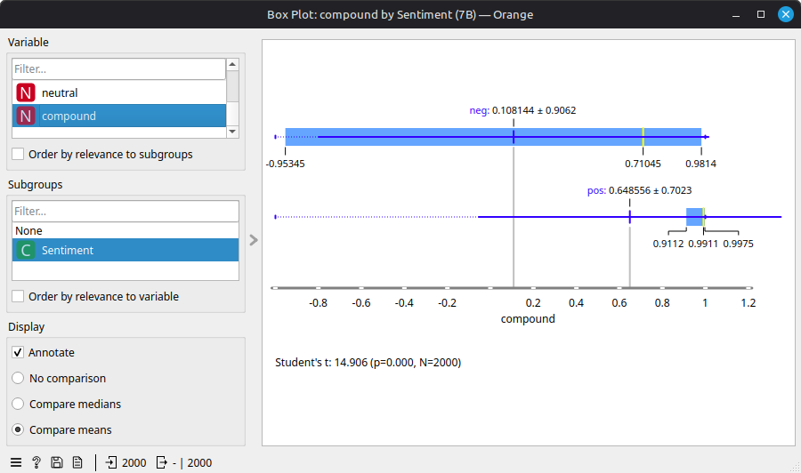
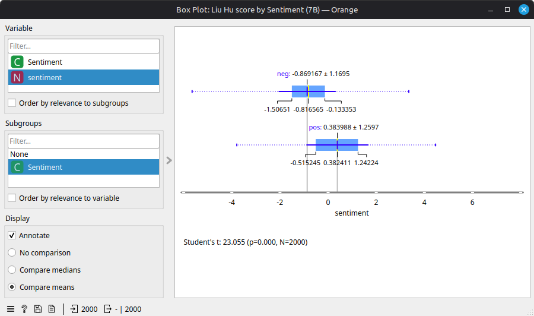
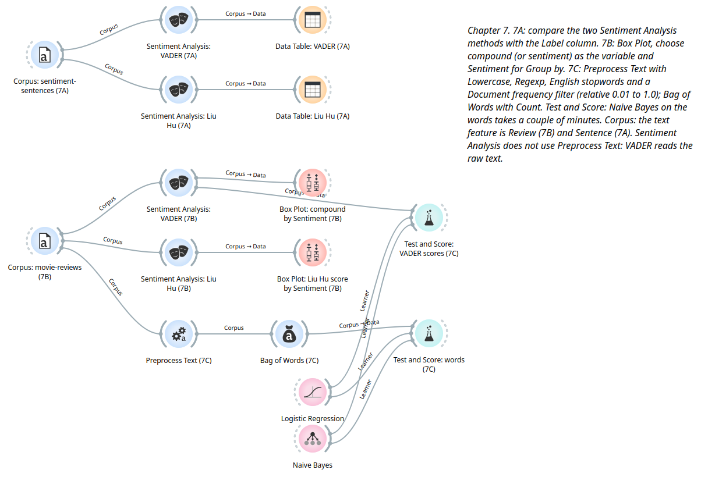
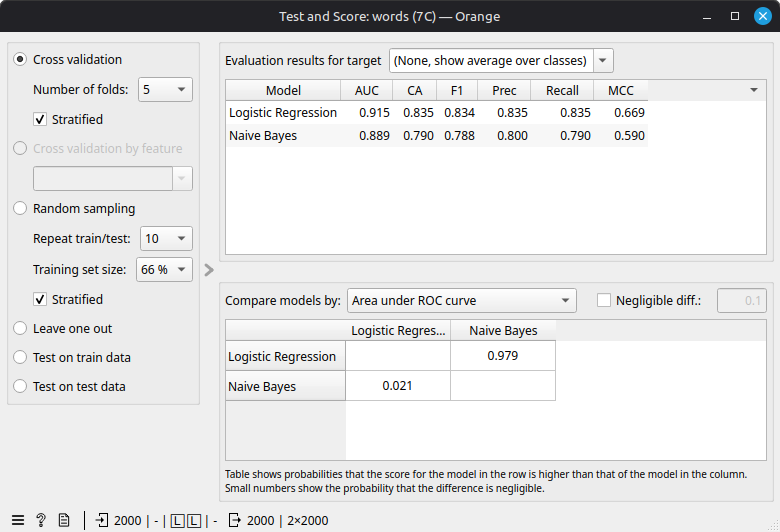
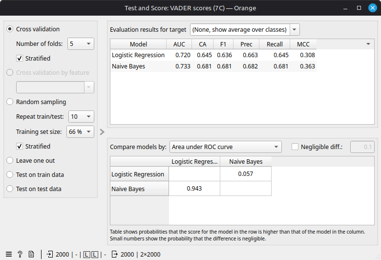

# Chapter 7: Sentiment Analysis

## Learning Objectives

By the end of this chapter, you will be able to:

- Explain what sentiment analysis measures, and why it is harder than counting good and bad words.
- Explain how a lexicon method (VADER, Liu Hu) scores a text, and read VADER's compound score.
- Predict which kinds of sentences fool a lexicon: negation, contrast, sarcasm, slang.
- Compare a lexicon method with a classifier trained on labeled examples, using the evaluation methods of Chapter 6.
- Decide when a lexicon is good enough and when you need labeled data.

---

## 7.1 What Is Sentiment Analysis?

**Sentiment analysis** decides whether a text expresses a positive or a negative opinion. It is used on product reviews, survey answers, support messages, and social media, because nobody can read a million opinions.

It looks like a simple task, and Chapter 4's classifier could do it if you had labels. There are two ways to do it:

- A **lexicon** (rule-based) method uses a list of words with scores: *wonderful* is +3, *awful* is -3. It adds up the scores of the words in the text. It needs no labeled data and you can see exactly why a text got its score.
- A **machine learning** method learns from examples that someone has already labeled, as in Chapter 4. It learns which words matter for *your* kind of text, but it needs the labels.

This chapter tries both on the same texts, so you can see what each is good at.

---

## 7.2 Lexicon Methods

Orange's *Sentiment Analysis* widget offers several methods. This chapter uses two:

| Method | How it scores a text |
|--------|----------------------|
| **VADER** | Looks up each word in a dictionary built for social media. It also reads **punctuation** (`!` raises the score), **capital letters** (`GOOD` is stronger than `good`), **intensifiers** (`very`), **negation** (`not good`), and `but`. It returns four numbers: `positive`, `negative`, `neutral` (the shares of the text) and `compound`. |
| **Liu Hu** | Counts the words from a list of positive words and a list of negative words, and returns one number: 100 × (positive − negative) / number of tokens. It has no idea what a word is next to. |

**VADER's compound score** is a single number from −1 (most negative) to +1 (most positive). The usual rule is:

- compound **≥ 0.05**: positive
- compound **≤ −0.05**: negative
- in between: neutral

Compound is not a percentage. A compound of −0.7 means a strongly negative text, not "70% negative".

> ⚠️ **VADER reads the raw text.** It ignores *Preprocess Text*, because lowercasing and removing punctuation would throw away the capitals and exclamation marks it uses. (Liu Hu does use tokens: if the corpus has none, the widget lowercases and tokenizes it itself.)

---

## 7.3 Why Sentiment Is Hard

A word list works when the words mean what they say. A lot of real text does not:

- **Negation**: *not good* contains *good*. A method that does not look at the neighboring words scores it positive.
- **Contrast**: *The ending was terrible, but I loved everything else* is positive overall, though it has a strong negative word.
- **Sarcasm**: *Oh great, another two hours of my life wasted* uses a positive word to say the opposite.
- **Slang and domain**: *The special effects were sick!* is praise. In a medical text, *positive* is bad news.
- **No sentiment words at all**: *I walked out after twenty minutes and asked for my money back* has no word in any list, and is clearly negative.
- **Length**: a long text collects many positive and negative words, and a lexicon adds them up. You will see what this does in 7B.

A trained model has the same problems with sarcasm, but it learns the words and phrases that signal sentiment *in your data*, such as *waste*, *boring*, or *money back* in movie reviews.

---

## 7.4 The Widgets

| Widget | What it does |
|--------|--------------|
| **Corpus** | Loads the documents. Check that the right column is the text feature. |
| **Sentiment Analysis** | Adds the sentiment columns to the corpus. Choose the method (Liu Hu, VADER, and others) on the left. |
| **Data Table** | Shows the documents with their scores. |
| **Box Plot** | Shows how a score is distributed in each class (set **Group by** to the class). |
| **Preprocess Text**, **Bag of Words** | As in Chapters 3 and 4, for the machine learning method. |
| **Test and Score** | Cross-validates learners, as in Chapter 6. |

---

## Lab Exercise 7A: Where Lexicons Fail

**Goal**: See what a lexicon gets right and wrong on sentences you can read in full.

**Dataset**: `sentiment-sentences.tab`, 16 sentences about films that we wrote to include each difficulty above. Each has a true **Label** (positive or negative) and a **Trick** column that names the difficulty.

**Steps**:

1. Load `sentiment-sentences.tab` with *Corpus*. The text feature is `Sentence`.
2. Connect *Corpus* to a *Sentiment Analysis* widget with the **VADER** method, and connect it to a *Data Table*.
3. Connect *Corpus* to a second *Sentiment Analysis* widget with the **Liu Hu** method (language English), and connect it to a second *Data Table*.
4. In each table, compare the score with the `Label`. For VADER use the rule in 7.2. For Liu Hu use positive when the score is above 0 and negative when it is below 0.

**Questions**:

- How many of the 16 sentences does each method label correctly? (We counted 11 for VADER. For Liu Hu we counted 6, with five sentences scoring exactly 0, which is neither positive nor negative.)
- Which sentences does VADER get wrong? Which `Trick` types are they? Why does it fail on each one?
- Look at the four sentences with *not*. Which method handles them, and why? How can a method that only counts words get *not good* wrong?
- *The film was good* and *The film was GOOD!!!* have the same words. How do their VADER scores differ? What did VADER use?
- *I walked out after twenty minutes and asked for my money back* gets a compound of 0. Why? What would you do about it?

---

## Lab Exercise 7B: Lexicons on Movie Reviews

**Goal**: Measure how well a lexicon agrees with known labels on real, longer texts.

**Dataset**: `movie-reviews.tab`, 2,000 movie reviews (1,000 `neg` and 1,000 `pos`, in the column `Sentiment`), about 760 words each. The text feature is `Review`.

**Steps**:

1. Load `movie-reviews.tab` with *Corpus*, and connect it to a *Sentiment Analysis* widget with **VADER**.
2. Connect it to a *Box Plot*. Choose `compound` as the variable and `Sentiment` for **Group by**. Compare the two boxes.
3. Count how many reviews VADER calls positive. Add a *Select Rows* widget with the condition `compound ≥ 0.05` and look at the number of matching rows and how many of them are `pos` and `neg`.
4. Repeat with **Liu Hu**: a *Sentiment Analysis* widget with the Liu Hu method, a *Box Plot* of its `sentiment` score grouped by `Sentiment`.

**What to expect.** With the rule *compound ≥ 0.05 is positive*, VADER labels 1,384 of the 2,000 reviews positive. Of those, 829 really are positive and 555 are not, so it gets only **64%** of the reviews right: 83% of the positive reviews, but just 44% of the negative ones. Liu Hu (score above 0 is positive) gets about **71%**. (Always compare with the baseline: always guessing one class gives 50%.)

**Questions**:

- In the Box Plot, how far apart are the medians of the negative and the positive reviews? Do the two boxes overlap?
- VADER calls most negative reviews positive. Why? (Hint: how long is a review, and how does a lexicon score a long text? Think about what a negative review also contains: the plot summary, the praise before the *but*, the names of characters.)
- A compound of 0.95 on a short sentence means "very positive". What does it mean on a 760-word review?
- Is Liu Hu better than VADER here? In 7A, VADER was the better one. Why can the order change?

---

## Lab Exercise 7C: Train a Model on the Labels

**Goal**: Compare a classifier trained on the labeled reviews with the lexicon scores.

**Steps**:

1. Connect the movie-reviews *Corpus* to *Preprocess Text* with Lowercase, Regexp tokenization, and English stopwords. Add a **Document frequency** filter (relative, from `0.01` to `1.0`), which drops the words that appear in fewer than 20 reviews. This leaves about 4,700 words, which keeps the models fast.
2. Add *Bag of Words* (Term Frequency: Count) and connect it to *Test and Score*. Add *Logistic Regression* and *Naive Bayes* learners to it, and use 5-fold cross-validation. Note the CA.
3. Now use the lexicon as the features. Connect the VADER *Sentiment Analysis* widget from 7B to a second *Test and Score* with the same two learners. Its features are `positive`, `negative`, `neutral`, and `compound`. Note the CA.

**What to expect.** We measured these results with 5-fold cross-validation (your last digit may differ):

| Features | Logistic Regression | Naive Bayes |
|----------|--------------------:|------------:|
| Bag of words (about 4,700 words) | 0.84 | 0.79 |
| The four VADER scores | 0.645 | 0.681 |
| Liu Hu's one score | 0.699 | 0.695 |
| VADER and Liu Hu together | 0.698 | 0.698 |

Naive Bayes takes a couple of minutes on the bag of words, and Logistic Regression about half a minute. The bag of words is a large table.

**Questions**:

- Which gets the higher score: the bag of words or the lexicon scores? By how much? Is the gap larger than the difference between learners?
- Training a classifier on the lexicon scores (0.645) gives about the same as the rule *compound ≥ 0.05* (0.637). What does that tell you about VADER's scores on these reviews?
- The bag-of-words model needed 2,000 labeled reviews. When would a lexicon be the better choice, even though it scores lower?
- Which words do you think the bag-of-words model learned for negative reviews? Would a general-purpose lexicon list them? (Think of *waste*, *boring*, *plot*.)

> 📝 **Reflection:** On 16 short sentences the lexicon did well, and on 2,000 long reviews it did badly. What would you check before using a lexicon on a new collection? How many labeled documents would you need to find out?

---

## Comprehension Questions

1. What is the difference between a lexicon method and a machine learning method for sentiment? Give one advantage of each.
2. What do the four VADER scores mean? How is the compound score turned into positive or negative?
3. Why does *Preprocess Text* make no difference to VADER?
4. Give an example of a sentence that fools a lexicon, and say why.
5. Why does a lexicon do worse on long reviews than on short sentences?
6. You have no labeled data for a new collection. How could you still check whether VADER works on it?

---

## Key Terms

- Sentiment analysis, polarity
- Lexicon, rule-based method
- VADER, compound score
- Negation, sarcasm
- Baseline

---

## Notes

- Save your workflow as `sentiment-reviews.ows`.
- *Sentiment Analysis* may need to download the VADER dictionary the first time you use it, so keep an internet connection for that first run.
- Chapter 14 returns to sentiment with a large language model, and compares it with VADER on short customer messages.
