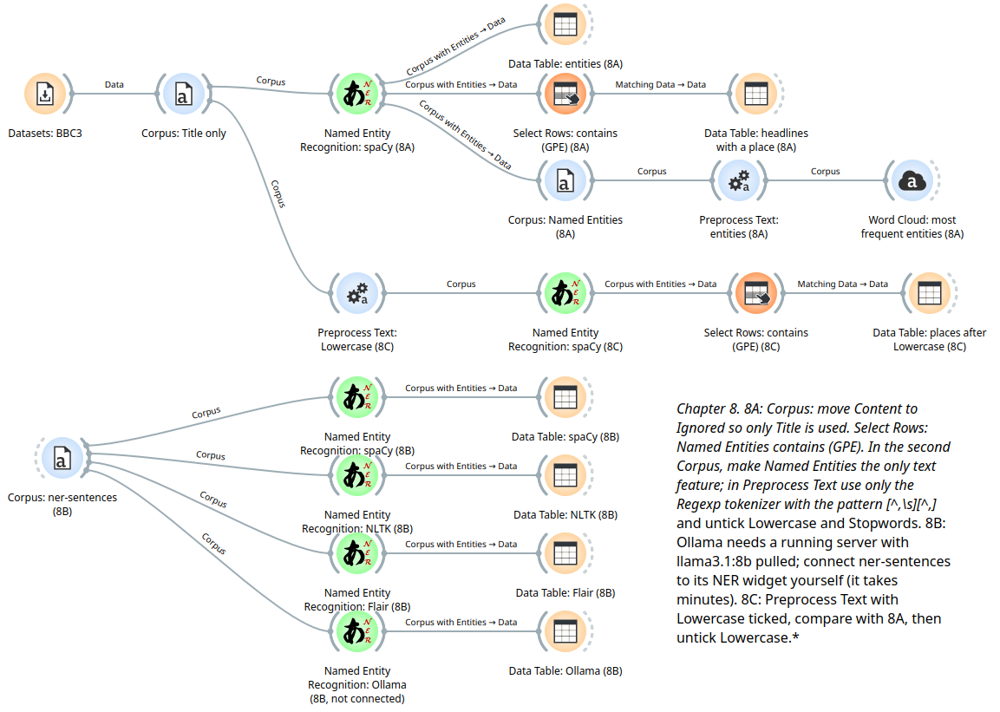
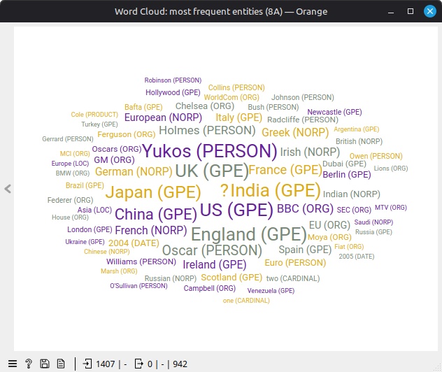
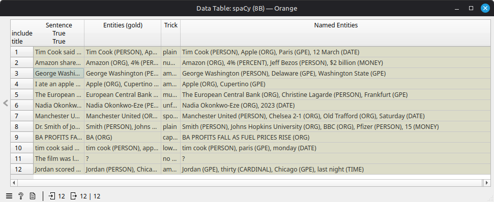
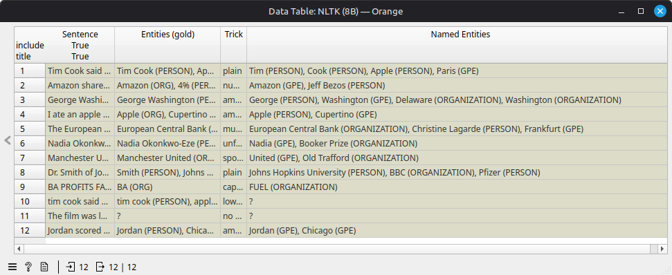
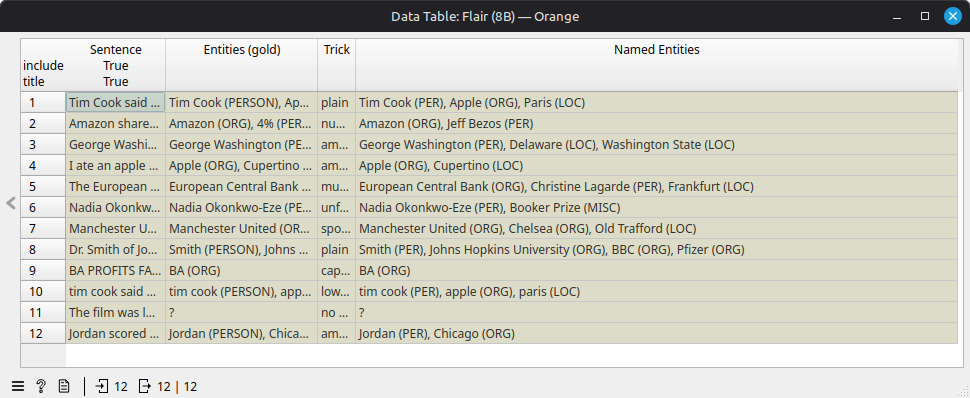
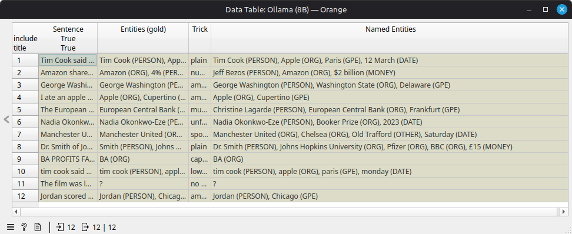

# Chapter 8: Named Entity Recognition

## Learning Objectives

By the end of this chapter, you will be able to:

- Explain what a named entity is, and name the common entity types.
- Extract entities from a corpus with the *Named Entity Recognition* widget, and read its output.
- Summarize a collection by its entities: which people, organizations, and places it mentions, and how often.
- Compare four recognizers (NLTK, spaCy, Flair, and a language model) for speed and for the kinds of mistakes they make.
- Explain why capital letters matter to a recognizer, and what *Preprocess Text* does to the result.

---

## 8.1 What Is a Named Entity?

A **named entity** is a word or phrase that names a particular thing: a person, a company, a country, a date, an amount of money. **Named Entity Recognition (NER)** finds these phrases in text and gives each a **type**.

> *Tim Cook* (PERSON) said *Apple* (ORG) will open a store in *Paris* (GPE) on *12 March* (DATE).

NER turns text into a list of things you can count, filter, and look up. It is used to find who and what a collection of news is about, to fill in forms from documents, to link text to a database, and as a first step in answering questions about a text.

An entity is not the same as a **keyword**. A keyword is a word that is frequent or typical for a document (*profits* in a business article). An entity is a *name*: *BA*, *Yukos*, *Greenspan*. It may occur only once.

The types depend on the model. The spaCy model used in this chapter has these (among others):

| Type | Meaning | Example |
|------|---------|---------|
| PERSON | People | *Jeff Bezos* |
| ORG | Companies, agencies, teams | *Apple*, *Chelsea* |
| GPE | Countries, cities, states | *Paris*, *US* |
| LOC | Other places | *Europe* |
| NORP | Nationalities and groups | *French*, *Greek* |
| DATE, TIME | Dates and times | *12 March*, *last night* |
| MONEY, PERCENT | Amounts | *$2 billion*, *4%* |
| CARDINAL | Other numbers | *thirty* |
| EVENT | Named events | *the Booker Prize* |

Other recognizers use other names: NLTK says `ORGANIZATION` and sometimes `GSP`, and Flair says `PER`, `ORG`, `LOC`, and `MISC`, and does not label dates or money at all. When you compare tools, compare the *phrases* first and the labels second.

---

## 8.2 How a Recognizer Works

The recognizer has to decide where an entity starts and ends, and what type it is. It uses clues:

- **Shape**: a capital letter in the middle of a sentence, all capitals (`BBC`), digits and a currency sign (`$2 billion`).
- **Context**: *said ___ will open* suggests a person or a company. *in ___* suggests a place.
- **Knowledge**: names the model has seen before.

The four options in the widget get these clues in different ways:

| Option | How it works | Speed (12 sentences) |
|--------|-------------|----------------------|
| **NLTK** | A classic statistical chunker over part-of-speech tags | 3 seconds |
| **spaCy** (`en_core_web_sm`) | A small neural network trained on a large annotated corpus | 0.1 seconds |
| **Flair** | A larger neural network that reads each word in context | 4 seconds |
| **Ollama** | A language model that is *asked* to list the entities as JSON | 3 minutes (llama3.1:8b) |

The first three are trained specifically for the job and are fast. The language model has not been trained for NER, but it has read so much text that it does it well. It is far slower, and it may label entities in its own way.

---

## 8.3 Why NER Is Hard

- **Capital letters carry much of the signal.** Names are capitalized in English. In headlines in *all capitals* or in text written in *lowercase*, that clue is gone.
- **The same word can be several types.** *Washington* is a person, a city, and a state. *Apple* is a company or a fruit. *Jordan* is a country or a basketball player. Only the context decides.
- **Unfamiliar names.** A model has seen *Paris* many times, but not *Nadia Okonkwo-Eze*.
- **Boundaries.** Is it *Chelsea* or *Chelsea 2-1*? *The European Central Bank* or *European Central Bank*?
- **Domain.** A model trained on news may do badly on tweets, recipes, or medical notes.
- **Short text.** A headline has almost no context.

---

## 8.4 The Widget

| Widget | What it does |
|--------|--------------|
| **Named Entity Recognition** (from the *orange3-nlp* add-on, see Chapter 2) | Choose NLTK, spaCy, Flair, or Ollama. Adds a column **Named Entities** to the corpus, with entries like `Tim Cook (PERSON), Apple (ORG)`. |
| **Data Table**, **Corpus Viewer** | Show the documents and their entities. |
| **Select Rows** | Keeps the documents whose `Named Entities` contains a given string, such as `(GPE)`. The count of rows appears in the status bar. |
| **Corpus**, **Preprocess Text**, **Word Cloud** | As in Chapter 3. |

Things to know:

- The widget **runs as soon as data arrives**, and again each time you click a different framework.
- The first time you use **NLTK** or **Flair**, the widget downloads its model, so it needs an internet connection and takes longer.
- **Ollama** needs a running Ollama server and a pulled model (we use `llama3.1:8b`, because a small model such as `phi4-mini` labels entities poorly). Pick the model in the widget's **Ollama Model** list. It runs once per document, so use a short text and a small sample.
- The widget reads the text left by the **transformation** stages of a preceding *Preprocess Text* (lowercase, remove accents, parse HTML, remove URLs). The tokenization, normalization, and filtering stages make no difference to it. You will see in 8C why this matters.

> 📝 This needs a version of *orange3-nlp* in which the widget reads the preprocessed text and sends the Ollama request as JSON (0.0.13 or later). Update the add-on if your Ollama results are all `Error: ...`.

---

## Lab Exercise 8A: Who Is in the News?

**Goal**: Extract the entities from the BBC headlines, count them by type, and find the most frequent ones.

**Dataset**: `BBC3`, headlines only (1,407 headlines).

**Steps**:

1. Load BBC3 with *Datasets* and connect it to *Corpus*. Move `Content` to **Ignored text features**, so that only `Title` is used.
2. Connect *Corpus* to *Named Entity Recognition* and choose **spaCy**. Connect the result to a *Data Table*. Look at the `Named Entities` column.
3. **Count headlines with a place.** Connect *Named Entity Recognition* to *Select Rows*. Add the condition `Named Entities` **contains** `(GPE)`, and connect it to a second *Data Table*. The number of rows is the number of headlines that mention a place. Repeat with `(ORG)` and `(PERSON)`.
4. **Find the most frequent entities.** Connect *Named Entity Recognition* to a second *Corpus* widget (it accepts a table as input), and make `Named Entities` its only text feature. Connect it to *Preprocess Text*, remove Lowercase and Stopwords, and use only the **Regexp** tokenizer with the pattern `[^,\s][^,]*`. That pattern makes each comma-separated entity one token. Connect it to a *Word Cloud*.

**What to expect.** spaCy finds **1,658 entities** in **1,163** of the 1,407 headlines (83%). The most common types are ORG (485), GPE (449), and PERSON (369), then NORP (133), CARDINAL (56), DATE (52), and MONEY (38). Headlines with a place: 413; with an organization: 444; with a person: 344. The most frequent entities are `US (GPE)` (90 headlines), `UK (GPE)` (27), `India (GPE)` (19), and `England (GPE)` (17). The Word Cloud also contains `?`, the placeholder for headlines with no entity (244 of them). Ignore it. The cloud caps the size of its most frequent words, so `Yukos (PERSON)` (17 headlines) can look as big as `US (GPE)` (90). To see the real counts, connect the Word Cloud's **Word Counts** output to a *Data Table*, as in Chapter 3.

**Questions**:

- Which type dominates? Which types do you expect to dominate in a collection of tweets, or of medical notes?
- Look at the most frequent *person* entities. Do all of them belong to people? (Hint: look for `Yukos`, `Oscar`, and `Euro`.) What does that say about trusting the types?
- Which headlines have no entity? Read ten. Are there entities the model missed?
- *Reflection:* What does counting entities tell you that the word cloud of Chapter 3 did not?

---

## Lab Exercise 8B: Which Recognizer?

**Goal**: Compare the four recognizers on sentences for which we know the right answer.

**Dataset**: `ner-sentences.tab`. It has 12 sentences, each with the correct entities in the column **Entities (gold)**, and a **Trick** column that names what makes the sentence hard (ambiguous name, unfamiliar name, capitals, lowercase, no entities).

**Steps**:

1. Load `ner-sentences.tab` with *Corpus*. The text feature is `Sentence`.
2. Add three *Named Entity Recognition* widgets, set to **spaCy**, **NLTK**, and **Flair**, and give each a *Data Table*. Put the tables side by side and compare each `Named Entities` with the gold column.
3. Add a fourth *Named Entity Recognition* widget, set to **Ollama** with `llama3.1:8b`, and connect it to a *Data Table*. This takes about three minutes. Make sure the Ollama server is running.
4. For each recognizer, count how many of the gold entities it found (ignore the type), how many it missed, and how many extra phrases it invented.

**What to expect.** There are 36 gold entities. Counting a phrase as found when its text matches (the type is not compared), we got:

| Recognizer | Found | Extra | Missed | Time |
|------------|------:|------:|-------:|------|
| spaCy | 31 | 4 | 5 | 0.1 s |
| NLTK | 17 | 7 | 19 | 3 s |
| Flair | 28 | 0 | 8 | 4 s |
| Ollama (llama3.1:8b) | 33 | 1 | 3 | 3 min |

Typical mistakes:

- **spaCy** calls `Nadia Okonkwo-Eze` an ORG and `Manchester United` a PERSON, reads `Chelsea 2-1` as one entity, and labels the whole all-capital headline `BA PROFITS FALL AS FUEL PRICES RISE` as an ORG.
- **NLTK** tags `Apple` and `Pfizer` as PERSON, splits `Tim Cook` into two people, and finds nothing at all in the lowercase sentence.
- **Flair** is exact when it answers, but it never labels dates, money, or percentages.
- **Ollama** finds the most, but its labels drift (`Booker Prize` as ORG, `Old Trafford` as OTHER), and the results can change from run to run.

**Questions**:

- Which recognizer would you use on a million documents? On 50 documents that matter a lot?
- Sentences 3, 4, and 12 contain ambiguous names (*Washington*, *Apple*, *Jordan*). Which recognizers use the context correctly?
- Sentence 11 has no entities. Did any recognizer invent one?
- Which recognizer does best on the all-capital headline, and on the lowercase sentence? Why do you think so?
- The Ollama model got the most right. Why might you still not choose it?

---

## Lab Exercise 8C: What Preprocessing Does to NER

**Goal**: See why you must not lowercase text before recognizing entities.

**Steps**:

1. Connect the headline *Corpus* from 8A to *Preprocess Text* (leave the defaults: Lowercase, Regexp, English stopwords), and connect that to a new *Named Entity Recognition* widget (spaCy).
2. Connect it to *Select Rows* with the condition `Named Entities` contains `(GPE)`, and look at the number of rows.
3. In *Preprocess Text*, untick **Lowercase**. Look again. Compare with the 413 headlines of 8A.
4. Do the same for `(ORG)` and `(PERSON)`.

**What to expect.** With Lowercase, spaCy finds **997** entities instead of 1,658, in 802 headlines instead of 1,163. The headlines with a place fall from 413 to **243**, with an organization from 444 to 200, and with a person from 344 to 207. `US` is found in 22 headlines instead of 90, because the word `us` looks like the pronoun.

**Questions**:

- Which type loses the most? Why?
- Unticking Lowercase is the fix here. What other stage of *Preprocess Text* would you want to keep before NER, and which would you skip? (Hint: look at the list of transformations in the widget.)
- You want to recognize entities *and* count words (Chapter 3). In which order, and on which text, would you do the two?
- *Reflection:* The recognizer was fine; the input was damaged. How can you check, on any new text, that a preprocessing step did not remove the signal?

---

## Comprehension Questions

1. What is a named entity? How does it differ from a keyword?
2. Give four entity types and an example of each.
3. How do the four recognizers in the widget work, at a high level? What is the trade-off between them?
4. Why is the type of an entity sometimes impossible to know from the word alone?
5. Why does lowercasing hurt NER?
6. Why would you not trust the entity counts from 8A without looking at the mistakes?

---

## Key Terms

- Named entity, Named Entity Recognition (NER)
- Entity type: PERSON, ORG, GPE, DATE, MONEY
- Span, boundary
- Gold standard
- Ambiguity
- spaCy, NLTK, Flair

---

## Notes

- Save your workflow as `named-entities.ows`.
- *Named Entity Recognition* finds the entities; it does not link them (two spellings of one person) or say how they relate. Chapter 10 returns to sentence structure, and *orange3-nlp* also has widgets that extract subject-verb-object relations.
- Chapter 9 turns long documents into short summaries.
