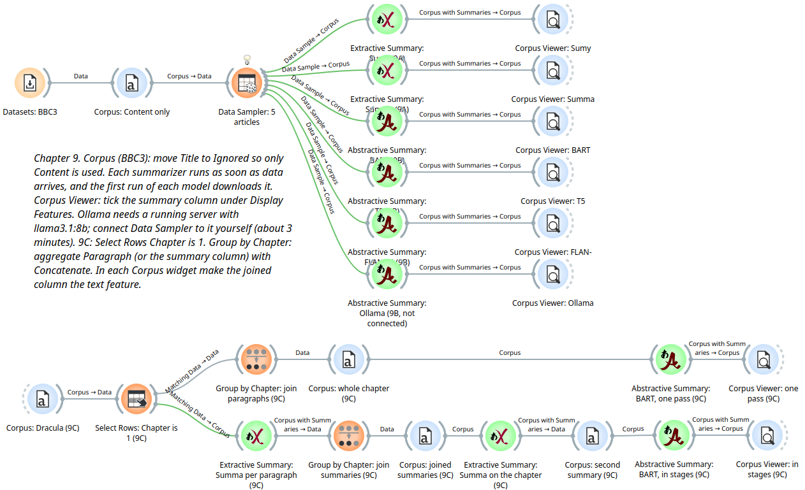
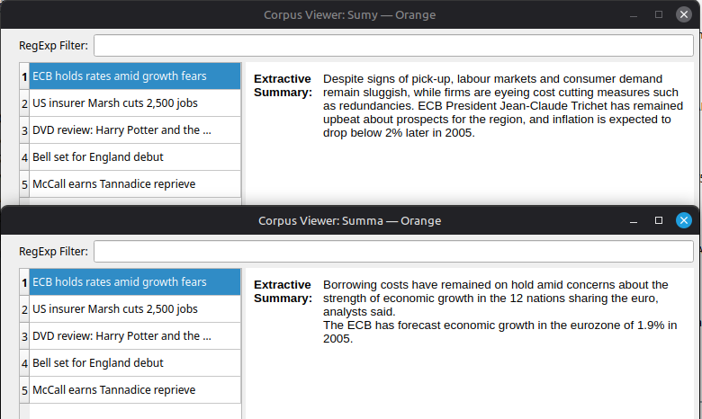
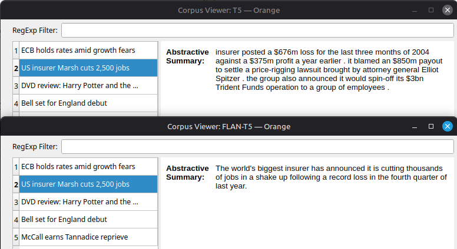
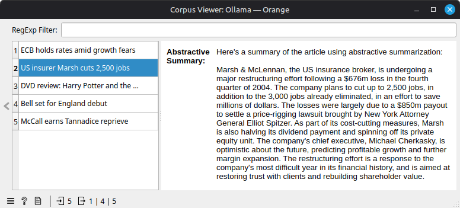
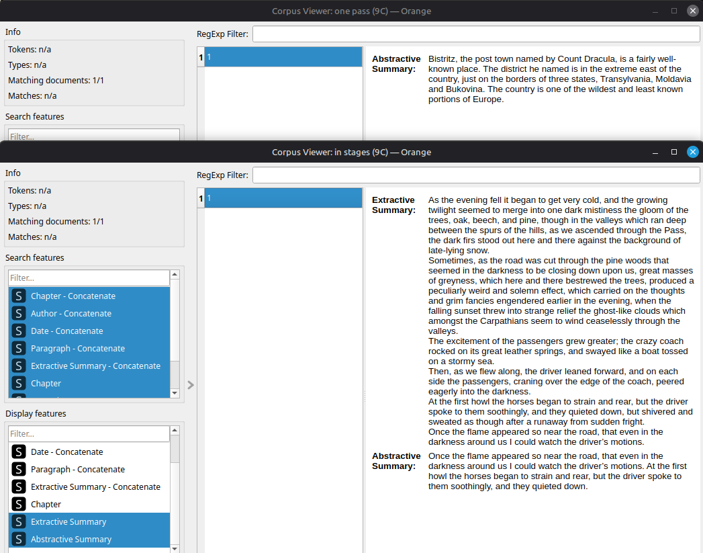

# Chapter 9: Text Summarization

## Learning Objectives

By the end of this chapter, you will be able to:

- Explain the difference between extractive and abstractive summarization, and name a method of each kind.
- Produce summaries with the *Extractive Summary* and *Abstractive Summary* widgets, and say what each backend really does.
- Judge a summary on four criteria: coverage, faithfulness, fluency, and conciseness.
- Recognize an invented fact (a **hallucination**) by checking a summary against its source.
- Explain why long documents need chunking, and build a summary of a text that is too long for one pass.

---

## 9.1 What Is Summarization?

A **summary** is a shorter text that keeps the important content of a longer one. People use summaries to decide what to read, to review many documents quickly, and as input to later steps (a search index, a classifier, a report).

There are two basic ways to build one:

- An **extractive** summarizer **chooses sentences** from the original and puts them together. Every word in the summary was written by the author of the document.
- An **abstractive** summarizer **writes new text**. It reads the document and generates sentences that may use words that are not in the original.

Here is the same BBC article (about the European Central Bank leaving its interest rate unchanged) summarized both ways:

> **Extractive (Sumy).** *Despite signs of pick-up, labour markets and consumer demand remain sluggish, while firms are eyeing cost cutting measures such as redundancies. ECB President Jean-Claude Trichet has remained upbeat about prospects for the region, and inflation is expected to drop below 2% later in 2005.*
>
> **Abstractive (BART).** *The European Central Bank has left its key interest rate unchanged at 2% for the 19th month in succession. Despite signs of pick-up, labour markets and consumer demand remain sluggish, while firms are eyeing cost cutting measures.*

Both are readable. The extractive one is guaranteed to say only what the article says, but it picked the two sentences that best represent the *topics* of the article, and missed the main news, that the rate did not change. The abstractive one states that news in its first sentence, but you have to check that it did not make anything up.

---

## 9.2 How the Methods Work

| Method | Kind | How it chooses or writes |
|--------|------|--------------------------|
| **Sumy** (LSA) | Extractive | Finds the main topics of the document with a matrix method (the LSI of Chapter 5) and keeps the sentences that best represent them. The widget keeps 2 sentences. |
| **Summa** (TextRank) | Extractive | Ranks sentences like Google's PageRank: a sentence is important if it is similar to many other important sentences. It keeps about 20% of the text. |
| **BART** | Abstractive | A neural network trained on pairs of news articles and their summaries (`bart-large-cnn`). |
| **T5**, **FLAN-T5** | Abstractive | General text-to-text networks. FLAN-T5 has been trained to follow instructions. |
| **Pegasus** | Abstractive | Trained to write a one-sentence summary. It accepts only about 400 words of input, so use it on short texts. |
| **Ollama** | Abstractive | A language model that is *asked* to summarize, as in Chapter 14. |

> ⚠️ **The widget names are about the task, not the method.** *Extractive Summary* has a **BART** option and an **Ollama** option. They are the same abstractive methods, so they do **not** copy sentences. The *Extractive Summary* widget's Ollama option only *asks* the model to extract, and the model usually paraphrases anyway (you will see this in 9B). Only **Sumy** and **Summa** are truly extractive.

---

## 9.3 Judging a Summary

There is no single right summary, and nobody can compute "accuracy" without one. Judge each summary on four questions:

| Criterion | The question |
|-----------|--------------|
| **Coverage** | Does it contain the main points of the article? |
| **Faithfulness** | Is everything in it true to the article? (An abstractive summary can state things the article never said.) |
| **Fluency** | Is it well-formed text, with proper capitals and sentences? |
| **Conciseness** | Is it short? Does it avoid repetition and filler? |

Faithfulness is the one to watch for abstractive methods. A made-up fact is **a hallucination**, and it reads just as confidently as a true one. The check is simple: take every number, name, and claim in the summary and find it in the article (the search box of *Corpus Viewer* helps).

Researchers also compare a summary with a human-written reference using **ROUGE**, which counts shared words and phrases. We have no reference summaries for these articles, so we read instead.

---

## 9.4 When the Text Is Too Long

Every neural summarizer has a limit on how much it can read. The *Abstractive Summary* widget cuts its input at about **3,700 characters** (about 600 words) for BART, T5, and FLAN-T5, and at 3,000 for Pegasus, **before** it summarizes. Anything beyond the cut is never seen. This is true of language models too: they have a limit, called the context window, though it is larger.

A typical news article (300 to 500 words) fits. A book chapter does not. Chapter 1 of *Dracula* has 5,678 words (30,494 characters), and a single pass of BART reads only the first 12% of it.

The remedy is **chunking**: summarize the pieces, then summarize the summaries.

1. Split the document into paragraphs.
2. Summarize each paragraph.
3. Join the paragraph summaries and summarize that text.

Each stage has to leave the next one a text that **fits**. If the joined summaries are still longer than the limit, the last stage cuts them off again, and you need one more round. You will try this in 9C.

---

## 9.5 The Widgets

| Widget | What it does |
|--------|--------------|
| **Extractive Summary** | Adds a column **Extractive Summary**. Choose Sumy, Summa, BART, or Ollama. |
| **Abstractive Summary** | Adds a column **Abstractive Summary**. Choose BART, Pegasus, T5, FLAN-T5, or Ollama. |
| **Corpus**, **Data Sampler** | Load the articles; the sampler keeps a few of them. |
| **Corpus Viewer** | Shows a document and, with the summary column ticked under **Display Features**, its summary. Its search box finds words in the article. |
| **Select Rows**, **Group by** | Pick the paragraphs of one chapter, and join the text of many rows into one (aggregation **Concatenate**). |

Things to know:

- Both summarizers read the **raw text** of all the corpus's text features. Do **not** put *Preprocess Text* in front of them: it would remove the capitals and punctuation that the sentence splitter needs. If the corpus has two text features (BBC3 has `Title` and `Content`), they are joined, so keep only the one you want.
- A summarizer **runs as soon as data arrives**, and again whenever you change the backend. The first run of a neural model has to load it (and download it the first time), so be patient.
- *Ollama* needs a running Ollama server and a pulled model (we use `llama3.1:8b`). It is slow: three to four minutes for five articles on our machine, against about half a minute for BART.

---

## Lab Exercise 9A: Extractive Summaries

**Goal**: Summarize news articles by selecting sentences, and see what that does well and badly.

**Dataset**: `BBC3`, article **Content** (not the headlines), five articles.

**Steps**:

1. Load BBC3 with *Datasets* and connect it to *Corpus*. Move `Title` to **Ignored text features**, so that only `Content` is used.
2. Connect *Corpus* to *Data Sampler*. Choose **Fixed sample size** and set it to **5**. (The sampler's default seed makes the choice repeatable. You should get *ECB holds rates amid growth fears*, *US insurer Marsh cuts 2,500 jobs*, *DVD review: Harry Potter and the Prisoner of Azkaban*, *Bell set for England debut*, and *McCall earns Tannadice reprieve*, with 288 to 472 words each. If your titles differ, your answers will too, but the lessons are the same.)
3. Connect *Data Sampler* to two *Extractive Summary* widgets, one set to **Sumy** and one to **Summa**. Connect each to a *Corpus Viewer*, and tick the **Extractive Summary** column under Display Features.
4. For each article, read the summary next to the article. Count its words.

**What to expect.** Sumy is nearly instant and always returns two sentences (35 to 67 words). Summa is also instant and returns about a fifth of the article, so its summaries range from 36 to 137 words. Both return sentences that are in the article word for word. For the ECB article, Sumy gave *"Despite signs of pick-up, labour markets and consumer demand remain sluggish…"* and Summa gave *"Borrowing costs have remained on hold amid concerns about the strength of economic growth in the 12 nations sharing the euro, analysts said."* Neither says that the rate stayed at 2%.

**Questions**:

- Which method gives the shorter summary? Which is more useful for the Marsh article (the 472-word one), and why?
- Sumy's summary of the Marsh article begins *"It blamed an $850m payout to settle a price-rigging lawsuit…"*. What is missing from that sentence on its own, and why is this a typical problem of extractive summaries?
- Does an extractive summary ever say something false about the article? Why or why not?
- Neither widget lets you set the length. How would you get a shorter summary from Summa?

---

## Lab Exercise 9B: Abstractive Summaries and Hallucinations

**Goal**: Compare abstractive summarizers on the same five articles, and catch the facts they invent.

**Steps**:

1. From the same *Data Sampler*, add three *Abstractive Summary* widgets set to **BART**, **T5**, and **FLAN-T5**, each with its own *Corpus Viewer* (display the **Abstractive Summary** column). Each takes from half a minute to a minute and a half.
2. **Optional.** Add a fourth set to **Ollama** with `llama3.1:8b`, and connect the sampler to it only when you are ready to wait three or four minutes.
3. For each summary, fill in this table (score each 1 to 5):

   | Article | Method | Coverage | Faithfulness | Fluency | Conciseness |
   |---------|--------|:--------:|:------------:|:-------:|:-----------:|
   | | | | | | |

4. **Check the facts.** For every number and name in a summary, search for it in the article with the *Corpus Viewer* search box. Write down any claim you cannot find.

**What to expect.**

- **BART** gives short, fluent, accurate summaries (23 to 57 words) for all five articles. For the ECB article it starts with the news: *"The European Central Bank has left its key interest rate unchanged at 2% for the 19th month in succession."*
- **T5** is accurate but writes a spaced period before each sentence end (` .`) and does not capitalize the first word (*"insurer posted a $676m loss…"*). It is less fluent. It also takes the longest sentences straight from the article: *"it blamed an $850m payout to settle a price-rigging lawsuit brought by attorney general Elliot Spitzer"*.
- **FLAN-T5** is short (24 to 33 words) and **invents facts**. For the ECB article it says *"The eurozone's economy grew by 0.5% in 2004, but the euro has weakened against the dollar."* Neither the 0.5% nor the weakening is in the article. For the Marsh article it says *"a record loss"*; the article gives a loss of $676m but never calls it a record.
- **Pegasus** (if you add it) writes one sentence. For the DVD review it says *"Harry Potter and the Deathly Hallows: Part 1 is a film that will leave you spellbound."* That is a different film from the one reviewed. For the Marsh article, which is longer than its 512-token limit, it reads only the start and summarizes a single quote: *"Clearly 2004 was the most difficult year in MMC's financial history," chief executive Michael Cherkasky said.*
- **Ollama** (llama3.1:8b) writes the longest summaries (83 to 128 words), nearly always starts with a sentence like *"Here's a summary of the article using abstractive summarization:"*, and is the most complete. In the screenshot, the Marsh summary has the 2,500 jobs, the $676m loss, the $850m settlement, the halved dividend, and the spin-off, and all of them are in the article. But the answers change from run to run: in another of our runs it called the $850m settlement a *"$676 million payout"*, mixing two numbers. The extractive prompt gives much the same paraphrased text as the abstractive one.

**Questions**:

- Which method would you trust to publish without reading? What would you check first?
- A hallucination is fluent and confident. Why is it harder to catch than a bad extractive summary?
- Is a longer summary better? Compare the Ollama summaries with BART's on coverage and on conciseness.
- Pegasus is trained to produce one sentence. On which kind of text would that be useful, and on which not?
- Run BART on the same article twice, then Ollama twice. Which one gives a different answer?

---

## Lab Exercise 9C: A Chapter of *Dracula*

**Goal**: Summarize a text that is far too long for one pass, in one pass and in stages.

**Dataset**: `dracula.tab`, the whole novel with one paragraph per row. **Chapter 1** has 37 paragraphs and 5,678 words.

**Steps**:

1. Load `dracula.tab` with *Corpus* (the text feature is `Paragraph`) and connect it to *Select Rows* with the condition `Chapter` **is** `1`.
2. **One pass.** Connect *Select Rows* to *Group by*: group by `Chapter`, and aggregate `Paragraph` with **Concatenate**. This joins the 37 paragraphs into one document. Connect it to a *Corpus* and set **`Paragraph - Concatenate`** as its text feature (see the warning below), then to *Abstractive Summary* (**BART**), then to *Corpus Viewer*.
3. **In stages.** Connect *Select Rows* to *Extractive Summary* (**Summa**), which summarizes each paragraph. Connect it to a second *Group by* that concatenates the paragraph summaries, then to *Corpus*, and set **`Extractive Summary - Concatenate`** as its text feature. Then connect another *Extractive Summary* (**Summa**) and a *Corpus* again, with the new **`Extractive Summary`** column as its text feature, and then *Abstractive Summary* (**BART**) and *Corpus Viewer*.
4. Compare the two final summaries with the chapter. Read the chapter's first page and its last page.

> 💡 **Build 9C one widget at a time, from left to right.** A summarizer runs again whenever anything upstream of it changes, and a neural summarizer reloads its model each time (10 to 30 seconds for BART). While you are still setting the text features, open the *Abstractive Summary* widgets last, or delete the link into them until the *Corpus* in front of them shows the right text. The saved `summarization.ows` already has every setting in place.

> ⚠️ **Check the text feature of every *Corpus* widget that follows a *Group by*.** *Group by* names its output columns `Chapter - Concatenate`, `Paragraph - Concatenate`, and so on, and the *Corpus* widget picks the **first** text column by default, which is `Chapter - Concatenate`. That column is only `1 1 1 1 …` (the chapter number, 37 times). The summarizers then see nothing but numbers. Extractive Summary returns `?`, and BART invents a counting sequence such as `1. 1. 1 1 1 2 3 4 5 6 6 7 8 …`. If your summary is a row of numbers, this is the cause. Move `Chapter - Concatenate` (and the other columns) to **Ignored text features** and keep only the joined text.

**What to expect.**

- **One pass.** BART reads only the first 3,700 of the 30,494 characters. Its summary is about the opening description of Transylvania: *"Bistritz, the post town named by Count Dracula, is a fairly well-known place. The district he named is in the extreme east of the country, just on the borders of three states, Transylvania, Moldavia and Bukovina…"* The castle, the coach, the coachman, the wolves, and Borgo Pass, which all come later, are not mentioned.
- **In stages.** Summa leaves 24 non-empty summaries (13 of the 37 paragraphs are too short for Summa and give an empty summary), together 5,370 characters. That is still more than BART's limit, so a second Summa step shrinks it to about 1,400 characters. BART then summarizes that and the result comes from the **end** of the chapter: *"Once the flame appeared so near the road, that even in the darkness around us I could watch the driver's motions. At the first howl the horses began to strain and rear…"* It describes the wolves and the blue flames, which the one-pass summary never saw.
- **Neither is a good summary of the chapter.** One shows the beginning only, the other the end only. Other chains we tried (Sumy and then Summa, or BART on every paragraph and then BART) gave a summary of one scene, and in Chapter 2 invented that the narrator was staying in the castle with his wife and children. Small summarizers cannot condense 30,000 characters into a faithful paragraph.

**Questions**:

- Why does the one-pass summary mention only the beginning? Where in the widget's behaviour is the cause?
- The staged summary is made from the whole chapter, yet it is about one scene. Why? (Hint: which sentences does Summa keep from the joined summaries?)
- Each stage threw information away. Which stage lost the most?
- What would you need to summarize a chapter faithfully? Think of the model, the length of text it accepts, and the check you would do afterwards. Chapter 14 gives you a language model with a much longer limit.
- *Reflection:* You must summarize 10,000 customer reviews. Which method do you choose, how do you check it, and what do you tell your boss about its mistakes?

---

## Comprehension Questions

1. What is the difference between extractive and abstractive summarization? Give one advantage of each.
2. Name the two truly extractive backends. Why are the *Extractive Summary* widget's BART and Ollama options not extractive?
3. What is a hallucination, and how do you find one?
4. Why must you not run *Preprocess Text* before a summarizer?
5. Why does a summary of a very long text mention only part of it? How does chunking help?
6. Why is a summary hard to evaluate automatically?

---

## Key Terms

- Summarization
- Extractive summarization, abstractive summarization
- Sentence ranking (LSA, TextRank)
- Hallucination, faithfulness
- Coverage, fluency, conciseness
- ROUGE
- Chunking, context window

---

## Notes

- Save your workflow as `summarization.ows`.
- Summarizer widgets cut their input, so check the length of your documents first.
- Chapter 14 uses a large language model for summaries, and shows how to write the instruction (the prompt) yourself.
