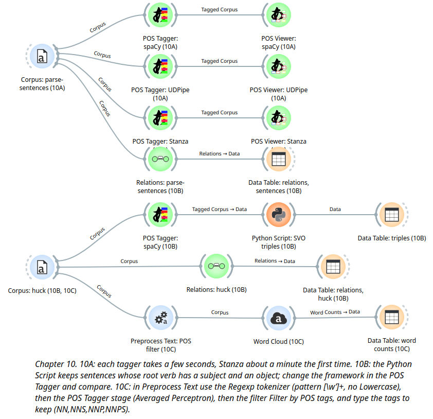
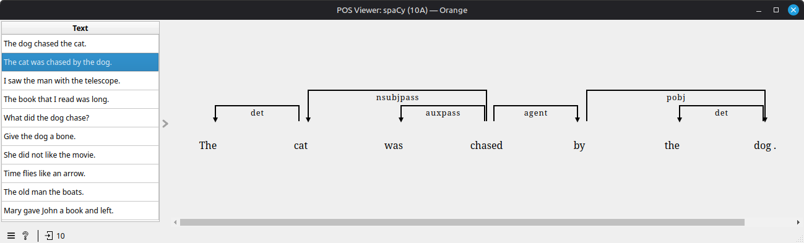
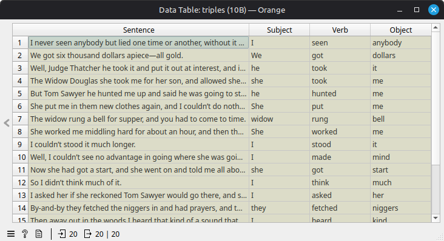
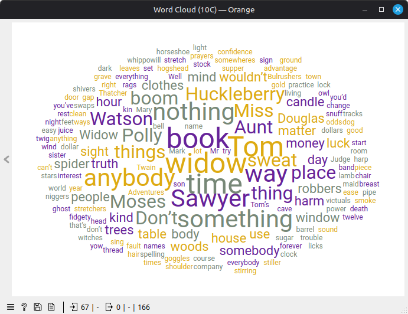

# Chapter 10: Part-of-Speech Tagging and Dependency Parsing

## Learning Objectives

By the end of this chapter, you will be able to:

- Explain what a part-of-speech tag and a dependency parse are, and what a bag of words throws away.
- Read a dependency tree: the root, the heads, and the labels such as subject and object.
- Compare three parsers (spaCy, UDPipe, Stanza) on the same sentences, and say which choices they make differently.
- Extract subject-verb-object triples from parsed text, and judge how reliable they are.
- Use part-of-speech tags to filter words in *Preprocess Text*, with the right tag set.

---

## 10.1 What a Bag of Words Cannot See

The models of Chapters 4 to 6 treat a document as a bag of words. *The dog chased the cat* and *The cat chased the dog* have the same bag, but they do not mean the same thing. Who did what to whom is carried by the **structure** of the sentence, and two tools recover it:

- **Part-of-speech (POS) tagging** gives every word a grammatical category: noun, verb, adjective, and so on.
- **Dependency parsing** connects the words in a tree. Each word depends on one other word, its **head**, and the connection has a label such as *subject* or *object*.

Both are steps you can build on: filter a corpus to nouns, find who is doing what in a news story, or pick out the adjectives that describe a character.

---

## 10.2 Part-of-Speech Tags

Tags come in two sizes. The **universal** tag set has about 17 coarse categories. The **Penn Treebank** set, the older English standard, has about 45 finer ones.

| Universal | Penn | Meaning | Example |
|-----------|------|---------|---------|
| NOUN | NN, NNS | common noun (singular, plural) | `dog`, `dogs` |
| PROPN | NNP, NNPS | proper noun | `Tom`, `Sawyer` |
| VERB | VB, VBD, VBG, VBN, VBP, VBZ | verb (base, past, -ing, participle, present) | `chase`, `chased` |
| ADJ | JJ, JJR, JJS | adjective | `old`, `older` |
| ADV | RB | adverb | `quickly` |
| DET | DT | determiner | `the`, `a` |
| ADP | IN | preposition | `on`, `with` |
| PRON | PRP | pronoun | `she`, `me` |

The *POS Tagger* widget stores **both** versions for every word (`pos` is universal, `tag` is Penn). The taggers inside *Preprocess Text* produce only Penn tags. Keep this in mind in 10C.

---

## 10.3 Dependency Trees

In the tree for *The dog chased the cat*:

- **chased** is the **root**: the word everything else hangs from.
- **dog** is the subject (`nsubj`) of *chased*, and **cat** is its object (`dobj` or `obj`).
- **The** is a determiner (`det`) of the word it modifies.

The **head** of a word is the word it points to, and the label says what kind of connection it is. The root has no head.

Parsers do not agree on the names. spaCy follows an older English scheme and UDPipe and Stanza follow **Universal Dependencies** (UD), so the same relation gets different labels:

| Relation | spaCy | UDPipe and Stanza |
|----------|-------|-------------------|
| direct object | `dobj` | `obj` |
| indirect object (*Give **the dog** a bone*) | `dative` | `iobj` |
| passive subject | `nsubjpass` | `nsubj:pass` |
| preposition | `prep` | `case` |
| object of a preposition | `pobj` | `obl` or `nmod` |
| negation (*not*) | `neg` | `advmod` |
| relative clause | `relcl` | `acl:relcl` |

> ⚠️ **Check the label names before you write a rule.** A rule that looks for `dobj` finds nothing with UDPipe or Stanza.

---

## 10.4 The Widgets

| Widget | What it does |
|--------|--------------|
| **POS Tagger** | Tags and parses every document with spaCy, Stanza, or UDPipe, and adds one text column, `POS Tags`, with the word, lemma, universal tag, Penn tag, label, and head of every word. It reads the raw text, not the output of *Preprocess Text*. |
| **POS Viewer** | Draws the dependency tree of the selected document. It lists only the first 30 documents of its input, and it uses the first text feature of the corpus. |
| **Rule-based Entity-Relationship Extraction** | Finds subject-verb-object relations with spaCy and outputs a table of `subject`, `verb`, `object`, and `sentence`. |
| **Preprocess Text** | Its **POS Tagger** stage tags the tokens and its **POS tags** filter keeps only the tokens with the tags you type. |
| **Python Script** | Lets you read the `POS Tags` column yourself. 10B uses it to compare the three parsers. |

How fast are the parsers? On the 67 sentences of `huck.tab` we measured about 1 second for spaCy, 2 seconds for UDPipe, and almost 2 minutes for Stanza, which loads several models. The first run of each also downloads its model.

---

## Lab Exercise 10A: Read the Trees

**Goal**: Read dependency trees, and see where three parsers disagree.

**Dataset**: `parse-sentences.tab`, 10 short sentences that we chose for their difficulty. The text feature is `Sentence`, and the `Feature` column names the difficulty.

**Steps**:

1. Load `parse-sentences.tab` with *Corpus*.
2. Add three *POS Tagger* widgets to it, one for each framework (spaCy, UDPipe, Stanza), and connect each to its own *POS Viewer*.
3. In each viewer, select a sentence in the list on the left and look at the tree.
4. Go through the ten sentences and note the root and the main labels.





**What to expect.** All three parsers agree on the easy sentences. For *The dog chased the cat.* every parser makes **chased** the root, **dog** its `nsubj`, and **cat** its object (`dobj` in spaCy, `obj` in UDPipe and Stanza). They differ where the sentence is harder:

| Sentence | What happens |
|----------|--------------|
| *The cat was chased by the dog.* (passive) | All three find `cat` as the passive subject. The agent *dog* is `pobj` for spaCy, `obl` for UDPipe, and `obl:agent` for Stanza. |
| *I saw the man with the telescope.* | Who has the telescope? spaCy and UDPipe attach it to *man*. Stanza attaches *telescope* to *saw*. The sentence is truly ambiguous, and a parser has to choose. |
| *The book that I read was long.* | spaCy makes **was** the root, and UDPipe and Stanza make **long** the root, with *was* as a copula (`cop`). Both are valid analyses under their schemes. |
| *What did the dog chase?* (question) | spaCy tags *chase* as a noun (`NN`) and makes it the root, with *dog* as a `compound` of it. UDPipe makes *did* the root. Only Stanza tags *chase* as a verb (`VB`) with *dog* as its `nsubj`. |
| *The old man the boats.* (garden path) | The sentence means that the old people operate the boats. All three parsers read *man* as a noun and the root, and *boats* as an appositive or vocative. All three fail. |
| *Mary gave John a book and left.* | UDPipe and Stanza tag *left* as a verb (`VBD`). spaCy tags it as an adjective (`JJ`). |

**Questions**:

- What is the root of each sentence? Is it always a verb?
- *Time flies like an arrow.* has another reading in which *time flies* are insects. Which reading do the parsers choose? Can they choose the other?
- In *Give the dog a bone*, which word is the indirect object? What label do spaCy and UDPipe give it?
- Which parser would you trust for questions? How would you check on more questions than one?
- Why can a parser be wrong on *The old man the boats*, while a person understands it after a moment's thought?

---

## Lab Exercise 10B: Subject-Verb-Object Triples

**Goal**: Extract who-did-what triples from text, and judge how reliable they are.

**Dataset**: `huck.tab`, 67 sentences from the first chapter of *Adventures of Huckleberry Finn*. The text feature is `Sentence`.

**Steps**:

1. Connect `parse-sentences.tab` to a *Rule-based Entity-Relationship Extraction* widget and a *Data Table*. Compare the triples with the trees from 10A.
2. Load `huck.tab` with a second *Corpus*, connect it to the same extraction widget, and look at the `subject`, `verb`, and `object` columns.
3. Connect `huck.tab` to a *POS Tagger* and then to a *Python Script* widget with the script below. It takes the root verb of each sentence and keeps the sentence if the verb has both a subject and an object. Run it with each of the three frameworks and note the number of triples.

```python
import json
from Orange.data import Domain, StringVariable, Table

tags = in_data.domain["POS Tags"]
sentence = in_data.domain.metas[0]
rows = []
for doc in in_data:
    tokens = json.loads(str(doc[tags]))
    for i, t in enumerate(tokens):
        if t["dep"].lower() != "root":
            continue
        children = lambda labels: [tokens[j]["text"] for j, u in enumerate(tokens)
                                   if j + u["head"] == i and j != i and u["dep"] in labels]
        subject = children(("nsubj", "nsubj:pass", "nsubjpass"))
        obj = children(("dobj", "obj"))
        if subject and obj:
            rows.append([str(doc[sentence]), subject[0], t["text"], obj[0]])

domain = Domain([], metas=[StringVariable(n) for n in ("Sentence", "Subject", "Verb", "Object")])
out_data = Table.from_list(domain, rows)
```



**What to expect.**

- On the ten test sentences the extraction widget finds 8 relations in 7 sentences. For *The cat was chased by the dog* it turns the passive around and gives (the dog, chase, the cat). For *Mary gave John a book* it gives two triples, (mary, give, john) and (mary, give, a book). For *Time flies like an arrow* it gives (time, fly_like, an arrow). It also gives (i, see, the man with the telescope), so the ambiguity of 10A is built into the answer. For *The book that I read was long* it gives (i, read, that), and the pronoun *that* tells you little.
- On `huck.tab` the widget finds 100 relations in 45 of the 67 sentences. The most common subjects are *i* (32) and *she* (21). Several triples are good, such as (we, get, six thousand dollars) and (he, tell, the truth). Others are not: (the name of the adventures of tom sawyer, read, a book) is wrong, because the book was read by *you*, and (that, ai, no matter) comes from Huck's *ain't*.
- The Python Script keeps only one triple per root verb. Of the 67 sentences it finds triples in **20** with spaCy, **22** with UDPipe, and **23** with Stanza. The three overlap a lot. Disagreements are informative: in *The Widow Douglas she took me for her son* spaCy takes *she* as the subject, UDPipe takes *Douglas*, and Stanza takes *Widow*.

**Questions**:

- In how many of the 67 sentences does the extraction widget find no triple at all? Read five of them. Why are there none? (Look for *is*, *was*, and sentences with no direct object.)
- Look at the most common subjects. Why is *i* more useful as a clue to the narrator than as a fact? What would you need to turn *she* into a name?
- Find three wrong triples. For each, is the error in the parse or in the rule?
- The rules ignore *is* and *was* as verbs. What is lost? (Hint: *Aunt Polly is a ...*.)
- Huck's English is not standard (*I never seen anybody*, *There was things*). How might that change the parsers' accuracy?

---

## Lab Exercise 10C: Filter Words by Part of Speech

**Goal**: Use POS tags to ask a question a plain word count cannot: which nouns, verbs, or adjectives dominate a text?

**Steps**:

1. Connect the `huck.tab` *Corpus* to a *Preprocess Text* widget. Use the **Regexp** tokenizer with the pattern `[\w’]+` (it keeps contractions such as *couldn’t*), and untick Lowercase and Stopwords.
2. Add the **POS Tagger** stage (Averaged Perceptron) and then the **POS tags** filter. Look at the default text in the filter box.
3. Replace it with `NN,NNS,NNP,NNPS`. Connect *Preprocess Text* to a *Word Cloud*, and connect its *Word Counts* output to a *Data Table*. Note the top words.
4. Change the filter to the verb tags `VB,VBD,VBG,VBN,VBP,VBZ`, and then to the adjective tags `JJ,JJR,JJS`.
5. Tick Lowercase, and look at the nouns again.



**What to expect.** Without the filter the corpus has 1,434 tokens and 460 different words. The most frequent are *and* (82), *I* (61), *the* (52), and *a* (43).

| Filter | Tokens | Different words | Most frequent |
|--------|-------:|----------------:|---------------|
| none | 1,434 | 460 | and, I, the, a |
| `NOUN,VERB` (the default) | **0** | **0** | nothing |
| nouns `NN,NNS,NNP,NNPS` | 254 | 166 | widow (9), book (7), time (6), Tom (5), Sawyer, nothing, anybody, way (4) |
| verbs `VB,VBD,VBG,VBN,VBP,VBZ` | 299 | 140 | was (39), said (11), got (10), go (9), is (8), had (8) |
| adjectives `JJ,JJR,JJS` | 62 | 44 | dead, good, bad (4), old (3), awful, little (2) |

> ⚠️ **The default filter text empties the corpus.** `NOUN,VERB` are universal tags, and the tagger in *Preprocess Text* produces Penn tags. No token matches, so every document has no tokens. Type Penn tags.

With Lowercase ticked, the nouns list changes: *i* becomes the most common "noun" (41 times), because the tagger no longer recognizes the pronoun *I* and tags the lowercase *i* as a noun. Taggers use capitals as a clue. **Tag before you lowercase**, or leave Lowercase off.

**Questions**:

- The nouns show what the text is about, and the verbs show what happens in it. Which list tells you more about this chapter of the novel? What does *was* at the top of the verbs say about the style?
- The adjectives are only 62 tokens. What can you conclude from such a small sample? What would you do with a whole novel?
- Why does the order of the stages matter: Lowercase, then tag, then filter?
- When would you filter to nouns before you build a topic model (Chapter 5)? What would you lose?

> 📝 **Reflection:** The parser told you that *Tom* is the subject of a sentence, and the NER widget of Chapter 8 told you that *Tom* is a person. Which questions do you need each one for? Which would you use to ask "who does what in this novel"?

---

## Comprehension Questions

1. What can a dependency parse tell you that a bag of words cannot? Give an example sentence.
2. What is the root of a dependency tree, and is it always a verb?
3. Why can the same relation have different labels (`dobj` and `obj`) in two parsers? What must you check before you write a rule that uses a label?
4. Why is the tag list `NOUN,VERB` wrong for the *Preprocess Text* filter, and what do you type instead?
5. Why is a triple like (the dog, chase, the cat) not enough to know whether the text says that the dog chased the cat?
6. *I saw the man with the telescope* has two readings. How would a parser choose one, and what would you do if the choice mattered?

---

## Key Terms

- Part-of-speech (POS) tagging, universal tags, Penn Treebank tags
- Dependency parsing, head, root, dependency label
- Subject, object, passive, copula
- Universal Dependencies
- Subject-verb-object (SVO) triple
- Garden-path sentence

---

## Notes

- Save your workflow as `dependency-parsing.ows`.
- *POS Tagger* downloads its model the first time you use a framework, so keep an internet connection for that first run. Stanza is slow to start.
- Chapter 11 moves from structure to meaning with embeddings.
