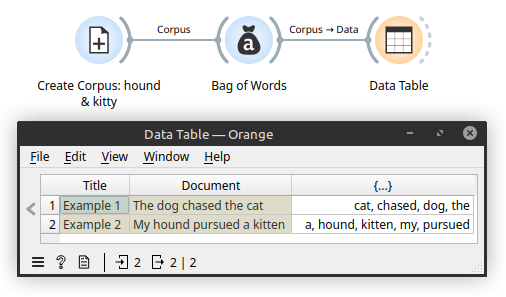
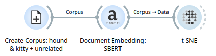
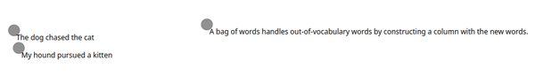
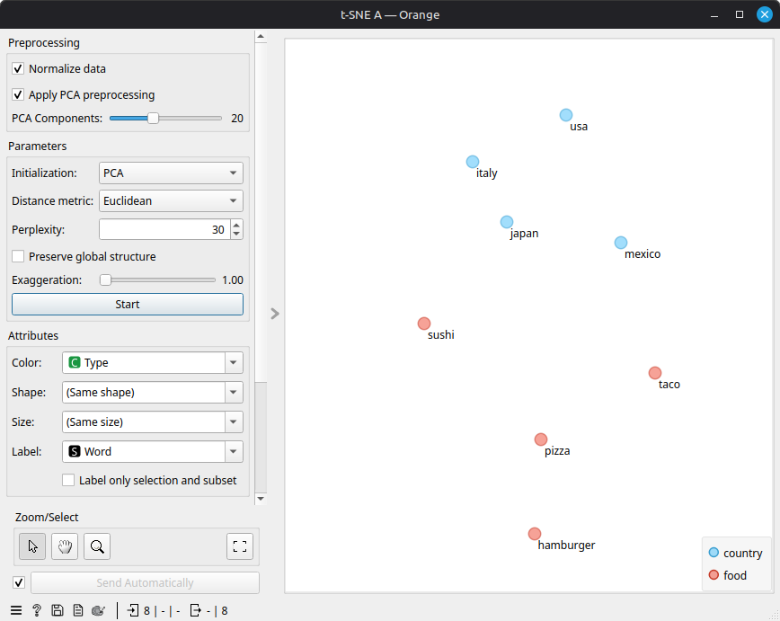
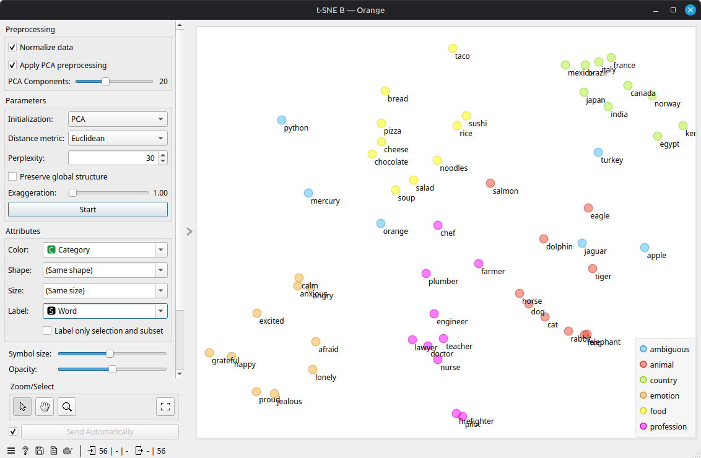
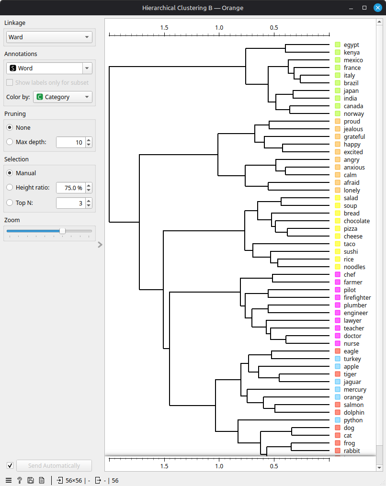
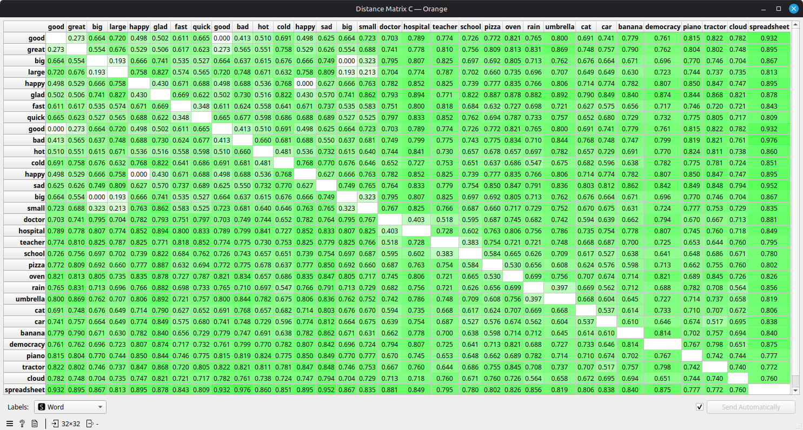
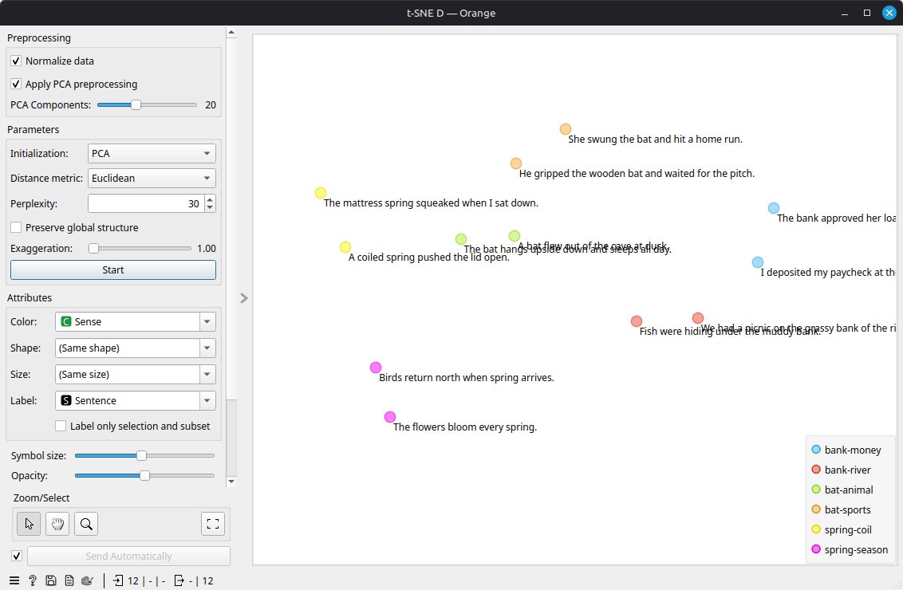
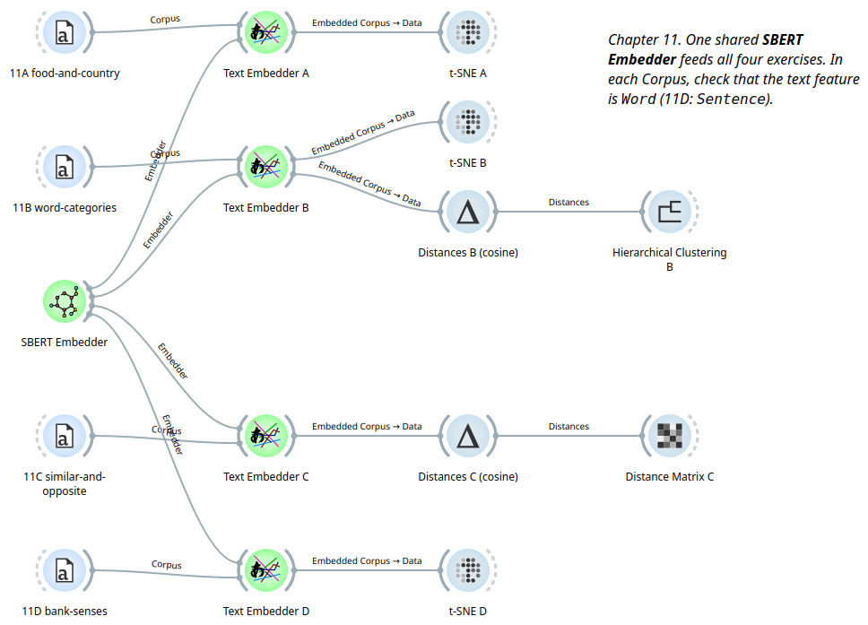

# Chapter 11: Embeddings: Meaning as Position

## Learning Objectives

By the end of this chapter, you will be able to:

- Explain why counting words cannot capture what words mean.
- Describe an embedding as a point in space, where nearby points have similar meanings.
- Embed a small set of words or short sentences in Orange and read the resulting map of clusters and outliers.
- Measure how close two embeddings are using distance.
- Recognize the limits of embeddings: they depend on the model, they can place opposites close together, and they struggle with words that have more than one meaning.

---

## 11.1 Why Counting Words Is Not Enough

In earlier chapters we turned text into numbers by counting words (Bag of Words and TF-IDF). Counting works surprisingly well for sorting news into categories, but it has a blind spot: to a counting model, every word is an unrelated symbol.

Consider two sentences that mean the same thing:

> The dog chased the cat.
> My hound pursued a kitten.

They share no content words, so a bag of words sees them as having nothing in common. The model has no way to know that *dog* and *hound* are nearly the same thing.

Counting also creates very wide, mostly empty tables: one column for every word in the vocabulary, almost all zeros.

> 🧠 **Think of it this way:** a bag of words is like a filing cabinet with one drawer per word. Nothing tells you that the "dog" drawer and the "hound" drawer belong near each other.

---

## 11.2 What Is an Embedding?

An **embedding** replaces each piece of text with a short list of numbers, called a **vector**. You can think of those numbers as coordinates that place the text on a map. The key property is:

> **Texts with similar meanings get nearby positions on the map.**

A real map needs two numbers (latitude and longitude). The embedding model we use, SBERT (`all-MiniLM-L6-v2`), uses 384 numbers per text. In Orange these appear as columns named `emb_0`, `emb_1`, ... `emb_383`. We cannot draw 384 dimensions, so we will squeeze them down to two later in the chapter.

### Where do the numbers come from?

Embedding models are trained on enormous amounts of text. They learn from a simple idea: *words that appear in similar contexts have similar meanings.* "Dog" and "hound" show up near words like *barked*, *leash*, and *tail*, so the model gives them similar vectors. Nobody tells the model what a dog is.

### Words, sentences, and documents

- **Word embeddings** (such as Word2Vec and GloVe) give each word one fixed position, no matter how it is used.
- **Sentence embeddings** (such as SBERT) read a whole sentence and produce a position that depends on the context of every word.

This chapter focuses on small pieces of text: single words and short sentences. Chapter 12 scales up to paragraphs and whole documents.

After embedding a third, unrelated sentence, the two related sentences land close together and the unrelated one lands far away:

---

## 11.3 Reading the Map

### Squeezing 384 dimensions into 2

To look at embeddings, we use **t-SNE**, a method that projects the high-dimensional vectors onto a flat plot while trying to keep neighbors together. Keep three cautions in mind:

- **Nearby points are meaningful; far-apart points are less so.** t-SNE preserves local neighborhoods well but can distort the distances between distant groups.
- **The axes mean nothing.** "Left" and "up" are not meanings.
- **Results can change between runs.** Rerunning t-SNE can rotate or rearrange the picture. Look for which items stay together, not for exact positions.

### Measuring "close"

To measure closeness without a picture, we compare the vectors directly. **Cosine distance** compares the *direction* the two vectors point:

- distance **0** means the vectors point the same way (very similar meaning)
- distance near **1** means they are unrelated
- cosine distance = 1 − cosine similarity

Orange's *Distances* widget calculates this for every pair of items when you choose **Cosine**.

---

## 11.4 Embedding Text in Orange

These widgets work together:

| Widget | What it does |
|--------|--------------|
| **Corpus** | Loads a dataset and lets you choose which column is the text to embed. |
| **SBERT Embedder** | Provides the SBERT model. It does not embed anything by itself; it hands the model to *Text Embedder*. The model downloads the first time you use it. |
| **Text Embedder** | Applies the connected model to every row and adds the `emb_*` columns. |
| **t-SNE** | Squeezes the vectors down to two dimensions for plotting. |
| **Distances** | Calculates distances between rows (choose Cosine). |
| **Hierarchical Clustering** | Groups rows by distance and draws a tree (dendrogram). |

The wiring is always the same: *Corpus* → *Text Embedder* ← *SBERT Embedder*, then *Text Embedder* → *t-SNE*.

> 💡 The datasets in this chapter are small on purpose, so you can look at every point and explain why it landed where it did.

---

## 11.5 The Limits of Embeddings

Embeddings feel like magic, so it is important to know where they fail.

1. **They depend on the model and its training data.** A different model gives a different map, and even the size of the "close" numbers changes from model to model. Compare *rankings* (which items are nearest), not absolute numbers.
2. **Opposites can land close together.** *Good* and *bad* are opposites, yet they appear in the same kinds of sentences ("The food was ___"), so the model places them near each other. Embeddings capture *relatedness* and *topic*, not necessarily *agreement*.
3. **Words with several meanings are ambiguous.** The word *bank* can mean a place for money or the side of a river. A single word on its own has only one position, so it cannot choose. Sentence models help by using context: "I deposited money at the bank" and "We picnicked on the river bank" land in different places. The separation is real but not perfect.
4. **They reflect the text they were trained on,** including its gaps and biases.

---

## Lab Exercise 11A: A First Map

**Goal**: See whether embeddings place related words together.

**Dataset**: `food-and-country.tab` (4 foods and 4 countries).

| Type | Word |
|------|------|
| food | pizza |
| food | sushi |
| food | taco |
| food | hamburger |
| country | italy |
| country | japan |
| country | mexico |
| country | usa |

**Steps**:

1. Use *Corpus* to load `food-and-country.tab`. Make sure `Word` is the text feature.
2. Add *Text Embedder* and connect the corpus to it.
3. Add an *SBERT Embedder* and connect it to the *Embedder* input of *Text Embedder*.
4. Connect *Text Embedder* to *t-SNE*. Color the points by `Type` and show the `Word` as labels.

**Questions**:

- Do foods and countries form separate groups?
- Pizza and Italy go together in your mind. Are they close on the map? What does that tell you about what the model means by "similar"?
- Rerun t-SNE. What stayed the same? What changed?

---

## Lab Exercise 11B: Group Words by Category

**Goal**: Use embeddings to find groups in a bigger set of words, and notice the words that do not fit.

**Dataset**: `word-categories.tab` (56 words: animals, professions, emotions, foods, and countries, plus six words in a group called `ambiguous`: *apple, turkey, jaguar, python, orange, mercury*).

**Steps**:

1. Build the same *Corpus* → *Text Embedder* ← *SBERT Embedder* → *t-SNE* workflow, with `Word` as the text. Color by `Category`.
2. Add *Distances* after *Text Embedder* (set the metric to **Cosine**, compare **rows**).
3. Connect *Distances* to *Hierarchical Clustering*. Show `Word` as the label and color by `Category`.

**Questions**:

- Which categories form the tightest groups? Which are loosest?
- Where did the six `ambiguous` words go? Explain each one. Why did *turkey* end up near the countries?
- Do the t-SNE picture and the dendrogram agree about which words belong together?

> 📝 **Optional**: Cut the dendrogram into 5 clusters. How well do they match the 5 real categories?

---

## Lab Exercise 11C: How Close Is "Close"?

**Goal**: Measure distances and compare synonyms, opposites, related words, and unrelated words.

**Dataset**: `similar-and-opposite.tab` (16 word pairs, two rows per pair). The `Relation` column tells you whether a pair is a `synonym`, `antonym`, `related`, or `unrelated`.

**Steps**:

1. Embed the `Word` column as before and send the result to *Distances* (**Cosine**, rows).
2. Open the result in a *Distance Matrix* widget.
3. Look up the distance for at least two pairs from each `Relation` (for example *good/great*, *good/bad*, *doctor/hospital*, *cat/car*). Record them in a table.

**Questions**:

- Which type of pair is closest on average? Which is farthest?
- Are opposites (*good/bad*) closer or farther than words that are merely related (*doctor/hospital*)?
- Why might a model treat opposites as similar? (Hint: think about where each word appears in sentences.)

---

## Lab Exercise 11D: One Word, Two Meanings

**Goal**: See how context helps, and where it does not.

**Dataset**: `bank-senses.tab` (12 sentences using *bank*, *bat*, and *spring*, with two meanings each). The `Sense` column gives the meaning, such as `bank-money` or `bank-river`.

**Steps**:

1. Embed the `Sentence` column with *SBERT Embedder* and *Text Embedder*.
2. Send the result to *t-SNE*. Color by `Sense` and label points with the sentence.

**Questions**:

- Do the two meanings of *bank* separate? What about *spring*?
- Is *bat* as clearly separated as *bank*? What could make it harder?
- Write one more pair of sentences with an ambiguous word of your own. Predict where they will land, then test it.

> 📝 **Reflection:** If a single word has only one position, but a sentence gets a position that depends on context, why is that an advantage? What would you lose if you embedded only single words?

---

## Comprehension Questions

1. What does it mean when two texts are "close" in embedding space?
2. How is an embedding different from a bag-of-words count vector?
3. Why might *good* and *bad* appear near each other on a map?
4. Why should you not trust the exact distances between far-apart groups on a t-SNE plot?
5. Why is the word *bank* a problem for word-level embeddings, and how do sentence-level embeddings help?
6. Name one practical task where embeddings help, and one where you would still use bag of words.

---

## Key Terms

- Embedding
- Vector
- Embedding space
- Semantic similarity
- Cosine distance
- t-SNE
- Static vs. contextual embeddings
- Ambiguity (polysemy)

---

## Notes

- Save your workflow as `word-embeddings.ows`.
- Chapter 12 scales up from words and short sentences to paragraphs and whole documents, and compares embedding models.
