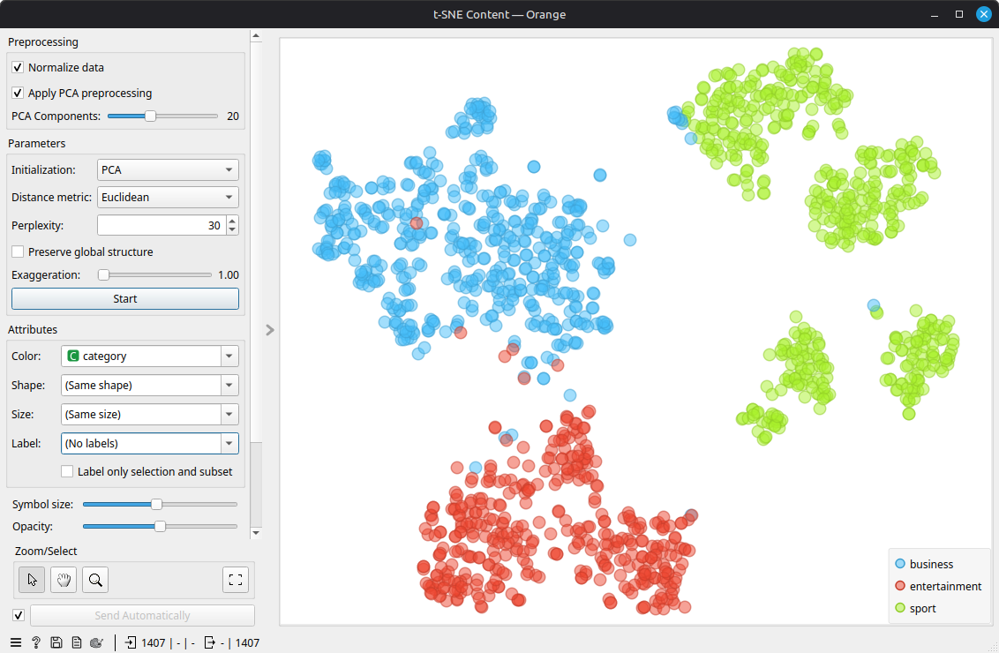
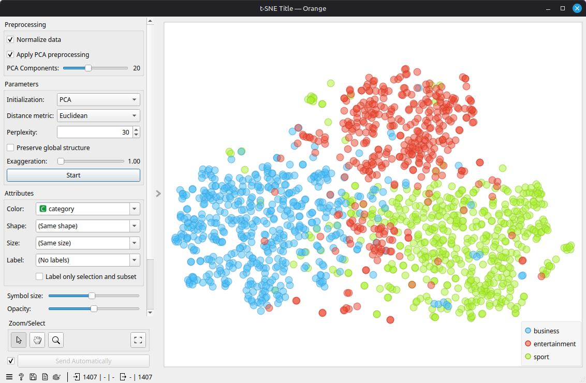
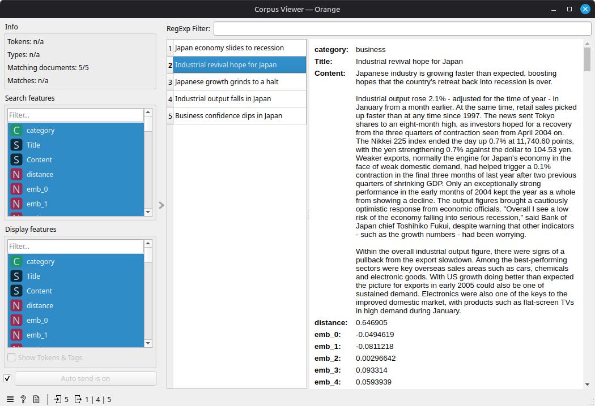
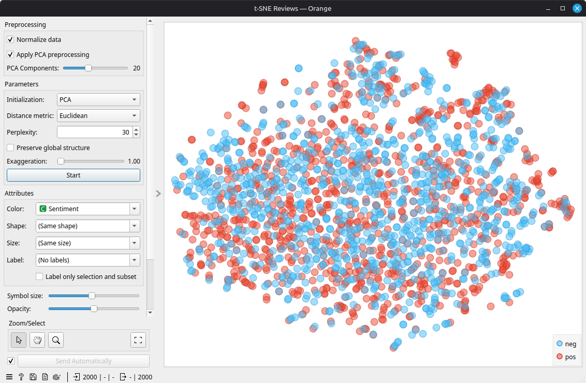
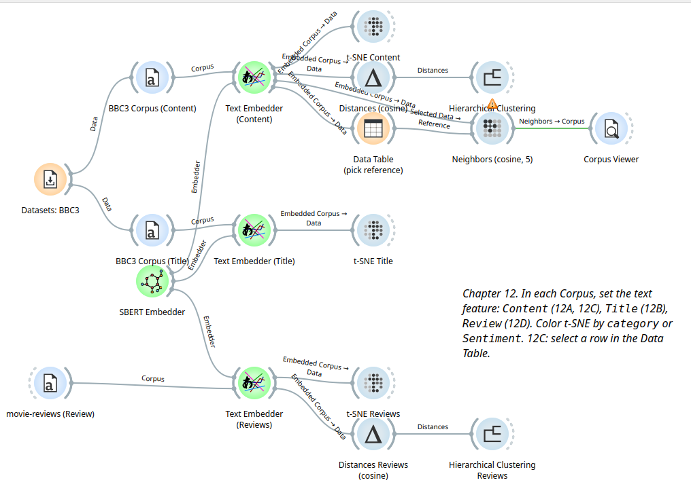

# Chapter 12: Document Embeddings: Clustering and Finding Similar Texts

## Learning Objectives

By the end of this chapter, you will be able to:

- Explain how a model turns a whole paragraph or article into a single vector, and why long texts are a problem.
- Embed a real corpus in Orange and use t-SNE and hierarchical clustering to find groups of similar documents.
- Check clusters against known labels, and explain why clusters are not always the labels you expected.
- Find the documents most similar to a chosen document.
- Choose an embedding model for a task by weighing quality, speed, cost, and privacy.

---

## 12.1 From Sentences to Documents

Chapter 11 embedded words and short sentences, which we could inspect one by one. Real projects use **documents**: news articles, reviews, tickets, transcripts. A document embedding is the same idea at a larger scale: **one document becomes one vector**, and documents with similar content get nearby positions.

That gives us two jobs a bag of words does poorly:

- **Clustering**: group documents with no labels given, then see whether the groups make sense.
- **Similarity search**: given one document, find the others closest to it, even when they share few words.

We will use two corpora:

| Corpus | Documents | Labels we know |
|--------|-----------|----------------|
| **BBC3** | 1,407 BBC news articles (2004-05), about 320 words each on average | `category`: business (510), entertainment (386), sport (511) |
| **movie-reviews** | 2,000 movie reviews | `Sentiment`: pos or neg |

The labels are not given to the embedding. We use them afterwards, to check whether the embedding grouped the documents the way a person would.

> 💡 BBC3 is downloaded from Orange's *Datasets* widget (core/BBC3). It is licensed for non-commercial research use, so it is not included with this book.

---

## 12.2 How a Document Becomes One Vector

### Pooling: averaging

The simplest method gives every word a vector and averages them. This is called **pooling**. With toy two-number vectors:

| Word | Vector |
|------|--------|
| stocks | (0.9, 0.1) |
| fell | (0.2, 0.3) |
| sharply | (0.1, 0.2) |
| **average** | **(0.4, 0.2)** |

The document now has one vector, no matter how long it is. The cost is that word order and context are lost: *dog bites man* and *man bites dog* get the same average. Orange's *spaCy Embedder* and *FastText Embedder* work this way.

### Sentence models read the whole text

Models such as **SBERT** do not average fixed word vectors. They read the entire input, so each word's contribution depends on its neighbors, and then they pool internally. This is why Chapter 11's *bank* sentences separated by meaning.

### The length limit

Every model reads only a fixed number of word pieces and **ignores the rest**. SBERT (`all-MiniLM-L6-v2`) reads 256 pieces, roughly the first 190 words. A BBC article averages about 320 words, so the vector describes mostly the *beginning* of the article. For news, that is usually fine, because the opening paragraph states the topic. For a long report, a book, or a review whose verdict is at the end, it is a real limit. Two common remedies:

- Split the document into chunks, embed each chunk, and compare chunks (the *Text Chunker* widget does the splitting).
- Choose a model that accepts longer inputs (see section 12.5).

---

## 12.3 Embedding a Corpus in Orange

The workflow is the one from Chapter 11, plus three widgets for exploring the result.

| Widget | What it does |
|--------|--------------|
| **Datasets** | Downloads BBC3 and sends it to *Corpus*. |
| **Corpus** | Holds the documents; choose which column is the text to embed. |
| **SBERT Embedder** + **Text Embedder** | Adds the `emb_*` columns, as in Chapter 11. |
| **t-SNE** | Draws the documents on a 2D map. |
| **Distances** + **Hierarchical Clustering** | Groups documents by cosine distance and draws a dendrogram. |
| **Neighbors** | Finds the documents closest to a chosen reference document. |
| **Corpus Viewer** / **Data Table** | Lets you read the documents behind the points. |

> 💡 With 1,407 articles, embedding takes noticeably longer than the small datasets in Chapter 11. Wait for the widget to finish before you open t-SNE.

---

## 12.4 Clusters Are Not Labels

Clustering finds groups of *similar* documents. Whether those groups equal the labels depends on what the embedding captures. If the labels are topics, a good embedding recovers them. If the labels are something else, such as the writer's opinion, it may not. Keep these cautions in mind:

- **Color by the label, not by the cluster.** If the colors separate on the map, the embedding captured that label.
- **A mixed cluster is information.** Open the documents and ask what they have in common before blaming the model.
- **Compare against a baseline.** A bag-of-words representation is the honest comparison for "did embeddings help?".

---

## Lab Exercise 12A: News Topics on a Map

**Goal**: See whether embeddings recover known news categories without being told about them.

**Dataset**: BBC3 (1,407 articles in 3 categories).

**Steps**:

1. Add a *Datasets* widget and download **BBC3** (under *core*). Connect it to a *Corpus* widget. By default *Corpus* uses both `Title` and `Content` as text, joined together. In **Used text features**, drag `Title` out so that only `Content` remains.
2. Connect *Corpus* to *Text Embedder*, and an *SBERT Embedder* to the *Embedder* input of *Text Embedder*.
3. Connect *Text Embedder* to *t-SNE*. Color by `category`.
4. Select a few points that sit between two groups and read them in a *Corpus Viewer*.

**Questions**:

- How cleanly do the three categories separate? Which two are closest?
- Find articles that landed among the wrong color. Why might the model have put them there? (Hint: read the text.)
- The model was never shown the `category` column. What does that tell you about what the vectors contain?

---

## Lab Exercise 12B: Headlines or Full Articles?

**Goal**: Compare how much text the model needs.

**Steps**:

1. Reuse the 12A workflow. Connect *Datasets* to a second *Corpus* widget and keep only `Title` in **Used text features** (drag `Content` out). Connect it to a second *Text Embedder* (using the same *SBERT Embedder*) and a second *t-SNE*.
2. Compare the two t-SNE maps, both colored by `category`.
3. Optional: add *Distances* (**Cosine**, rows) and *Hierarchical Clustering* to each chain and cut the tree into 3 clusters. Which version's clusters match the categories better?

**Questions**:

- Are headlines as separable as full articles? Which categories are harder from a headline alone?
- Look at a headline that landed in the wrong group. What would a person need to know to place it?
- Article embeddings only use the first ~190 words. Why did that still work for news?

---

## Lab Exercise 12C: Find Similar Articles

**Goal**: Use distance to retrieve the documents closest to one you pick.

**Steps**:

1. From the 12A workflow, connect *Text Embedder* to a *Neighbors* widget as **Data**. Set the distance to **Cosine** and the number of neighbors to 5.
2. Connect *Text Embedder* to a *Data Table*. Select one article (for example, a business story about a company) and connect the *Data Table* output to the **Reference** input of *Neighbors*. Until you select a row, *Data Table* sends *every* row, and *Neighbors* shows the warning "Every data instance is same as some reference". Selecting one row clears it, and *Neighbors* then shows an information note ("Input data includes reference instance(s)"). That note is expected: the reference article comes from the same data, so *Neighbors* leaves it out of its own results.
3. View the *Neighbors* output in a *Corpus Viewer* or *Data Table*.
4. Repeat with an entertainment article and a sport article.

**Questions**:

- Are the five neighbors about the same story, the same topic, or merely the same category?
- Do the neighbors share many words with the reference, or do they match in meaning with different words?
- Would a person agree with the ranking? Where would they disagree?

---

## Lab Exercise 12D: When Clusters Are Not the Labels

**Goal**: Discover that embeddings group by topic, not by whatever label you care about.

**Dataset**: `movie-reviews.tab` (2,000 reviews; `Sentiment` is `pos` or `neg`).

**Steps**:

1. Load `movie-reviews.tab` with *Corpus* (the text feature is `Review`) and embed it as before.
2. Connect to *t-SNE*. Color by `Sentiment`.
3. Add *Distances* (**Cosine**) and *Hierarchical Clustering*. Color by `Sentiment`.
4. Select a few tight groups on the t-SNE map and read their reviews in a *Corpus Viewer*.

**Questions**:

- Do positive and negative reviews separate? Compare with BBC3.
- Read the reviews in one tight group. What do they share, if not their sentiment?
- Reviews are longer than the model's limit, and a verdict often comes at the end. How might that matter here?
- Optional: if you build a classifier on these embeddings with *Test and Score*, how does it compare with one built on a bag of words? What does that say about when an embedding helps?

> 📝 **Reflection:** In 12A the labels were topics, and the embedding recovered them. In 12D the labels were opinions, and it did not. How would you decide, before you start, whether an embedding is the right tool for a task?

---

## 12.5 Choosing an Embedding Model

Orange's NLP add-on offers several embedders. They plug into *Text Embedder* the same way, so you can swap one for another and compare the maps.

| Embedder | Runs where | Notes |
|----------|-----------|-------|
| **SBERT** | Locally | Fast, general purpose, small download. Reads 256 word pieces. Used in this book. |
| **Nomic** | Locally, through an Ollama server | Open model, good for search and clustering. Needs `nomic-embed-text` pulled in Ollama. |
| **E5** | Locally | Built for search. |
| **USE** | Locally | Google's general model; multilingual. |
| **spaCy** / **FastText** | Locally | Average word vectors; fast, ignore word order. |
| **Doc2Vec** | Locally | You can train it on your own corpus; weaker on short texts. |
| **OpenAI** / **Gemini** | Cloud API | High quality and longer inputs, but your text leaves your machine, and it costs money. |

Questions to ask when choosing:

1. **Privacy**: May this text be sent to a third party? If not, use a local model.
2. **Length**: Does the text exceed the model's limit? Chunk it or pick a longer-context model.
3. **Language**: Is the text English? Check that the model supports your language.
4. **Speed and size**: How many documents, and on what hardware?
5. **Evidence**: Try two models on a sample you can label, and look at the maps, as you did here.

---

## Comprehension Questions

1. How does averaging word vectors differ from what a sentence model like SBERT does?
2. A model reads only the first 256 word pieces. What kind of documents suffer most from that?
3. Why do we color the points by a label the embedding never saw?
4. BBC3 categories separate well but movie-review sentiment does not. Why?
5. Why is cosine distance a better fit for embeddings than counting shared words?
6. Name two situations in which you would not send documents to a cloud embedding service.

---

## Key Terms

- Document embedding
- Pooling (averaging)
- Context length (input limit)
- Chunking
- Clustering
- Dendrogram
- Cosine distance
- Nearest neighbors (similarity search)
- Baseline

---

## Notes

- Save your workflow as `document-embeddings.ows`.
- Chapter 13 moves from finding structure in documents to answering questions and generating text with language models.
