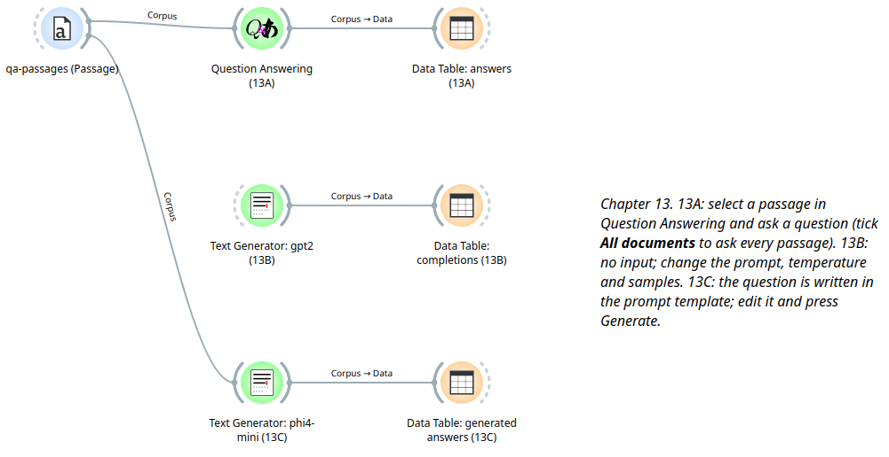
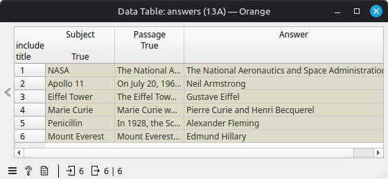
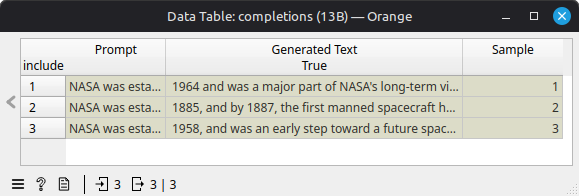
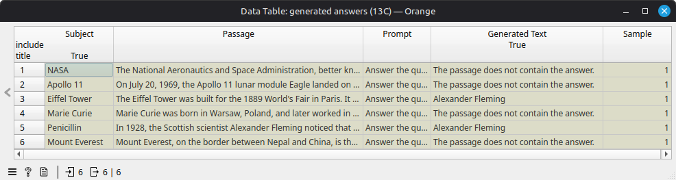

# Chapter 13: Question Answering and Text Generation

## Learning Objectives

By the end of this chapter, you will be able to:

- Explain the difference between extractive question answering (find the answer in a text) and generative question answering (write the answer).
- Use Orange's *Question Answering* widget to pull answers out of passages, and explain why it returns an answer even when the passage has none.
- Explain how a language model generates text one word at a time, and how temperature, a fixed seed, and several samples change the result.
- Use the *Text Generator* widget to continue a prompt, and to answer a question from a passage you supply.
- Recognize hallucination, and the difference between an answer that is correct and an answer that is grounded in your text.

---

## 13.1 Two Ways to Answer a Question

**Question answering (QA)** means giving a question and some text and getting back an answer. There are two very different ways to do it:

| | Extractive QA | Generative QA |
|---|---|---|
| **How it works** | Finds the span of words in the passage that answers the question | Writes a new answer, usually with a language model |
| **Example answer** | `1958` | `NASA was founded in 1958.` |
| **Where the answer comes from** | Always a piece of the passage | The passage, the model's memory, or both |
| **Can it say "I don't know"?** | Not unless it is built to | Yes, if you ask it to, but it may not |
| **Orange widget** | *Question Answering* | *Text Generator* |

Neither is better in every case. The rest of the chapter shows what each one does well and where each one goes wrong.

---

## 13.2 Extractive QA: Pointing at the Answer

An extractive model reads the question and the passage together. For every word in the passage it estimates how likely that word is to be the **start** of the answer and how likely it is to be the **end**, and it returns the best-scoring span.

Two consequences matter for everything that follows:

- **The answer is always words from the passage.** The model cannot paraphrase, add up numbers, or combine two sentences.
- **It always returns something.** The model was trained on questions whose answers were always present, so it never learned to refuse. If you ask a question the passage cannot answer, it still picks the best-looking span, often with high confidence.

The *Question Answering* widget downloads a Hugging Face model the first time you use it (at the time of writing, a DistilBERT model trained on the SQuAD question-answering dataset). It shows only the answer text, not a confidence score.

---

## 13.3 Text Generation: Autocomplete on a Large Scale

A **language model** is trained to predict the next word (more exactly, the next *token*, a word or part of a word) given the words so far. Generating text is just doing that repeatedly: predict a word, add it to the text, predict the next one.

At each step the model has a probability for every possible next word. Several settings decide how the next word is picked:

- **Temperature** controls how adventurous the choice is. At `0` the model always takes the single most likely word. Higher values give less likely words a chance, so the text becomes more varied and, eventually, less sensible.
- **Top-p** limits the choice to the most likely words that together cover that fraction of the probability.
- **Seed** is the starting point for the random choices. The same seed with the same settings gives the same text, so you can repeat an experiment.
- **Samples per prompt** generates the same prompt several times so you can see how much the answer varies.

Two kinds of model appear in this chapter:

- A **base model** such as `gpt2` only continues text. Give it `NASA was established in` and it writes what plausibly comes next, whether or not it is true.
- An **instruction-tuned model** such as `phi4-mini` was trained further to follow requests. Give it a question and it answers.

---

## 13.4 Generative QA and Hallucination

To make a generative model answer from *your* text, put the text in the prompt:

```
Answer the question using only the passage. If the passage does not contain the answer, say so.

Passage: <the passage>

Question: <the question>
Answer:
```

Telling the model to use only the passage is called **grounding**. It helps, but it is a request, not a rule. A language model also remembers what it saw in training, and it can:

- answer from memory when the passage is silent (the answer may be right, but it is not grounded in your text),
- make up a plausible answer when it has no memory of the topic either. Making things up is called **hallucination**.

With a passage you can check the answer. Without one, you cannot, which is why Chapter 15 retrieves relevant passages and puts them in the prompt automatically.

---

## 13.5 The Widgets

| Widget | What it does |
|--------|--------------|
| **Corpus** | Loads the passages. |
| **Question Answering** | Asks one question of one selected passage, or of all passages (**All documents**), and adds an `Answer` column. |
| **Text Generator** | Sends a prompt to Ollama or to a local Hugging Face model and returns the generated text as a corpus. |
| **Data Table** | Shows the answers or generations for all rows at once. |

The *Text Generator* has a **backend** (Ollama or Hugging Face), the settings from section 13.3, and a **prompt template**. With no input, the template is the prompt and it runs once. With a corpus connected, it runs once per passage, and `{Passage}` is replaced by that passage's text.

> 💡 Ollama must be running and `phi4-mini` must be pulled (`ollama pull phi4-mini`) before you start 13C. The first time you use `gpt2`, it is downloaded (about 0.5 GB).



---

## Lab Exercise 13A: Ask the Passage

**Goal**: Use extractive QA to find answers, then see what it does when there is no answer.

**Dataset**: `qa-passages.tab` (6 short passages: NASA, Apollo 11, the Eiffel Tower, Marie Curie, penicillin, and Mount Everest).

| Passage | Question | Answer in the passage |
|---------|----------|-----------------------|
| NASA | What year was NASA founded? | 1958 |
| Apollo 11 | Who was the first person to step onto the Moon? | Neil Armstrong |
| Eiffel Tower | Who designed the Eiffel Tower? | Gustave Eiffel |
| Marie Curie | When did Marie Curie win the Nobel Prize in Chemistry? | 1911 |
| Penicillin | Who discovered penicillin? | Alexander Fleming |
| Mount Everest | How tall is Mount Everest? | 8,849 meters |

**Steps**:

1. Load `qa-passages.tab` with *Corpus* (the text feature is `Passage`) and connect it to *Question Answering*.
2. Select the NASA passage, type its question, and press **Ask**. Repeat for each passage and its question.
3. Tick **All documents**, then ask `Who discovered penicillin?`. Connect the widget to a *Data Table* to see the `Answer` column for all six passages.
4. Ask `Who won the Nobel Prize in Literature?` of all documents.



**Questions**:

- Did each question get the right answer from its own passage?
- In step 3, what did the five passages that do not mention penicillin return? Does any answer tell you the passage has no answer?
- In step 4 the question is not answered by *any* passage. What came back? How could you tell a wrong answer from a right one, when the widget shows no confidence score?

---

## Lab Exercise 13B: Autocomplete

**Goal**: See how a language model continues text, and how temperature, seed and samples change it.

**Steps**:

1. Add a *Text Generator* with no input. Choose the **Hugging Face** backend and the model `gpt2`.
2. Set the prompt to `NASA was established in`, **Max new tokens** to 30, **Samples per prompt** to 3, and tick **Fixed seed**.
3. Press **Generate** and read the output in a *Data Table*. Run it at temperature `0`, then `0.7`, then `1.2`.
4. Repeat with the prompts `Once upon a time in a distant galaxy` and `The most surprising thing about climate change is`.
5. Run the same settings twice. Then untick **Fixed seed** and run twice more.



**Questions**:

- At temperature `0`, how do the three samples compare? Why?
- As the temperature goes up, what happens to the variety of the text? What happens to how sensible it is?
- Is `NASA was established in` completed with the correct year? What does the model care about: being true, or sounding plausible?
- What did the fixed seed let you do? What changed when you removed it?

> 📝 **Optional**: Change the backend to **Ollama** with `phi4-mini` and run `NASA was established in` again. How does an instruction-tuned model treat the same prompt?

---

## Lab Exercise 13C: Generative QA

**Goal**: Compare a generated answer with the extractive one, and test how well it stays grounded in the passage.

**Steps**:

1. Connect the *Corpus* to a second *Text Generator*. Choose the **Ollama** backend, the model `phi4-mini`, and temperature `0`.
2. Use this prompt template (the question is part of it):

   ```
   Answer the question using only the passage. If the passage does not contain the answer, say so.

   Passage: {Passage}

   Question: Who discovered penicillin?
   Answer:
   ```

3. Press **Generate** and read the answers for all six passages in a *Data Table*.
4. Change the question to `What year was NASA founded?`, then `What is the capital of France?`, then `Who was the first person to step onto the Moon?`. Generate each time.
5. Delete the passage and the instruction, leaving only a question, and ask the model with no input connected.



**Questions**:

- Compare with 13A, step 3. What do the passages without the answer return now?
- For the Moon question, which passages does the model answer from? Is the Apollo 11 passage the only one that mentions it? What does that say about where the answer came from?
- The Eiffel Tower and Marie Curie passages both mention Paris but do not say it is the capital of France. Check what the model said for those two. Is the answer correct? Is it grounded in the passage?
- With no passage (step 5), the answers can still sound confident. How would you check them? What if you had no reference?

> 📝 **Reflection:** The extractive model always returns something from the passage and never refuses. The generative model refuses sometimes but also answers from memory. Which failure is easier to catch? Which would you rather deploy for questions about your own company's documents, and what would you add to make it safer?

---

## Comprehension Questions

1. What is the difference between extractive and generative QA?
2. Why does the extractive model return an answer to a question the passage does not answer?
3. What does temperature `0` do, and why are several samples identical at that setting?
4. Why does a fixed seed matter when you write down results from a generative model?
5. What is the difference between an answer that is correct and an answer that is grounded?
6. What is hallucination, and why is a base model like `gpt2` especially prone to it?

---

## Key Terms

- Question answering (QA)
- Extractive QA
- Generative QA
- Language model
- Token
- Temperature
- Top-p
- Seed
- Base model / instruction-tuned model
- Grounding
- Hallucination

---

## Notes

- Save your workflow as `question-answering.ows`.
- Chapter 14 uses a large language model for more tasks (summarizing, classifying, and extracting), and Chapter 15 adds retrieval so the model answers from your own documents.
