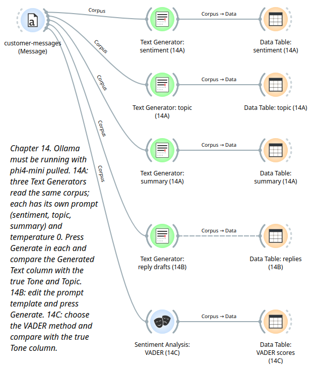
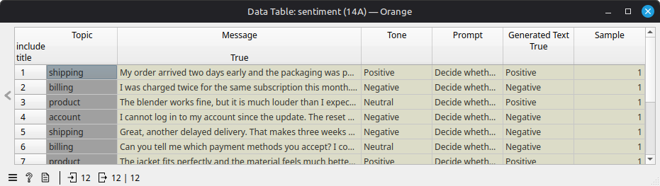
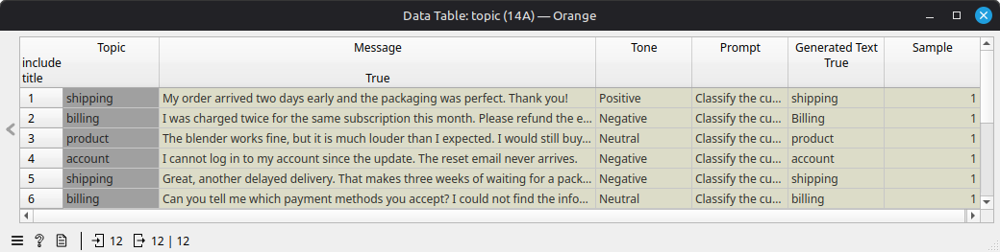
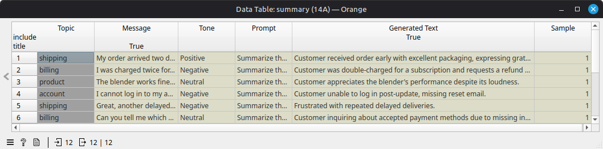

# Chapter 14: Using a Large Language Model

## Learning Objectives

By the end of this chapter, you will be able to:

- Explain what a large language model (LLM) is and why one model can do many different tasks.
- Install Ollama, download a model, and connect Orange to it.
- Run sentiment analysis, classification, summarization, and free-form generation on the same documents, using the *Text Generator* with a different prompt for each task.
- Read a prompt as the "program" that tells the model what to do, and explain how changing it changes the result.
- Compare an LLM with a classical NLP method on speed, repeatability, and accuracy, and decide when each is the better tool.

---

## 14.1 What Is a Large Language Model?

In Chapter 13 you saw that a language model predicts the next word. A **large language model (LLM)** is the same idea trained at a much larger scale: billions of adjustable numbers (called *parameters*), trained on an enormous amount of text. Two things happen at that scale:

- The model picks up grammar, facts, and styles of writing, along with many patterns of reasoning.
- It can be *instructed*. After extra training on examples of requests and good answers, a model such as `phi4-mini` treats your text as a task: "summarize this", "is this positive or negative?", "reply to this customer".

The result is a **generalist**. Chapters 4 to 10 built one model per task. With an LLM, you keep one model and change the **prompt**.

### Local or hosted?

An LLM can run on your own computer or on someone else's server:

| | Local (Ollama) | Hosted (a company's API) |
|---|---|---|
| **Privacy** | Text never leaves your machine | Text is sent to a third party |
| **Cost** | Free once downloaded | Pay per use |
| **Quality** | Smaller models, weaker on hard tasks | Largest models, strongest |
| **Speed** | Limited by your hardware | Fast, but depends on the network |
| **Works offline** | Yes | No |

This book uses a local model so that the exercises are free, private, and repeatable on a laptop.

---

## 14.2 Running a Model on Your Computer with Ollama

**Ollama** is a free program that downloads language models and serves them to other programs on your computer. Orange's LLM widgets talk to it. It runs as a background server, by default at `localhost:11434`.

**Install Ollama** from [ollama.com/download](https://ollama.com/download):

- **macOS** and **Windows**: download the installer and run it.
- **Linux**: run the install script shown on the download page.

**Download the book's model.** In a terminal:

```
ollama pull phi4-mini
```

This model is about 2.5 GB, so the download takes a few minutes, and it needs at least that much free memory to run. Larger models are better but need much more memory and are slower on a laptop.

**Check that it works:**

```
ollama list
ollama run phi4-mini "Say hello in one sentence."
```

`ollama list` should show `phi4-mini`. If an Orange widget cannot find the model, the usual causes are that Ollama is not running or that the model has not been pulled.

---

## 14.3 The Prompt Is the Program

An LLM has no sentiment button and no classify button. You give it a **prompt**, which is text that says what to do, and the model writes the answer. A **prompt template** is a prompt with a placeholder, such as `{Message}`, that Orange fills in with the text of each document, so the same instruction runs once per row. In 14A you will use these three:

| Task | Prompt template (the text of each message goes where `{Message}` is) |
|------|--------------------------------------------------------------------|
| Sentiment | `Decide whether the customer message is Positive, Negative, or Neutral. Reply with one word only.` + `Message: {Message}` |
| Classification | `Classify the customer message as one of: shipping, billing, product, account. Reply with one word only.` + `Message: {Message}` |
| Summary | `Summarize the customer message in one short sentence.` + `Message: {Message}` |

A good prompt states the **task**, the **allowed answers**, and the **format** ("reply with one word only"). The sentiment and classification prompts ask for one word because a program has to read the answer. Asking a model to choose among labels it was never trained on, with no examples, is called **zero-shot classification**. It works because the model was instructed, but it still depends on the model following the instruction, and a model sometimes does not (you will see an example in 14A).

---

## 14.4 The Widgets

| Widget | What it does |
|--------|--------------|
| **Text Generator** (orange3-nlp) | Runs a prompt template you write, once per document, on a local model. It has a temperature, a seed, and a number of samples. It adds the columns `Prompt`, `Generated Text`, and `Sample`. |
| **Sentiment Analysis** (Orange3-Text) | A classical, lexicon-based method (VADER), used in 14C for comparison. |
| **Data Table** | Shows the generated text next to the true labels. |

Things to know before you start:

- The *Text Generator* runs when you press **Generate**, not automatically. Choose the **Ollama** backend and the model `phi4-mini:latest`, and wait for the progress bar to finish before you read the result.
- It adds **one row for each sample** of each document. With **Samples per prompt** set to 1, the output has one row per document.
- The model's answer is in the column `Generated Text`. It is free text, so a model can answer `Billing` when you asked for `billing`, or add a word you did not ask for.
- A *Text Generator* adds the same three column names every time, so you cannot connect one *Text Generator* to another. To run several prompts on the same documents, connect the *Corpus* to one *Text Generator* for each prompt, as in 14A.
- Set the **temperature** to `0` when you want the same answer each time. A higher temperature lets the model pick less likely words, so the answers vary.



---

## Lab Exercise 14A: One Dataset, Three Tasks

**Goal**: Apply sentiment analysis, classification, and summarization to the same messages with three prompts, and check each answer against the truth.

**Dataset**: `customer-messages.tab` (12 short customer messages). Each message has a true `Topic` (shipping, billing, product, or account) and a true `Tone` (Positive, Negative, or Neutral), so you can score the model. Some messages are tricky on purpose: a sarcastic one, a mixed one, and neutral questions.

**Steps**:

1. Load the dataset with *Corpus*. The text feature is `Message`.
2. Connect *Corpus* to three *Text Generator* widgets. In each one, choose the **Ollama** backend, the model `phi4-mini:latest`, and **temperature** `0`, with **Samples per prompt** 1. Give them these prompts, from 14.3, and these **Max new tokens**:
   - the sentiment prompt, with Max new tokens `10`
   - the classification prompt, with Max new tokens `10`
   - the summary prompt, with Max new tokens `60`
3. Press **Generate** in each and wait for the progress bar to finish. Connect each *Text Generator* to its own *Data Table*.
4. In the first two tables, compare `Generated Text` with the true `Tone` and `Topic`. In the third, read the summaries next to the messages.







**What to expect.** We measured these with `phi4-mini` at temperature 0 (your results may differ a little):

| Task | Result | Time for 12 messages |
|------|--------|----------------------|
| Sentiment | 8 of 12 right. It answers only `Positive` or `Negative`, never `Neutral`, so all four neutral messages are wrong | about 15 s |
| Classification | 11 of 12 right if you ignore capital letters, but only 9 of 12 match your labels exactly: it answers `Billing` and `Shipping` once each, and calls the password message `billing` | about 7 s |
| Summary | One sentence of 5 to 15 words each | about 25 s |

At temperature 0 the same prompt gave the same answers when we repeated the sentiment and classification runs, and usually the same summaries (in one of our repeats some summaries were different). At temperature 0.7 all 12 summaries differed from the temperature-0 ones.

**Questions**:

- How many sentiments and topics match the truth? Which messages does the model get wrong? Look closely at the sarcastic message, the mixed one, and the neutral questions.
- Look at the classification answers. Does every answer come from your list, written exactly as you wrote it? What does that tell you about how reliably a model follows "reply with one word only"? What would happen to a count of messages by topic?
- Change the classification prompt to `Classify the customer message by topic. Reply with one word only.` (no list of labels) and generate again. What kinds of labels does the model invent? Why is that a problem if you want to count messages by topic?
- Generate the summaries again at temperature `0.7`. Are they identical? Do they keep the key facts?

---

## Lab Exercise 14B: Writing Your Own Prompt

**Goal**: Do a task that has no ready-made widget, by writing the prompt yourself.

**Steps**:

1. Connect *Corpus* to a *Text Generator*. Choose the **Ollama** backend and the model `phi4-mini`.
2. Use this prompt template, which runs once per message:

   ```
   Write a polite two-sentence reply from customer support to this message:

   {Message}
   ```

3. Set the temperature to `0.7`, **Samples per prompt** to 3, and tick **Fixed seed**. Press **Generate** and read the replies in a *Data Table*.
4. Set the temperature to `0` and generate again. Compare.
5. Change the prompt so the model must return a small structured answer:

   ```
   Extract the main issue from the message as JSON with keys "topic" and "urgent" (true or false). Reply with JSON only.

   Message: {Message}
   ```


**Questions**:

- How different are the three replies to the same message at temperature `0.7`? At temperature `0`?
- Read the replies as a customer would. Do they promise anything the company never agreed to (a refund, a deadline, an investigation)? Do any contain a leftover placeholder such as `[Your Name]`?
- In step 5 the prompt says "Reply with JSON only". Is the answer exactly JSON? What would a program that expects JSON have to do first?
- Which of your own ideas could be a prompt? Write one and test it on three messages.

---

## Lab Exercise 14C: LLM or Classical?

**Goal**: Compare the LLM with a classical sentiment method on the same messages.

**Steps**:

1. Connect *Corpus* to **Sentiment Analysis** (Orange3-Text) and choose the **VADER** method. View the result in a *Data Table*.
2. VADER gives a score from -1 (very negative) to +1 (very positive). Turn each score into a label: Positive above `0.05`, Negative below `-0.05`, Neutral otherwise.
3. Compare the VADER labels with the true `Tone` and with the sentiment `Generated Text` from 14A.


**What to expect.** VADER (compound at or above 0.05 is positive, at or below -0.05 is negative) gets 6 of the 12 tones right, against 8 for the model in 14A. VADER calls the sarcastic delivery message positive (compound 0.69), and also the double-charge message (0.13) and three of the four neutral ones. It gets only the invoice message right among the neutral ones, with a compound of exactly 0. The model, which does read sarcasm, gets the delayed-delivery message right but calls every neutral message positive or negative.

**Questions**:

- Which method gets more of the 12 messages right? Where do they disagree?
- Does VADER understand the sarcastic message? Why or why not? (Hint: how does it work?)
- Which method is faster? Which gives the same answer every time you run it?
- You need to score 5 million product reviews tonight, on one laptop. Which method would you use, and what would you check first?

> 📝 **Reflection:** An LLM is more flexible, but it is slower, can vary between runs, and can ignore instructions. A classical method is fast and repeatable, but narrow. For a real project, how would you decide? What would you measure on a small labeled sample before you chose?

---

## Comprehension Questions

1. What advantages do LLMs offer over task-specific models?
2. What is a prompt template, and how does changing the prompt change what the same model does?
3. Why does an LLM sometimes answer "Support" when asked to choose from a list that does not contain it?
4. What privacy and cost reasons favor running a model locally with Ollama?
5. Give two reasons the output of an LLM may differ from run to run, and one way to make it more repeatable.
6. When might you still prefer a traditional NLP pipeline over an LLM?

---

## Key Terms

- Large language model (LLM)
- Parameters
- Instruction-tuned model
- Prompt / prompt template
- Ollama
- Local vs hosted model
- Zero-shot classification
- Temperature / seed
- Hallucination

---

## Notes

- Save your workflow as `llm-tasks.ows`.
- LLMs answer from what they learned in training, which may be out of date or wrong. Chapter 15 adds **retrieval**, so the model answers from your own documents.
