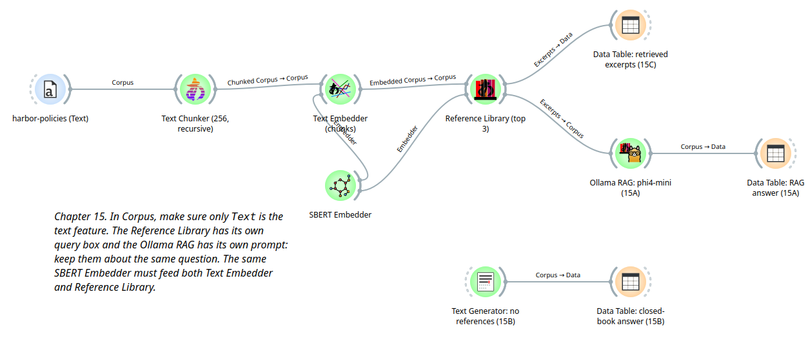
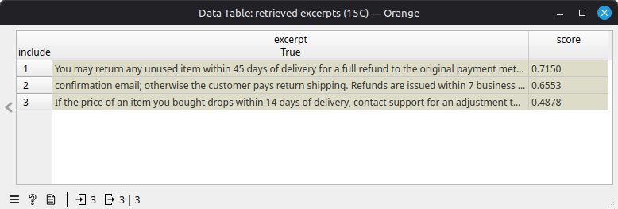
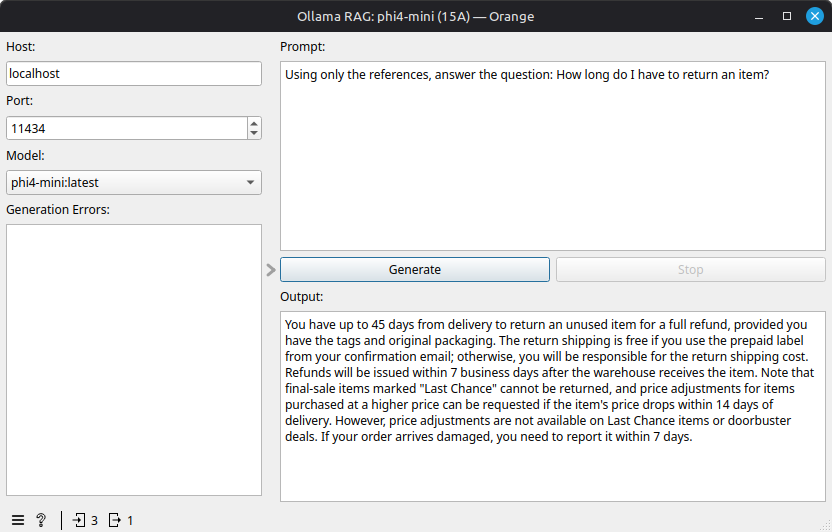
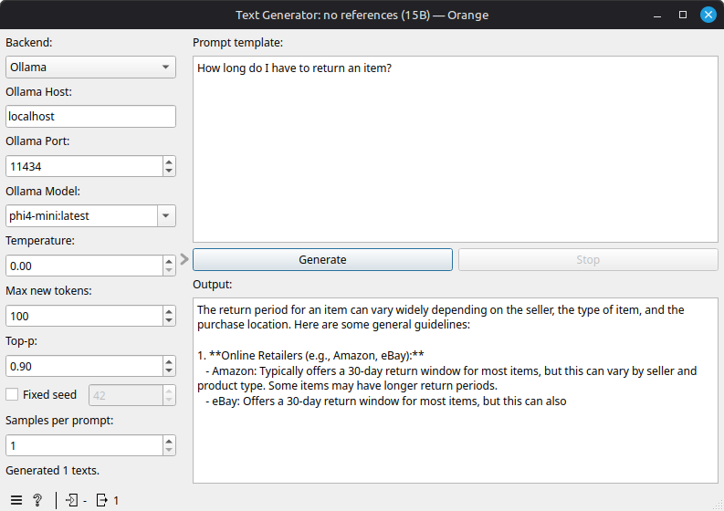
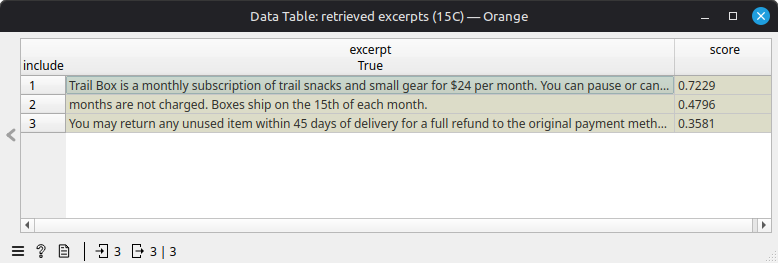
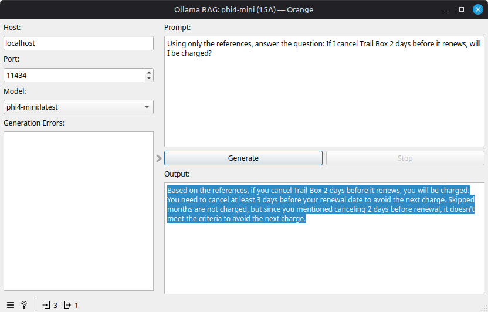

# Chapter 15: Retrieval-Augmented Generation (RAG)

## Learning Objectives

By the end of this chapter, you will be able to:

- Explain retrieval-augmented generation (RAG) and why it helps a language model answer from documents it was never trained on.
- Build a RAG pipeline in Orange: split documents into chunks, embed them, retrieve the chunks closest to a question, and give them to a language model.
- Explain how chunk size, the number of retrieved chunks (top-k), and the wording of the question change what the model sees.
- Tell whether a wrong answer is a **retrieval** failure (the right text was not found) or a **generation** failure (it was found but misused).
- Check an answer against its sources instead of trusting it.

---

## 15.1 Open-Book Answers

In Chapter 13 you saw that a language model answers from memory unless you hand it the text. In Chapter 14 you saw that its answers can be fluent and still wrong. Two problems remain:

- **The model does not know your documents.** Ask `phi4-mini` how long a particular company allows for returns, and it can only say that it varies. Your company's policies, your lab's notes, and this morning's news were not in its training data.
- **You cannot paste everything into every prompt.** A model reads a limited amount of text at once, and a long prompt is slow.

**Retrieval-augmented generation (RAG)** solves both by turning a closed-book exam into an open-book exam. Before the model answers, the system *retrieves* the few passages most relevant to the question and puts them in the prompt. The model then answers from those passages.

> Think of RAG as "search, then write." Retrieval finds the pages. Generation writes the answer.

RAG helps in three ways: it gives the model facts it never learned, it can be updated by changing the documents rather than the model, and you can see which passages the answer came from. It does not make the model infallible, as you will see in Exercise 15C.

---

## 15.2 The Pipeline

A RAG system has an **indexing** stage, done once per document set, and a **question** stage, done for every question.

**Indexing (once):**

1. **Chunk**: split each document into short pieces, because a question is usually answered by a sentence or two, not a whole manual.
2. **Embed**: turn each chunk into a vector (Chapters 11 and 12).
3. **Index**: store the vectors so that the closest ones to any query can be found quickly. Orange's *Reference Library* does this with a FAISS vector index.

**Each question:**

4. **Embed the question** with the *same* embedding model.
5. **Retrieve** the top-k chunks whose vectors are closest to the question's vector.
6. **Augment**: build a prompt from the instruction, the retrieved chunks (the *references*), and the question.
7. **Generate**: the language model writes the answer.

The embedding model must be the same for the chunks and for the question. Vectors from different models are not comparable.

---

## 15.3 The Choices That Matter

| Choice | If it is too small | If it is too large |
|--------|--------------------|--------------------|
| **Chunk size** (128 to 1024 characters in *Text Chunker*) | A fact is split across chunks and loses its context | A chunk covers several topics, so its vector is a blurry average, and it uses up space in the prompt |
| **Top-k** (*Max excerpts* in *Reference Library*) | The chunk you need may not be retrieved | Irrelevant chunks dilute the prompt and can distract the model |
| **Matching threshold** (minimum similarity) | Weak matches pass | Nothing passes |

Two more things to keep in mind:

- **The question you search with and the question you ask are separate.** In Orange, the *Reference Library* has a query box, and the *Ollama RAG* has a prompt box. If they are about different things, the model gets references for one question and is asked another.
- **Retrieval is by meaning, not by words.** A question like "Can I send something back?" can find a chunk about "returns", because their embeddings are close.

---

## 15.4 The Widgets

| Widget | What it does |
|--------|--------------|
| **Corpus** | Loads the documents. Only the text column should be marked as the text feature. |
| **Text Chunker** | Splits each document into chunks of 128, 256, 512, or 1024 characters (recursive strategy: paragraph, then line, then word boundaries, with 10% overlap). |
| **SBERT Embedder** + **Text Embedder** | Embeds the chunks. The same *SBERT Embedder* also goes to the *Reference Library* so it can embed your query. |
| **Reference Library** | Builds the vector index, and returns the *Max excerpts* chunks most similar to your query as an `excerpt` column with a similarity `score`. |
| **Ollama RAG** | Sends your prompt, followed by the retrieved excerpts, to an Ollama model and shows the answer as it streams in. |
| **Data Table** | Shows the retrieved excerpts and their scores. |



Things to know:

- *Reference Library* starts from the embedded chunks; if the *Embedder* input is not connected, it cannot embed your query.
- *Ollama RAG* has no temperature or seed setting, so its answers can differ from run to run. Compare answers by looking at the retrieved excerpts, which *do* repeat.
- Ollama must be running with `phi4-mini` pulled, as in Chapter 14.

---

## The Dataset

**`harbor-policies.tab`** is the policy handbook of a fictional store, *Harbor Outfitters*, split into eight short documents: Shipping, Returns, Warranty, Accounts, Payment, Harbor Club (loyalty program), Trail Box (subscription), and Price Adjustments and Damage. The numbers are invented, so no language model could know them. That makes it easy to tell whether an answer came from the documents.

---

## Lab Exercise 15A: Build the Pipeline

**Goal**: Build a RAG pipeline and ask it questions about the policies.

**Steps**:

1. Load `harbor-policies.tab` with *Corpus*. The text feature is `Text`.
2. Connect it to *Text Chunker* with the **recursive** strategy and chunk size **256**.
3. Add an *SBERT Embedder* and a *Text Embedder*. Connect the chunker and the embedder to *Text Embedder*.
4. Connect *Text Embedder* to *Reference Library*, and connect the *SBERT Embedder* to the library's **Embedder** input. Set **Max excerpts** to 3.
5. Type `How long do I have to return an item?` in the library's query box and press **Find References**. Connect the library to a *Data Table* to read the excerpts and scores.
6. Connect the library to *Ollama RAG*. Choose `phi4-mini`, and enter this prompt:

   ```
   Using only the references, answer the question: How long do I have to return an item?
   ```

7. Ask two more questions. Change **both** the library query and the RAG prompt each time:
   - `How long is the warranty on a tent?`
   - `How many points do I earn per dollar on boots?`





**Questions**:

- Look at the retrieved excerpts before the answer. Does the top excerpt contain the answer? What are the scores of the first and third excerpts?
- Is each answer right? Check it against the `Returns`, `Warranty`, and `Harbor Club` documents.
- What happens if you change only the library query and leave the RAG prompt alone?

---

## Lab Exercise 15B: With and Without the Documents

**Goal**: See what retrieval adds.

**Steps**:

1. Add a *Text Generator* (Ollama, `phi4-mini`, temperature `0`) with no input, and a prompt that is only the question: `How long do I have to return an item?`
2. Compare its answer with the RAG answer from 15A.
3. Ask the RAG pipeline `Do you sell kayaks?` (change both the query and the prompt). Nothing in the handbook mentions kayaks.



**Questions**:

- How does the answer without references differ from the answer with them? Could anyone, including a person, have answered correctly without the documents?
- What does the model say about kayaks? Does it make something up, or does it say the references do not mention them? What retrieved excerpts did it have to work from? Look at their scores.
- Why is "I couldn't find that in the documents" a valuable answer?

---

## Lab Exercise 15C: When RAG Goes Wrong

**Goal**: Learn to tell retrieval failures from generation failures.

For each question below, first read the policies yourself. The correct answers are:

| Question | Correct answer, from the policies |
|----------|-----------------------------------|
| I am a Harbor Club member with a $60 order. What will I pay for standard shipping? | Nothing: Harbor Club members get free standard shipping with no minimum |
| If I cancel Trail Box 2 days before it renews, will I be charged? | Yes: the cancellation must be at least 3 days before renewal |
| How long will my order take to arrive if I live in Toronto? | 8 to 12 business days (Canadian orders) |

**Steps**:

1. For each question, set the library query and the RAG prompt, and try these settings:
   - chunk size **128** with **1** excerpt, then **3**
   - chunk size **512** with **1** excerpt, then **3**
   - chunk size **1024** with **3** excerpts

   (Change the chunk size in *Text Chunker*, and wait for the embedding to finish.)
2. For every run, record (a) whether the excerpts contain the text needed to answer, and (b) whether the answer is correct. The model's wording is random, so press **Generate** at least three times for each setting before you decide.





**Questions**:

- Find a run where the needed excerpt was **not** retrieved. What was retrieved instead? Why?
- Find a run where the needed excerpt **was** retrieved and the answer was still wrong. What did the model do with it?
- Does retrieving more excerpts always help? Describe a case in which it did not.
- Does a larger chunk always help?
- You are building a support bot from these documents. What would you check before you let customers use it?

> 📝 **Reflection:** RAG makes answers checkable, because you can read the excerpts. But a model can see the right words and still reach the wrong conclusion. How would you design a system so a person can catch that, such as showing the source excerpts next to every answer?

---

## Comprehension Questions

1. What problem does retrieval solve that a better prompt alone cannot?
2. Why must the same embedding model be used for the chunks and for the question?
3. What is the trade-off in choosing a chunk size? In choosing top-k?
4. How is RAG different from ordinary keyword search? From asking the model without references?
5. What is the difference between a retrieval failure and a generation failure, and how can you tell which happened?
6. Why can a RAG system still give a wrong answer, even when the correct passage was retrieved?

---

## Key Terms

- Retrieval-augmented generation (RAG)
- Chunk / chunking
- Embedding
- Vector index
- Top-k
- Similarity score / threshold
- References (context)
- Grounding
- Retrieval failure / generation failure

---

## Notes

- Save your workflow as `rag.ows`.
- Chapter 16 asks you to design your own project, and RAG over your own documents is a good candidate.
